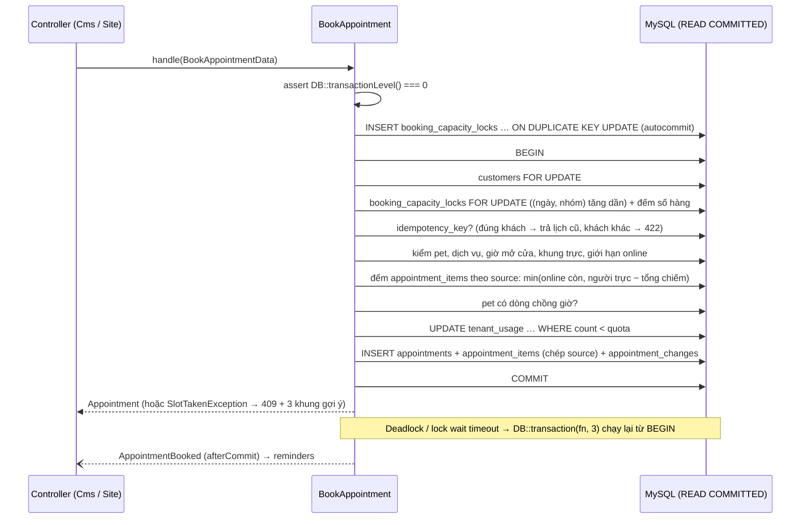

# Kiến trúc PawBook

Tóm tắt một trang. Chi tiết dữ liệu ở `docs/database/db-schema.md`, quyết định ở `docs/adr/`, màn hình ở `docs/design/danh-muc-man-hinh.md`, quy ước code ở `CLAUDE.md`.

Laravel 12 (PHP 8.3) + Inertia 2 + Vue 3 TypeScript, MySQL 8.4 (kết nối READ COMMITTED, UTC), Redis (cache, session, queue). Một DB dùng chung, mọi bảng nghiệp vụ có `tenant_id` (ADR-0001).

> Trạng thái 27/10/2026: trên `dev` mới có nền tenancy (TenantContext, BelongsToTenant, ResolveTenant) và starter kit. Phần còn lại của file là **kiến trúc đích**; Bước 1 trong plan đưa code về đúng khung này.

## 1. Các khu

| Khu | URL | File route | Route name | Guard | Controller | Layout Vue |
|---|---|---|---|---|---|---|
| Trung tâm | `/`, `/login`, `/forgot-password`, `/invite/{token}`, `/dashboard` (chuyển hướng) | `routes/web.php`, `routes/auth.php` | không tiền tố | `web` | `Auth\…`, gốc | `AuthLayout`, `BareLayout` |
| Tài khoản cá nhân | `/account/*` (S39) | `routes/account.php` | `account.*` | `web` | `Account\…` | `CmsLayout` (không có shop) |
| CMS của shop | `/app/{tenant:slug}/*` | `routes/app.php` | `app.*` | `web` + thành viên shop | `Cms\…` | `CmsLayout`, `PrintLayout`, `BareLayout` (TV S16.1) |
| Site của shop | `/{slug}/*` (URL tiếng Việt) | `routes/site.php` (**đăng ký cuối cùng**) | `site.*` | `customer` (SĐT + OTP) | `Site\…` | `SiteLayout` |
| Admin nền tảng | `/admin/*` | `routes/admin.php` | `admin.*` | `platform` (bảng, cookie riêng, 2FA) | `App\Platform\Http\…` | `AdminLayout` |

Không có tự đăng ký: shop chỉ sinh ra từ `ProvisionTenant` (admin tạo), nhân viên vào shop qua lời mời. `users` là danh tính toàn cục; thành viên shop = dòng `staff` đang `active`. Khách Site là `customers` (guard `customer`), không bao giờ vào được `/app`.

## 2. Middleware theo khu

```
CMS   /app/{slug}:  web → ResolveTenant → auth → verified → EnsureTenantWritable → ImpersonationGuard → CurrentBranch → Policy / can:
Site  /{slug}:      web → ResolveTenant(site) → throttle → [auth:customer + khách đúng shop] → EnsureTenantWritable(site)
Admin /admin:       AdminSessionCookie (trước StartSession) → web → auth:platform → EnsureTwoFactor → role
Job:                TenantAware (job middleware) → TenantContext::runAs(tenant_id đã serialize)
Scheduler:          Tenant::forEach(fn) cho việc theo từng shop; withoutTenancy chỉ ở command whitelist
```

- `ResolveTenant`: slug → `tenants` (không scope). Không có hoặc `cancelled` → 404. CMS: user đăng nhập mà không phải thành viên → 404 (không lộ shop tồn tại). Đặt `TenantContext`, `URL::defaults(['tenant' => slug])`, `setPermissionsTeamId`, lưu `users.last_tenant_id`; xóa context trong `finally`. Khách chưa đăng nhập đi tiếp để `auth` chuyển về `/login`.
- `EnsureTenantWritable`: shop `suspended` → mọi request ghi trả 423, GET vẫn được. Site: chặn đặt lịch và gửi OTP; khách đã đăng nhập vẫn hủy được lịch (ngoại lệ có test). `trial`, `active`, `past_due` đi bình thường (past_due có banner).
- `TenantScope` fail closed: không có tenant trong context mà query model tenant → `TenantNotResolvedException`.
- `withoutTenancy` chỉ được gọi ở: `App\Platform\*`, `App\Tenancy\*` (vd `StaffMembership` tìm shop của user), command quét mọi shop (`reminders:dispatch`, `tenants:check-expiry`), `LoginRequest` (kiểm user còn shop nào hoạt động). Arch test giữ danh sách này.

## 3. Module và thư mục

```
app/
  Tenancy/        TenantContext, BelongsToTenant, TenantScope, ResolveTenant helpers, TenantAware, StaffMembership
  Platform/       admin nền tảng: Models, Http, Actions, Queries (ADR-0008)
  Actions/<Module>/  một class một use case: final, handle(DTO), tự mở DB::transaction(fn, 3)
  Data/           DTO readonly
  Queries/        query đọc phức tạp (danh sách, báo cáo, lịch ngày); số query cố định
  Services/       logic dùng chung không phải use case (CapacityService, ServiceQuoteResolver, StockLedger, Sequence, ShopClock)
  Support/        tiện ích nhỏ (Money, Phone, Interval)
  Models/         phẳng; Concerns/: HasPublicId, AppendOnly, ImmutableUnlessDraft
  Enums/          enum PHP backed
```

| Module (`app/Actions/<Module>`) | Bảng chính | Task |
|---|---|---|
| `Tenants` (ProvisionTenant, gói, tạm khóa) | tenants, tenant_settings, tenant_subscriptions | 4.3, 4.5 |
| `Staff` (mời, role, cơ sở, lịch trực) | staff, invitations, staff_working_hours | 4.2, 4.4, 5.3 |
| `Customers` (khách, pet) | customers, pets | 5.1 |
| `Services` | services, service_price_rules, branch_services | 5.2 |
| `Booking` (BookAppointment, Reschedule, Cancel, CheckIn) | appointments, appointment_items, booking_capacity_locks | 5.4–5.7 |
| `Visits` (CreateVisit, cấp cứu, CompleteVisit) | visits, visit_items | 5.8, 5.9 |
| `Medical` (bệnh án, tiêm) | medical_records, medical_entries, pet_vaccinations | 6.2, 6.3 |
| `Billing` (hóa đơn, thanh toán, ca thu ngân) | invoices, payments, cash_sessions | 5.10, 5.11 |
| `Messaging` (nhắc, gửi Zalo/SMS) | reminders, message_deliveries | 6.1 |
| `Inventory` (GĐ2) | stock_* | 11.x |
| `Workforce` (GĐ3) | shift_*, attendance_*, payroll_* | 12.x |

Frontend: `resources/js/pages/`, `components/`, `layouts/` chữ thường (theo starter kit), thư mục con PascalCase theo khu (`pages/Cms/Visits/Show.vue`). Tests: `tests/Feature`, `Unit`, `Concurrency` (nhiều tiến trình, `DatabaseTruncation`), `Arch`, `Browser`. Mọi test chạy MySQL 8.4.

## 4. Luồng đặt lịch (ADR-0002)



Sơ đồ chi tiết (hai request tranh một chỗ, vì sao không REPEATABLE READ): `docs/design/so-do-dat-lich.md`.

## 5. Thứ tự khóa toàn cục

`tenants` → `staff` → `customers` → `booking_capacity_locks` (ngày rồi nhóm, tăng dần) → `appointments` → `appointment_items` → `invoices` → `visits` → `cash_sessions` (`FOR SHARE` khi ghi tiền mặt, `FOR UPDATE` khi đóng ca) → `stock_items` (product_id tăng dần) → hàng đếm nóng (`tenant_usage`, `branch_daily_counters`, `tenant_counters`).

Mọi Action ghi dùng `DB::transaction(fn, 3)`; `innodb_lock_wait_timeout` khoảng 5 giây cho web.

## 6. Queue và nhắc hẹn (ADR-0007)

Horizon trên Redis: hàng `high` (xác nhận lịch, OTP), `default`, `low` (nhắc hàng loạt). `reminders` = việc cần nhắc (dedupe theo `dedupe_key`), `message_deliveries` = mỗi lần gửi thật. Zalo ZNS trước, lỗi thì SMS. Scheduler mỗi phút claim nguyên tử (`claimed_at`), job `TenantAware`, idempotent.
