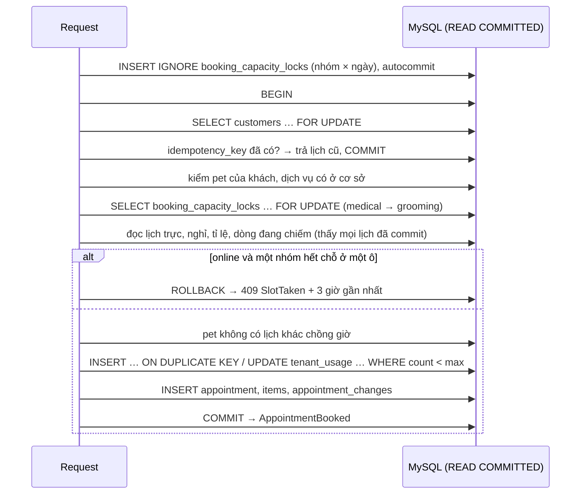

# Kiến trúc: PawBook

Tài liệu sống: mỗi task cập nhật mục liên quan. Nguồn quyết định: `docs/database/db-schema.md`, `docs/adr/`.

## Tổng quan

Laravel 12 + Inertia 2 + Vue 3, một DB MySQL 8 dùng chung, Redis cho cache / session / queue. Chạy hoàn toàn trong Docker.

## Multi-tenancy

- Một DB + cột `tenant_id` (ADR 0001). `App\Tenancy\TenantContext` giữ shop hiện tại (scoped singleton).
- `BelongsToTenant` + `TenantScope`: **fail closed** cả đọc lẫn ghi khi chưa có shop. Lối thoát duy nhất: `runAs()`, `Tenant::forEach()`, `withoutTenancy()`.
- Ở DB: mọi bảng tenant có `UNIQUE(tenant_id, id)`; FK giữa hai bảng tenant là FK ghép `(tenant_id, x_id)`; pet gắn khách bằng `(tenant_id, customer_id, pet_id)`. Helper migration: `App\Database\TenantSchema`.
- `ResolveTenant` (route `/app/{tenant:slug}`): chạy trước auth và route binding, 404 khi shop không mở được hoặc user không phải thành viên.
- Validation `TenantRule::exists/unique`, cache key `t:{id}:…`, job `TenantAware` (tenant đi theo payload).
- `App\Models\Platform\*`: dữ liệu *về* shop, không scope, chỉ đọc từ `/admin`.

## Đặt lịch & hạn mức

- **Giờ shop:** `App\Scheduling\ShopClock` là chỗ duy nhất đổi giờ shop ↔ UTC, theo từng ngày (DST). Ngày shop query bằng khoảng UTC `[đầu ngày, đầu ngày kế)`.
- **Người trực** (task 5.3): `Roster` biến `staff_working_hours` (khung tuần, TIME local) thành khoảng UTC từng ngày; mỗi khung chỉ tính cho `service_group` của nó (người 2 role = 1 người). `dutySets()` = khung trừ nghỉ (kể cả nghỉ một phần), bỏ ngày đóng cửa. Interface `DutySource` để GĐ3 cắm ca xếp.
- **Chỗ trống** (task 5.4): `AvailabilityService` chia ngày shop thành ô 15 phút. Ô có người trực nếu thời gian trực của người đó phủ kín ô và ô nằm trong giờ mở cửa. Hạn mức online = `OnlineRates::maxOnline(người trực, tỉ lệ thứ/giờ)` = floor(người trực × tỉ lệ). Chiếm chỗ = dòng `booked`/`checked_in` của lịch chưa hủy chồng ô; Site chỉ so dòng `online`. Mọi dòng của một lịch bắt đầu cùng lúc; mỗi dòng chiếm một chỗ của nhóm nó suốt thời lượng + buffer. Cả khoảng ngày tải bằng số query cố định, phần còn lại là số học trên ô (`Interval`, `IntervalSet`).
- **Đặt lịch** (task 5.5, ADR 0002): `BookAppointment`, dùng chung Site và lễ tân. Kết nối MySQL chạy `READ COMMITTED`.

- Thứ tự khóa toàn cục: `customers` → `booking_capacity_locks` ((ngày, nhóm) tăng dần, medical trước grooming) → `tenant_usage`. Deadlock / lock wait timeout: `DB::transaction(…, 3)`.
- Lễ tân không bị chặn theo hạn mức: lưu kèm cảnh báo khi vượt số người trực, không có ai trực, hoặc người được gán đang bận.
- Test đua thật: `tests/Concurrency` (mỗi lần đặt là một tiến trình PHP, một kết nối MySQL, chạy cùng lúc), CI chạy 10 lần liền.

## Hàng đợi & Visit

_Task 5.8–5.9._

## Hóa đơn

_Task 5.10–5.11._

## Queue & nhắc hẹn

_Task 6.1._

## Admin nền tảng

- Cùng app, `/admin` (ADR 0008). Route ở `routes/admin.php`, middleware group `platform` (như `web` nhưng **không** có tenant middleware, đặt cookie phiên `pawbook_admin_session` trước `StartSession`, Inertia props riêng). Code ở `App\Platform\*`; model ở `App\Models\Platform\*`.
- Guard `platform` (provider `platform_admins`). Trang cần đăng nhập dùng `platform.auth`: không phải admin đang hoạt động → 404 (khu admin không lộ diện, chỉ `/admin/login` mở cho khách). `platform.role:super_admin` cho A6.
- Đăng nhập (A1): mật khẩu → `PendingLogin` (chưa đăng nhập guard) → TOTP (A1) hoặc bật 2FA lần đầu (A1.1) → `CompletePlatformLogin`. Mã TOTP không dùng lại được (cache 120 s). Rate limit 5/phút theo email + IP và theo admin ở bước mã.
- Admin đầu tiên: `php artisan platform:admin-create {email} --role=super_admin`. Admin sau: A6 mời → email chứa token 32 byte (DB lưu sha256, 72 giờ, 1 lần) → A7 đặt mật khẩu → bắt buộc bật 2FA.
- A2 `App\Platform\Queries\TenantList`: `withoutTenancy()`, đếm cơ sở / nhân viên / lịch tháng (`tenant_usage`) bằng subquery, số query cố định.
- Mọi hành động admin ghi `platform_audit_logs` (`App\Platform\Audit`). Demo: `PLATFORM_SKIP_2FA=true` chỉ có tác dụng khi `APP_ENV=local|demo`.
- Còn lại: A3–A5 (task 4.3, 4.5), đăng nhập thay (4.6).
