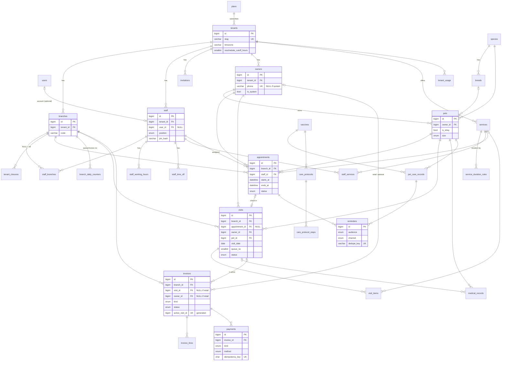
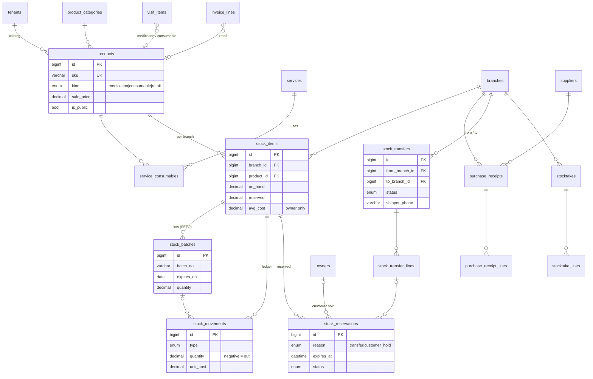
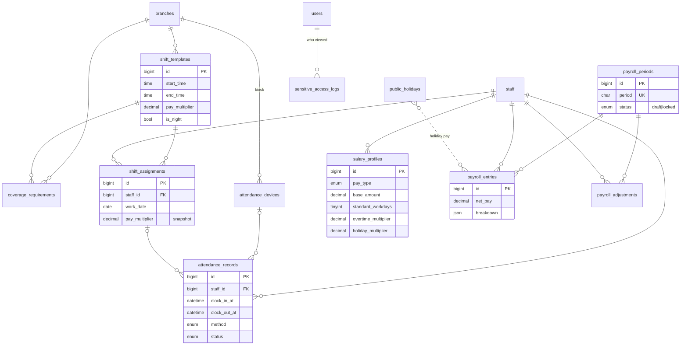

# Lược đồ DB: Pet Spa & Vet Booking

MySQL 8 (InnoDB, utf8mb4), một DB dùng chung, phân tách bằng `tenant_id`.

> **v2 (17/10/2026), theo nghiệp vụ chủ tiệm mô tả.** Thêm: đa chi nhánh, tiếp nhận + hàng đợi + lượt khám, hóa đơn & thanh toán (**MVP**); kho, thuốc theo lô, bán hàng, điều chuyển giữa chi nhánh (**Giai đoạn 2**); xếp ca, chấm công, lương (**Giai đoạn 3**). Bảng mới ở mục 1.3-1.5, nghiệp vụ ở 4.4-4.8, rủi ro mới ở 5.4-5.5. Những chỗ đánh dấu **[Mặc định, cần xác nhận]** là lựa chọn tạm, sửa được. ERD vẽ lại thành 3 ảnh ở mục 2.

**Quy ước chung**
- PK `BIGINT UNSIGNED AUTO_INCREMENT`. Bảng lộ ra URL công khai (`appointments`, `owners`) thêm `public_id CHAR(26)` (ULID) để tránh dò ID tuần tự.
- Mọi thời điểm lưu `DATETIME` theo **UTC** (không dùng `TIMESTAMP`: bị convert theo session tz và giới hạn 2038). Giờ "đồng hồ treo tường" (ca làm việc) lưu `TIME` + timezone của tenant.
- Bảng tenant: mọi index ghép **bắt đầu bằng `tenant_id`**; mọi unique nghiệp vụ đều kèm `tenant_id`.
- FK giữa hai bảng tenant dùng **FK ghép `(tenant_id, x_id)` → `(tenant_id, id)`** (mỗi bảng tenant có `UNIQUE(tenant_id, id)`). Lý do: FK đơn chỉ đảm bảo bản ghi tồn tại, không đảm bảo cùng tenant; FK ghép chặn rò rỉ ngay ở tầng DB.
- `deleted_at` (soft delete) cho `owners`, `pets`, `services`, `staff`, `branches`, `products`: lịch sử hẹn/y tế/hóa đơn không được mất tham chiếu.
- **Chi nhánh không phải ranh giới cô lập như tenant.** `branch_id` có FK ghép `(tenant_id, branch_id)` → `branches(tenant_id, id)`, nhưng **không** có global scope fail-closed: nhân viên chi nhánh 1 được tra tồn kho chi nhánh 2. Lọc theo chi nhánh làm ở query + Policy (chi nhánh đang chọn trong session), không làm ở global scope.
- Tiền: `DECIMAL(12,2)`, không float. Số lượng tồn kho: `DECIMAL(12,3)` (thuốc tính theo ml/viên lẻ).

---

## 1. Danh sách bảng

### 1.1 Bảng dùng chung toàn hệ thống (không có `tenant_id`)

| Bảng | Cột chính | Index / ghi chú |
|---|---|---|
| `tenants` | id, public_id, name, `slug VARCHAR(63)`, `timezone VARCHAR(64)` (IANA, vd `Asia/Ho_Chi_Minh`), `locale`, `currency CHAR(3)`, plan_id FK, stripe_id, trial_ends_at, status ENUM(active,suspended), `reschedule_cutoff_hours SMALLINT` (khách tự dời lịch phải trước giờ hẹn ít nhất N giờ, mặc định 24), `cancel_cutoff_hours SMALLINT`, `default_tax_rate DECIMAL(5,2)`, created_at | UNIQUE(slug), UNIQUE(stripe_id). Chính là "gốc" tenant = **một chủ** (có thể nhiều chi nhánh). Timezone đặt ở tenant: **[Mặc định, cần xác nhận]** mọi chi nhánh cùng múi giờ. |
| `users` | id, name, `email VARCHAR(191)`, password, email_verified_at, last_tenant_id | UNIQUE(email). User là danh tính toàn cục: 1 người có thể làm ở nhiều tiệm. |
| `plans` | id, code, name, `max_staff SMALLINT`, `max_appointments_per_month INT`, stripe_price_id, features JSON | UNIQUE(code) |
| `species` | id, code (dog, cat…), name | UNIQUE(code). Seed sẵn. |
| `breeds` | id, species_id FK, name, `default_size ENUM(xs,s,m,l,xl)` | UNIQUE(species_id, name). Catalog chung, tenant không sửa. |
| `stripe_webhook_events` | id, `event_id VARCHAR(255)`, type, payload JSON, processed_at | UNIQUE(event_id) → webhook idempotent. |
| `subscriptions`, `subscription_items` | Bảng của Cashier, billable = `tenants` (cột `tenant_id` ở đây là owner của subscription, không phải scope dữ liệu) | Theo Cashier. |
| `roles`, `permissions`, `model_has_roles`… | spatie/laravel-permission bật **teams mode**, `team_id = tenant_id` | `permissions` chung; `roles` có thể chung (owner, vet, groomer, receptionist) với `team_id NULL`; gán role theo `team_id`. |
| `jobs`, `failed_jobs`, `cache`, `sessions` | Hạ tầng Laravel | Payload job tự mang `tenant_id`. |

### 1.2 Bảng có `tenant_id`

Tất cả có `tenant_id BIGINT UNSIGNED NOT NULL` FK → `tenants.id`, `created_at/updated_at`, và `UNIQUE(tenant_id, id)`.

**Nhân sự & lịch làm việc**

| Bảng | Cột chính | Index |
|---|---|---|
| `branches` | id, public_id, tenant_id, `code VARCHAR(20)`, name, address, phone, `allowed_ips JSON NULL` (IP/WiFi tiệm, cho chấm công GĐ3), is_active, deleted_at | UNIQUE(tenant_id, code). MVP UI chỉ cần 1 chi nhánh, nhưng mọi bảng vận hành có `branch_id` ngay từ đầu (thêm sau rất đắt: backfill + đổi index). |
| `staff` (hồ sơ nhân viên) | id, tenant_id, `user_id FK NULL`, `home_branch_id`, `display_name`, phone, `position ENUM(vet,groomer,receptionist,assistant,security,cleaner,other)`, `is_bookable BOOL`, `color`, `pin_hash VARCHAR(255) NULL` (PIN chấm công), status ENUM(active,disabled), deleted_at | UNIQUE(tenant_id, user_id); IDX(tenant_id, is_bookable, status). **Nhân viên ≠ tài khoản**: bảo vệ, lao công có `user_id NULL`, chỉ chấm công bằng PIN. Vẫn là **hàng bị khóa** khi đặt lịch (mục 5). |
| `staff_branches` | tenant_id, staff_id, branch_id | PK(staff_id, branch_id); IDX(tenant_id, branch_id). Nhân viên làm được ở chi nhánh nào. |
| `invitations` | id, tenant_id, email, role, `token_hash CHAR(64)`, invited_by FK staff, expires_at, accepted_at | UNIQUE(token_hash); IDX(tenant_id, email) |
| `staff_working_hours` | id, tenant_id, staff_id, branch_id, `weekday TINYINT` (0-6), `start_time TIME`, `end_time TIME`, effective_from DATE NULL, effective_to DATE NULL | IDX(tenant_id, staff_id, weekday). Cho phép nhiều dòng/ngày (ca gãy). Từ GĐ3, ngày nào có `shift_assignments` thì availability lấy theo ca được xếp, bảng này là ca mặc định. |
| `staff_time_off` | id, tenant_id, staff_id, `starts_at DATETIME`, `ends_at DATETIME` (UTC), reason, created_by | IDX(tenant_id, staff_id, starts_at) |
| `tenant_closures` | id, tenant_id, `branch_id NULL` (NULL = cả chuỗi), `date DATE` (ngày local), reason | UNIQUE(tenant_id, branch_id, date) |

**Khách hàng & thú cưng**

| Bảng | Cột chính | Index |
|---|---|---|
| `owners` | id, public_id, tenant_id, name, `phone VARCHAR(20) NULL` (E.164), email NULL, telegram_chat_id NULL, zalo_user_id NULL, `is_system BOOL`, `system_branch_id NULL`, notes, deleted_at | UNIQUE(tenant_id, phone); UNIQUE(tenant_id, system_branch_id); IDX(tenant_id, name); UNIQUE(public_id). **SĐT là khóa khách, dùng chung mọi chi nhánh.** `phone` chỉ NULL với hồ sơ hệ thống "Thú hoang/vô chủ" (mỗi chi nhánh một, `is_system=1`); CHECK `phone IS NOT NULL OR is_system = 1`. MySQL cho nhiều NULL trong UNIQUE nên không đụng unique SĐT. |
| `pets` | id, tenant_id, owner_id, species_id FK (global), breed_id FK NULL (global), name, `is_stray BOOL`, sex, `birth_date DATE NULL`, `weight_kg DECIMAL(5,2)`, `size ENUM(xs,s,m,l,xl)`, is_neutered, allergies TEXT, deleted_at | IDX(tenant_id, owner_id); FK ghép (tenant_id, owner_id). Thú hoang: gắn owner hệ thống, tên mặc định "Thú hoang #n" (sửa được), vẫn đủ loài + cân nặng ước lượng để lên lượt khám. |
| `customer_otps` | id, tenant_id, phone, `code_hash CHAR(64)`, expires_at, attempts TINYINT, consumed_at, ip | IDX(tenant_id, phone, expires_at). Đăng nhập portal bằng SĐT + OTP SMS: OTP 5 phút, tối đa 5 lần nhập sai, rate limit gửi theo SĐT + IP. |
| `medical_records` | id, tenant_id, pet_id, `visit_id NULL`, appointment_id NULL, vet_staff_id, diagnosis, treatment, notes, recorded_at | IDX(tenant_id, pet_id, recorded_at). Quyền sửa: chỉ vet (Policy). Từ MVP v2, ghi khám đi qua lượt khám (`visit_id`). |

**Dịch vụ**

| Bảng | Cột chính | Index |
|---|---|---|
| `services` | id, tenant_id, name, category ENUM(grooming,medical,boarding), `default_duration_min SMALLINT`, `buffer_min SMALLINT` (dọn dẹp sau ca), `default_price DECIMAL(12,2)`, is_public, is_active, deleted_at | IDX(tenant_id, is_active) |
| `service_duration_rules` | id, tenant_id, service_id, species_id NULL, breed_id NULL, size ENUM NULL, `duration_min`, `price DECIMAL(12,2) NULL`, `priority TINYINT` | UNIQUE(tenant_id, service_id, species_id, breed_id, size) |
| `staff_services` | tenant_id, staff_id, service_id | PK(staff_id, service_id); IDX(tenant_id, service_id). Ai làm được dịch vụ gì (phục vụ "bất kỳ nhân viên"). |

**Lịch hẹn**

| Bảng | Cột chính | Index |
|---|---|---|
| `appointments` | id, public_id, tenant_id, branch_id, owner_id, pet_id, service_id, staff_id, `starts_at DATETIME`, `ends_at DATETIME` (đã cộng buffer), `duration_min` + `price` (**snapshot** tại lúc đặt), status ENUM(pending,confirmed,checked_in,completed,cancelled,no_show), source ENUM(staff,portal), `idempotency_key CHAR(36) NULL`, cancelled_at, notes | **IDX(staff_id, starts_at, ends_at, status)**: kiểm tra chồng lịch. IDX(tenant_id, branch_id, starts_at): lịch theo ngày của chi nhánh. IDX(tenant_id, pet_id, starts_at): lịch sử pet + check trùng pet. UNIQUE(tenant_id, idempotency_key): chống double-submit. UNIQUE(public_id). |

Snapshot `duration_min`/`price`: đổi quy tắc dịch vụ sau này không được làm "dịch chuyển" lịch hẹn đã đặt.
`checked_in` = khách đã đến và **đã có lượt khám** (`visits.appointment_id`). Lịch hẹn là kế hoạch, lượt khám là việc thực tế (mục 4.5).

**Tiêm phòng / tẩy giun**

| Bảng | Cột chính | Index |
|---|---|---|
| `vaccines` | id, tenant_id, name, `kind ENUM(vaccine,dewormer)`, species_id, manufacturer | IDX(tenant_id, species_id). Theo tenant vì mỗi phòng khám dùng hãng/loại khác nhau (có thể seed từ mẫu chung). |
| `care_protocols` | id, tenant_id, name, species_id, vaccine_id, is_active | IDX(tenant_id, species_id) |
| `care_protocol_steps` | id, tenant_id, protocol_id, `step_no TINYINT`, `min_age_days SMALLINT NULL`, `offset_days SMALLINT` (cách mũi trước), `is_recurring BOOL`, `repeat_every_days SMALLINT NULL` | UNIQUE(protocol_id, step_no) |
| `pet_care_records` | id, tenant_id, pet_id, protocol_id NULL, vaccine_id, step_no, `administered_on DATE`, administered_by staff_id, batch_no, `next_due_on DATE NULL`, `superseded_at DATETIME NULL` | IDX(tenant_id, pet_id, vaccine_id); **IDX(next_due_on, superseded_at)** cho scheduler quét toàn hệ thống. |

**Nhắc hẹn / thông báo**

| Bảng | Cột chính | Index |
|---|---|---|
| `reminders` | id, tenant_id, `remindable_type/id` (appointment hoặc pet_care_record), `audience ENUM(owner,branch_staff)`, channel ENUM(email,telegram,zalo,sms,in_app), `send_at DATETIME`, status ENUM(pending,sent,failed,skipped), attempts, sent_at, last_error, **`dedupe_key VARCHAR(191)`** | UNIQUE(dedupe_key) (vd `appt:123:24h:email`); IDX(status, send_at) cho worker. `branch_staff` + `in_app` = thông báo cho lễ tân chi nhánh "gọi xác nhận khách có lịch ngày mai" (gửi trước 1 ngày, vào bảng `notifications` của Laravel, có thêm cột tenant_id). |
| `tenant_usage` | tenant_id, `period CHAR(7)` (`2026-10`), appointments_count | PK(tenant_id, period). Đếm quota gói, tăng atomic. |

### 1.3 MVP v2: tiếp nhận, lượt khám, hóa đơn (có `tenant_id`)

| Bảng | Cột chính | Index / ghi chú |
|---|---|---|
| `branch_daily_counters` | tenant_id, branch_id, `date DATE` (local), `last_queue_no SMALLINT`, `last_invoice_no INT` | PK(tenant_id, branch_id, date). Cấp số thứ tự hàng đợi + số hóa đơn trong ngày bằng `INSERT ... ON DUPLICATE KEY UPDATE last_queue_no = LAST_INSERT_ID(last_queue_no + 1)` (nguyên tử, không `MAX()+1`). |
| `visits` (lượt khám / lượt spa) | id, public_id, tenant_id, branch_id, owner_id, pet_id, `appointment_id NULL`, `kind ENUM(medical,grooming)`, `visit_date DATE` (local), `queue_no SMALLINT`, status ENUM(waiting,in_progress,done,invoiced,cancelled), `assigned_staff_id NULL`, reason, checked_in_at, started_at, finished_at, created_by | UNIQUE(tenant_id, branch_id, visit_date, queue_no); UNIQUE(tenant_id, appointment_id); IDX(tenant_id, branch_id, visit_date, status) cho màn hàng đợi. **owner_id + pet_id NOT NULL**: khám/spa bắt buộc có hồ sơ. |
| `visit_items` | id, tenant_id, visit_id, `item_type ENUM(service,medication,consumable,product)`, service_id NULL, product_id NULL (GĐ2), `quantity DECIMAL(12,3)`, `unit_price DECIMAL(12,2)` (snapshot), performed_by staff_id, notes | IDX(tenant_id, visit_id). Bác sĩ/groomer ghi dịch vụ, thuốc, vật tư đã dùng. CHECK: đúng một trong service_id/product_id theo item_type. MVP chỉ có `service`; thuốc/vật tư trừ kho từ GĐ2. |
| `invoices` | id, public_id, tenant_id, branch_id, `code VARCHAR(30)` (vd `Q3-20261017-0042`), `visit_id NULL`, `owner_id NULL`, `kind ENUM(visit,retail)`, status ENUM(draft,issued,partially_paid,paid,void), subtotal, discount_amount, tax_amount, total, paid_amount, `issued_at`, `paid_at`, `voided_at`, void_reason, `replaces_invoice_id NULL`, created_by, `active_visit_id BIGINT GENERATED ALWAYS AS (IF(status <> 'void', visit_id, NULL)) STORED` | UNIQUE(tenant_id, code); **UNIQUE(tenant_id, active_visit_id)**: một lượt khám chỉ có một hóa đơn còn hiệu lực (MySQL không có partial unique nên dùng cột sinh). IDX(tenant_id, branch_id, issued_at) cho doanh thu. CHECK: `kind='visit'` thì `visit_id` và `owner_id` NOT NULL; `kind='retail'` thì `visit_id` NULL. |
| `invoice_lines` | id, tenant_id, invoice_id, `line_type ENUM(service,medication,consumable,product)`, visit_item_id NULL, service_id NULL, product_id NULL, `name` (snapshot), quantity, unit_price, discount_amount, tax_rate, line_total, `unit_cost DECIMAL(12,2) NULL` (giá vốn snapshot, GĐ2, **chỉ Owner thấy**) | IDX(tenant_id, invoice_id). |
| `payments` | id, tenant_id, invoice_id, `kind ENUM(payment,refund)`, `method ENUM(cash,bank_transfer,qr,card)`, amount (> 0), reference (mã giao dịch), received_by staff_id, paid_at, `idempotency_key CHAR(36)` | UNIQUE(tenant_id, idempotency_key); IDX(tenant_id, invoice_id). Thanh toán một phần = nhiều dòng. Hoàn tiền = dòng `refund`, không sửa dòng cũ. |

**Quy tắc hồ sơ khách theo loại hóa đơn** (theo đính chính của chủ tiệm):
- **Khám bệnh / spa** (`kind='visit'`): bắt buộc đi qua `visits` → bắt buộc có `owner_id` + `pet_id`. Khách vãng lai vẫn phải tạo hồ sơ (SĐT là khóa); thú hoang dùng hồ sơ hệ thống (mục 1.2 `owners`).
- **Chỉ mua hàng** (thức ăn, đồ chơi; `kind='retail'`): không cần hồ sơ, `owner_id` NULL. Lễ tân có thể tùy chọn gắn SĐT nếu khách muốn lưu lịch sử mua.
- Ràng buộc 2 lớp: CHECK constraint ở DB (MySQL 8.0.16+ có hiệu lực) + kiểm tra trong Action `CreateRetailInvoice` / `CreateVisitInvoice`. Hóa đơn retail **không được** có dòng `service` hoặc `medication` (thuốc phải kê qua lượt khám); kiểm tra ở Action vì CHECK không nhìn được bảng con.

### 1.4 Giai đoạn 2: kho, thuốc, bán hàng, điều chuyển (có `tenant_id`)

| Bảng | Cột chính | Index / ghi chú |
|---|---|---|
| `suppliers` | id, tenant_id, name, phone, tax_code, address, deleted_at | IDX(tenant_id, name) |
| `product_categories` | id, tenant_id, parent_id NULL, name | |
| `products` | id, tenant_id, category_id, `sku VARCHAR(50)`, barcode NULL, name, `kind ENUM(medication,consumable,retail)` (thuốc / vật tư dùng trong dịch vụ như dầu gội / hàng bán lẻ như thức ăn, đồ chơi), `unit VARCHAR(20)`, `sale_price DECIMAL(12,2)`, `is_batch_tracked BOOL`, `requires_prescription BOOL`, `is_public BOOL` (trưng bày trên portal, **không bán online**), image_path, is_active, deleted_at | UNIQUE(tenant_id, sku); IDX(tenant_id, kind, is_active). Danh mục chung cả chuỗi. |
| `service_consumables` | tenant_id, service_id, product_id, `quantity DECIMAL(12,3)` | PK(service_id, product_id). Định mức vật tư mỗi dịch vụ (vd "Tắm cỡ L" dùng 60ml dầu gội X) → tự trừ kho khi hoàn thành lượt. |
| `stock_items` | id, tenant_id, branch_id, product_id, `on_hand DECIMAL(12,3)`, `reserved DECIMAL(12,3)`, `avg_cost DECIMAL(12,2)` (bình quân gia quyền), `reorder_level DECIMAL(12,3)` | UNIQUE(tenant_id, branch_id, product_id); IDX(tenant_id, product_id) cho tra tồn liên chi nhánh. **Hàng bị khóa** (`lockForUpdate`) khi trừ/giữ/chuyển kho. Khả dụng = on_hand − reserved. |
| `stock_batches` | id, tenant_id, branch_id, product_id, `batch_no`, `expires_on DATE NULL`, `quantity DECIMAL(12,3)`, unit_cost, received_at | IDX(tenant_id, branch_id, product_id, expires_on): xuất **FEFO** (hết hạn trước xuất trước). Tổng quantity các lô = stock_items.on_hand (kiểm trong test). |
| `stock_movements` (sổ kho, chỉ thêm) | id, tenant_id, branch_id, product_id, batch_id NULL, `type ENUM(purchase,sale,visit_usage,transfer_out,transfer_in,adjustment,stocktake,return)`, `quantity DECIMAL(12,3)` (âm = xuất), unit_cost, `source_type/source_id` (phiếu nhập, hóa đơn, visit_item, phiếu chuyển…), created_by, created_at | IDX(tenant_id, branch_id, product_id, created_at). Không UPDATE/DELETE; sai thì ghi bút toán điều chỉnh. Nguồn để đối soát on_hand. |
| `purchase_receipts` (phiếu nhập) | id, tenant_id, branch_id, supplier_id, code, status ENUM(draft,posted,cancelled), invoice_ref, total_cost, received_at, posted_by | UNIQUE(tenant_id, code). Post = tạo lô + movement + cập nhật avg_cost trong 1 transaction. |
| `purchase_receipt_lines` | id, tenant_id, receipt_id, product_id, batch_no, expires_on, quantity, unit_cost | |
| `stock_transfers` (điều chuyển) | id, public_id, tenant_id, `from_branch_id`, `to_branch_id`, code, status ENUM(requested,approved,in_transit,received,cancelled), requested_by, approved_by, shipped_at, received_at, `shipper_name`, `shipper_phone`, tracking_ref, note | IDX(tenant_id, to_branch_id, status); IDX(tenant_id, from_branch_id, status). CHECK from ≠ to. |
| `stock_transfer_lines` | id, tenant_id, transfer_id, product_id, `quantity_requested`, `quantity_shipped`, `quantity_received`, batch_id NULL (chọn lô lúc xuất) | Lệch shipped/received → movement `adjustment` + ghi chú (hư hỏng khi vận chuyển). |
| `stock_reservations` (giữ hàng) | id, tenant_id, branch_id, product_id, quantity, `reason ENUM(transfer,customer_hold)`, transfer_line_id NULL, owner_id NULL, visit_id NULL, `expires_at DATETIME`, status ENUM(active,consumed,released,expired), created_by | IDX(tenant_id, branch_id, product_id, status); IDX(status, expires_at) cho job hết hạn. Giữ hàng tăng `stock_items.reserved`. |
| `stocktakes` + `stocktake_lines` (kiểm kê) | stocktake: id, tenant_id, branch_id, status ENUM(counting,posted), counted_at, posted_by. line: product_id, batch_id, `system_qty` (snapshot), `counted_qty` | Post = movement `stocktake` cho phần chênh. |

Hóa đơn retail và dòng thuốc/vật tư trong `visit_items` dùng `product_id` + trừ kho chi nhánh của hóa đơn/lượt khám.

### 1.5 Giai đoạn 3: ca làm, chấm công, lương (có `tenant_id`)

| Bảng | Cột chính | Index / ghi chú |
|---|---|---|
| `shift_templates` | id, tenant_id, branch_id, name ("Ca sáng", "Ca tối"), `start_time TIME`, `end_time TIME` (local), `crosses_midnight BOOL`, `pay_multiplier DECIMAL(4,2)` (vd ca tối 1.30), `is_night BOOL` | UNIQUE(tenant_id, branch_id, name) |
| `coverage_requirements` (phủ ca) | id, tenant_id, branch_id, `weekday TINYINT NULL` (NULL = mọi ngày), shift_template_id, `position` (vet, groomer, receptionist, security…), `min_count TINYINT` | UNIQUE(tenant_id, branch_id, weekday, shift_template_id, position). Xếp ca thiếu người → cảnh báo. |
| `shift_assignments` (xếp ca) | id, tenant_id, branch_id, staff_id, `work_date DATE` (local), shift_template_id, `start_time`, `end_time`, `pay_multiplier` (snapshot từ template) | UNIQUE(tenant_id, staff_id, work_date, shift_template_id); IDX(tenant_id, branch_id, work_date). Không cho 1 người 2 ca chồng giờ (kiểm ở Action, lock hàng staff). |
| `public_holidays` (dùng chung) | id, country CHAR(2), `date DATE`, name | UNIQUE(country, date). Seed ngày lễ VN; tenant thêm ngày nghỉ riêng qua `tenant_closures`. |
| `attendance_devices` | id, tenant_id, branch_id, name, `token_hash CHAR(64)`, last_seen_at, revoked_at | UNIQUE(token_hash). Máy kiosk ở quầy (tablet), đăng ký bởi Owner. |
| `attendance_records` (chấm công) | id, tenant_id, branch_id, staff_id, `work_date DATE` (local), shift_assignment_id NULL, `clock_in_at DATETIME`, `clock_out_at DATETIME NULL` (UTC), `method ENUM(pin_kiosk,qr)`, device_id NULL, ip, status ENUM(open,closed,auto_closed,adjusted), `worked_minutes INT NULL`, adjusted_by NULL, adjust_reason | IDX(tenant_id, staff_id, work_date); IDX(status, clock_in_at). Chỉ chấm ngày làm (không có nghỉ phép). Chỉ nhận chấm từ kiosk đã đăng ký hoặc IP chi nhánh. Quên chấm ra → job đóng tự động lúc hết ca, `auto_closed`, Owner duyệt. |
| `salary_profiles` | id, tenant_id, staff_id, `pay_type ENUM(monthly,daily,hourly)`, `base_amount DECIMAL(12,2)` (vd 8.000.000/tháng), `standard_workdays TINYINT` (vd 26), `overtime_multiplier DECIMAL(4,2)` (≥1.50), `holiday_multiplier DECIMAL(4,2)` (≥3.00), `night_extra_rate DECIMAL(4,2)` (≥0.30), effective_from DATE, effective_to NULL | IDX(tenant_id, staff_id, effective_from). Mức sàn theo Bộ luật Lao động 2019 (Điều 98), validate khi lưu. |
| `payroll_periods` | id, tenant_id, `period CHAR(7)`, status ENUM(draft,locked), locked_at, locked_by | UNIQUE(tenant_id, period). Đã khóa thì không tính lại/sửa công của kỳ đó. |
| `payroll_entries` | id, tenant_id, period_id, staff_id, workdays DECIMAL(5,2), regular_minutes, overtime_minutes, night_minutes, holiday_minutes, base_pay, overtime_pay, night_pay, holiday_pay, bonus_total, deduction_total, advance_total, net_pay, `breakdown JSON` (snapshot công thức + từng ca) | UNIQUE(period_id, staff_id). |
| `payroll_adjustments` | id, tenant_id, period_id, staff_id, `type ENUM(bonus,penalty,advance)`, amount, reason, created_by | IDX(tenant_id, period_id, staff_id) |
| `sensitive_access_logs` | id, tenant_id, user_id, `resource VARCHAR(50)` (`payroll`), action ENUM(unlock,view,export,update), ip, user_agent, created_at | IDX(tenant_id, resource, created_at). Ai đã mở trang lương, lúc nào. |

---

## 2. ERD

Chia 3 sơ đồ cho dễ đọc (bảng chung như `tenants`, `branches`, `staff` lặp lại ở sơ đồ sau). Ảnh render sẵn:
- [erd.png](erd.png): lõi MVP (tenant, chi nhánh, nhân viên, khách, lịch hẹn, lượt khám, hóa đơn, tiêm phòng, nhắc hẹn)
- [erd-inventory.png](erd-inventory.png): Giai đoạn 2, kho và điều chuyển
- [erd-hr.png](erd-hr.png): Giai đoạn 3, ca làm, chấm công, lương

### 2.1 Lõi MVP



### 2.2 Giai đoạn 2: kho



### 2.3 Giai đoạn 3: ca làm, chấm công, lương



---

## 3. Có `tenant_id` hay dùng chung?

- **Dùng chung:** `tenants`, `users`, `plans`, `species`, `breeds`, `permissions`/`roles` (spatie teams), `stripe_webhook_events`, bảng Cashier, bảng hạ tầng (`jobs`, `cache`, `sessions`).
- **Dùng chung (thêm từ v2):** `public_holidays`.
- **Có `tenant_id`:** tất cả còn lại: `branches`, `staff`, `staff_branches`, `invitations`, `staff_working_hours`, `staff_time_off`, `tenant_closures`, `owners`, `pets`, `customer_otps`, `medical_records`, `services`, `service_duration_rules`, `staff_services`, `appointments`, `vaccines`, `care_protocols`, `care_protocol_steps`, `pet_care_records`, `reminders`, `tenant_usage`; MVP v2: `branch_daily_counters`, `visits`, `visit_items`, `invoices`, `invoice_lines`, `payments`; GĐ2: các bảng mục 1.4; GĐ3: các bảng mục 1.5 trừ `public_holidays`.
- Có thêm `branch_id` (FK ghép, không global scope): `staff_working_hours`, `tenant_closures` (nullable), `appointments`, `visits`, `invoices`, `branch_daily_counters`, toàn bộ bảng kho và ca/chấm công. **Không** có `branch_id`: `owners`, `pets` (khách dùng chung cả chuỗi), `services`, `products` (danh mục chung).
- Bảng con (`care_protocol_steps`, `staff_services`) vẫn **lặp `tenant_id`** dù suy ra được từ cha: để global scope áp dụng đồng nhất và FK ghép hoạt động, đổi lại một cột 8 byte.

---

## 4. Mô hình hóa nghiệp vụ

### 4.1 Thời lượng dịch vụ động theo giống/cỡ
- Bảng quy tắc `service_duration_rules`, **không dùng JSON**: validate được, có FK, query được.
- Thứ tự resolve (cụ thể nhất thắng): `breed` → `species + size` → `species` → `services.default_duration_min`. Một query `ORDER BY (breed_id IS NOT NULL) DESC, (size IS NOT NULL) DESC LIMIT 1`.
- `pets.size` lưu sẵn (gợi ý từ `breeds.default_size` + `weight_kg`, nhân viên sửa được), vì cân nặng thay đổi và cỡ là quyết định nghiệp vụ, không phải công thức.
- Kết quả được **snapshot** vào `appointments.duration_min/price`; `ends_at = starts_at + duration + buffer`.

### 4.2 Lịch làm việc + ngày nghỉ nhân viên
- **Ca cố định hàng tuần**: `staff_working_hours` (weekday + `TIME` local). Lưu giờ local, không UTC: "9h sáng thứ 2" phải luôn là 9h dù đổi giờ DST.
- **Ngoại lệ**: `staff_time_off` (khoảng `DATETIME` UTC, nghỉ cả ngày hoặc vài giờ) + `tenant_closures` (ngày lễ toàn tiệm).
- **Tính slot trống** cho ngày D: ca tuần (convert sang UTC theo `tenants.timezone` cho đúng ngày D) − time_off − closures − appointments đang active → chia theo bước 15 phút với độ dài dịch vụ đã resolve. Tính trong PHP, không lưu bảng slot (tránh phải sinh/đồng bộ trước hàng triệu dòng).
- Để sau MVP: `staff_schedule_overrides` (ca đặc biệt cho 1 ngày), tài nguyên phòng/bàn grooming.

### 4.3 Phác đồ tiêm phòng / tẩy giun định kỳ
- **Mẫu** (`care_protocols` + `care_protocol_steps`) tách khỏi **thực tế** (`pet_care_records`). Vd Vaccine 7 bệnh chó: step 1 `min_age_days=42`, step 2 `offset_days=21`, step 3 `offset_days=21`, step 4 `is_recurring`, `repeat_every_days=365`. Tẩy giun: 1 step recurring 90 ngày.
- Khi ghi một mũi: tính `next_due_on` từ step kế tiếp (hoặc lặp lại) rồi lưu; đánh dấu record cũ của cùng vaccine `superseded_at` để scheduler chỉ thấy mũi mới nhất.
- Scheduler hàng ngày: `WHERE next_due_on BETWEEN today AND today+7 AND superseded_at IS NULL` (dùng index ở trên), tạo `reminders` với `dedupe_key = care:{record_id}:{offset}:{channel}` → chạy lại bao nhiêu lần cũng không nhắc trùng.
- `next_due_on` là `DATE` theo ngày local của tenant (lịch tiêm theo "ngày", không theo giờ).

### 4.4 Đa chi nhánh
- Tenant = một chủ. Chi nhánh là thuộc tính vận hành: lịch, lượt khám, hóa đơn, tồn kho, ca làm thuộc 1 chi nhánh. Khách, thú cưng, dịch vụ, sản phẩm dùng chung cả chuỗi (khách khám ở Q3 hôm nay, mai qua Q7 vẫn thấy hồ sơ).
- Session lưu `current_branch_id` (chỉ chọn trong `staff_branches` của mình; Owner chọn được "Tất cả" ở báo cáo). Query màn vận hành luôn lọc theo chi nhánh hiện tại; riêng **tra tồn liên chi nhánh** đọc mọi chi nhánh (chỉ cột tồn khả dụng, không giá vốn).
- Giá dịch vụ chung cả chuỗi. **[Mặc định, cần xác nhận]** chưa có giá riêng theo chi nhánh; cần thì thêm `branch_service_prices` sau.

### 4.5 Tiếp nhận, hàng đợi, lượt khám
- Lịch hẹn (kế hoạch) tách khỏi lượt khám (thực tế). Khách có hẹn đến: check-in → tạo `visit` gắn `appointment_id`. Khách vãng lai: lễ tân tìm SĐT → chọn/tạo hồ sơ + pet → tạo `visit` không có hẹn. Thú hoang: chọn hồ sơ hệ thống "Thú hoang/vô chủ" của chi nhánh, tạo pet "Thú hoang #n".
- Số thứ tự: `queue_no` cấp nguyên tử từ `branch_daily_counters` theo ngày local. Màn hàng đợi sắp theo: lịch hẹn đúng giờ trước, vãng lai theo số. **[Mặc định, cần xác nhận]** khách có hẹn được ưu tiên trong ±15 phút quanh giờ hẹn.
- Trạng thái: `waiting` → `in_progress` (bác sĩ/groomer nhận, gán `assigned_staff_id`; nhận bằng `UPDATE ... WHERE status='waiting'` để 2 bác sĩ không bấm nhận cùng một khách) → `done` (đã ghi dịch vụ/thuốc) → `invoiced`.
- Bác sĩ ghi chẩn đoán vào `medical_records`, dịch vụ/thuốc/vật tư vào `visit_items` (giá snapshot). Lễ tân lập hóa đơn từ visit, không gõ lại.

### 4.6 Hóa đơn & thanh toán
- `draft` (sửa được) → `issued` (khóa nội dung) → `partially_paid` / `paid`. **Đã issued thì không sửa dòng**: muốn sửa → `void` (lý do, ai hủy) + lập hóa đơn mới `replaces_invoice_id`. Khóa ở 3 lớp: Action từ chối, model `updating` guard ném exception khi status ≠ draft, test.
- Một visit chỉ có một hóa đơn hiệu lực (unique trên cột sinh `active_visit_id`).
- Thanh toán: mỗi lần trả một dòng `payments` với `idempotency_key` (bấm 2 lần không ghi 2 lần). Trong transaction: `lockForUpdate` hóa đơn → cộng `paid_amount` → đổi status. Hoàn tiền = dòng `refund`, `paid_amount` giảm.
- Số hóa đơn: `{branch.code}-{yyyymmdd}-{seq}` từ `branch_daily_counters`, không có lỗ hổng do rollback vì cấp trong cùng transaction với insert hóa đơn.
- Hồ sơ khách theo loại hóa đơn: xem quy tắc ở mục 1.3.

### 4.7 Kho, thuốc, điều chuyển (GĐ2)
- **Giá vốn bình quân gia quyền** theo chi nhánh: nhập lô mới `avg_cost = (on_hand*avg_cost + qty*unit_cost) / (on_hand + qty)`. Xuất kho ghi `unit_cost = avg_cost` hiện tại vào movement và `invoice_lines.unit_cost` → lợi nhuận = doanh thu − giá vốn − thuế, tính được cho từng hóa đơn.
- **Trừ kho khi kê/bán**: trong transaction, `lockForUpdate` dòng `stock_items` (theo `product_id` tăng dần nếu nhiều sản phẩm, tránh deadlock) → kiểm khả dụng → chọn lô FEFO (bỏ lô hết hạn) → trừ lô + on_hand → ghi movement. Thuốc kê trong lượt khám trừ ngay khi bác sĩ lưu; hủy dòng thì ghi movement trả lại.
- **Tra tồn liên chi nhánh**: query `stock_items` theo `product_id` mọi chi nhánh, trả `available = on_hand − reserved` + hạn gần nhất. Không trả giá vốn.
- **Luồng hết thuốc ở chi nhánh 1, chi nhánh 2 còn**:
  1. Lễ tân/bác sĩ CN1 tìm thuốc → thấy CN2 còn → hẹn khách ngày mai lấy.
  2. Khách đồng ý → tạo `stock_transfers` (requested, CN2 → CN1) **và** `stock_reservations` ở CN2 (`reason=transfer`) để CN2 không bán mất số đó. Gắn `owner_id`/`visit_id` của khách.
  3. CN2 duyệt (`approved`) → xuất kho, chọn lô FEFO, ghi shipper (`in_transit`, movement `transfer_out`, reservation `consumed`).
  4. CN1 nhận (`received`, movement `transfer_in`, lô giữ nguyên số lô + HSD, `avg_cost` CN1 cập nhật theo giá vốn chuyển sang) → tạo `stock_reservations` ở CN1 (`reason=customer_hold`, hết hạn mặc định 48h) cho khách.
  5. Khách đến lấy → bán qua hóa đơn, reservation `consumed`. Quá hạn → job chuyển `expired`, nhả `reserved`.
  - Nếu cả chuỗi hết: lập phiếu nhập từ nhà phân phối (`purchase_receipts`), vẫn có thể giữ hàng cho khách khi nhập về.
- Cảnh báo tồn thấp (`on_hand − reserved ≤ reorder_level`) và lô sắp hết hạn (≤ 30 ngày): job hằng ngày → thông báo in-app cho Owner/quản lý chi nhánh.
- **Giá nhập chỉ Owner thấy**: cột `avg_cost`, `unit_cost`, `total_cost` không bao giờ nằm trong API Resource mặc định; chỉ `ProductCostResource` khi có permission `inventory.view_cost` (chỉ Owner). Test assert JSON trả cho lễ tân không có khóa `cost` nào.

### 4.8 Ca làm, chấm công, lương (GĐ3)
- Owner tạo mẫu ca theo chi nhánh, xếp ca theo ngày; hệ thống so với `coverage_requirements` và cảnh báo "Thứ 7 ca tối thiếu 1 bác sĩ".
- Chấm công: kiosk (tablet ở quầy, đã đăng ký bằng token thiết bị) → nhân viên nhập mã NV + PIN (rate limit, khóa 15 phút sau 5 lần sai). Kiểm IP thuộc `branches.allowed_ips`. Không cần mọi nhân viên có tài khoản. Chỉ ghi ngày đi làm, không có nghỉ phép.
- Công thức lương (mỗi kỳ tháng): `đơn giá ngày = base_amount / standard_workdays`; giờ thường × hệ số ca (`pay_multiplier`); tăng ca × `overtime_multiplier`; giờ đêm (22:00-06:00) cộng `night_extra_rate`; ngày lễ × `holiday_multiplier`; + thưởng − phạt − tạm ứng. Kết quả và công thức snapshot vào `payroll_entries.breakdown`. **[Mặc định, cần xác nhận]** tăng ca = phần vượt giờ ca được xếp.
- Chốt kỳ: `payroll_periods.status=locked` → mọi sửa `attendance_records`, `payroll_adjustments` thuộc kỳ đó bị từ chối.
- **Trang lương** (chỉ Owner, permission `payroll.view`): middleware `RequireSensitiveUnlock:payroll` bắt nhập lại mật khẩu (**[Mặc định, cần xác nhận]** dùng lại mật khẩu đăng nhập; nếu muốn mật khẩu cấp 2 riêng thì thêm `users.secondary_password_hash`), mở khóa 10 phút (lưu `unlocked_until` trong session, không gia hạn tự động), ghi `sensitive_access_logs` mỗi lần mở khóa/xem/xuất file. Không cache trang lương.
- Thống kê: Lễ tân chỉ xem số liệu **hôm nay của chi nhánh mình**; chặn ở query (server ép khoảng ngày = hôm nay), không chỉ ẩn bộ lọc ngày trên UI.

---

## 5. Rủi ro lớn nhất

### 5.1 Race condition: double-booking
**Vấn đề:** 2 request cùng check "slot trống" rồi cùng insert. MySQL không có exclusion constraint như Postgres.

**Giảm thiểu (đề xuất):** khóa bi quan trên **một hàng `staff`**, không khóa theo range `appointments`:
```php
DB::transaction(function () use ($data) {
    Staff::whereKey($data->staffId)->lockForUpdate()->first();   // serialize theo nhân viên
    $overlap = Appointment::where('staff_id', $data->staffId)
        ->whereIn('status', Appointment::BLOCKING)
        ->where('starts_at', '<', $data->endsAt)
        ->where('ends_at', '>', $data->startsAt)
        ->exists();
    if ($overlap) throw new SlotTakenException();
    Appointment::create([...]);
});
```
- Khóa 1 hàng đã tồn tại tránh gap lock / next-key lock trên `appointments` (nguồn deadlock phổ biến ở REPEATABLE READ).
- "Nhân viên bất kỳ": thử từng nhân viên trong **transaction riêng** (lock → check → insert → commit, fail thì sang người kế), không giữ nhiều lock cùng lúc → không deadlock.
- Kiểm tra cả trùng lịch của **pet** trong cùng transaction.
- Kèm `idempotency_key` để double-click/retry không tạo 2 lịch.
- Quota gói cũng là race: `UPDATE tenant_usage SET appointments_count = appointments_count + 1 WHERE tenant_id=? AND period=? AND appointments_count < ?`, affected = 0 thì từ chối.
- Bắt buộc có **test concurrency** (bắn song song N request vào cùng slot, assert đúng 1 thành công). Đây là điểm đáng show trên CV.

Phương án thay thế: bảng `appointment_slots` với `UNIQUE(staff_id, slot_start)` theo bước 15 phút, cho đảm bảo cứng ở DB nhưng phải insert/xóa nhiều dòng và khóa cứng granularity. Để dành làm ADR so sánh.

### 5.2 Rò rỉ dữ liệu giữa tenant
**Vấn đề:** quên global scope ở 1 query, route model binding lấy ID của tenant khác, validation `exists:pets,id` không check tenant, job queue chạy không có context tenant, cache key trùng.

**Giảm thiểu:**
- Trait `BelongsToTenant`: global scope + tự gán `tenant_id` khi `creating`; ném exception nếu tạo model khi chưa có tenant context (fail closed).
- **FK ghép `(tenant_id, x_id)`** ở DB: dù code sai cũng không thể gắn pet tenant A vào owner tenant B.
- Validation: `Rule::exists('pets','id')->where('tenant_id', tenant()->id)`.
- Job implement `TenantAware` (serialize `tenant_id`, middleware set context trước khi `handle()`); scheduler lặp qua từng tenant hoặc query có chủ đích `withoutGlobalScope` và chỉ ở chỗ đó.
- Cache/lock key luôn prefix `t:{tenant_id}:`.
- `public_id` ULID cho URL công khai; Larastan rule hoặc test cấm `withoutGlobalScopes()` ngoài whitelist.
- Pest dataset test: user tenant A gọi mọi endpoint với ID của tenant B → luôn 404.

### 5.3 Timezone
**Vấn đề:** tenant ở tz khác server; giờ ca làm việc là giờ local; DST làm 1 ngày có 23/25 giờ; nhắc "9h sáng" bị lệch; `TIMESTAMP` tự convert theo session.

**Giảm thiểu:**
- `config('app.timezone') = 'UTC'`, MySQL connection `timezone => '+00:00'`, cột `DATETIME` lưu UTC.
- `tenants.timezone` (IANA). Convert UTC ↔ local **chỉ ở biên**: input form, hiển thị, tính slot, tính giờ gửi nhắc.
- Ca làm việc `TIME` local, convert theo từng ngày cụ thể (`CarbonImmutable::parse("$date $time", $tz)->utc()`), không cộng offset cố định.
- "Lịch theo ngày" của tiệm query theo khoảng UTC `[startOfDay local → UTC, endOfDay local → UTC)`, không dùng `DATE(starts_at)`.
- Test với tz có DST (`America/New_York`) dù khách chính ở VN.

### 5.4 Race condition: trừ kho, giữ hàng, điều chuyển (GĐ2)
**Vấn đề:** 2 quầy bán món cuối cùng cùng lúc; CN2 bán mất thuốc đang chờ chuyển cho CN1; nhận phiếu chuyển 2 lần làm cộng kho đôi.
**Giảm thiểu:** mọi thay đổi tồn đi qua một service `StockLedger` duy nhất: `lockForUpdate` hàng `stock_items` (thứ tự product_id tăng dần) → kiểm `on_hand − reserved` → ghi movement. Chuyển trạng thái phiếu bằng `UPDATE ... WHERE status = :expected` (affected = 0 → đã có người xử lý). Test concurrency: 10 request bán 1 món còn 1 → đúng 1 thành công (`->group('mysql')`).

### 5.5 Lộ dữ liệu nhạy cảm trong cùng tenant
**Vấn đề:** giá vốn, lương lộ qua JSON API dù UI đã ẩn; lễ tân xem thống kê tháng bằng cách sửa query string.
**Giảm thiểu:** API Resource riêng cho dữ liệu nhạy cảm, gated bằng permission; filter ngày ép ở server theo quyền; trang lương thêm lớp mở khóa 10 phút + audit log; test dataset "role × endpoint → không có khóa cost/salary trong response".

---

## Gợi ý ADR
1. Một DB + `tenant_id` + FK ghép (vs DB riêng mỗi tenant).
2. Chống double-booking bằng lock hàng `staff` (vs bảng slot unique).
3. Lưu UTC `DATETIME` + giờ ca local `TIME`.
4. Chi nhánh: `branch_id` + FK ghép, không global scope (vs coi chi nhánh là tenant con).
5. Lịch hẹn tách lượt khám; hóa đơn bất biến sau khi phát hành (void + lập mới).
6. Sổ kho append-only + giá vốn bình quân gia quyền (vs FIFO theo lô).
