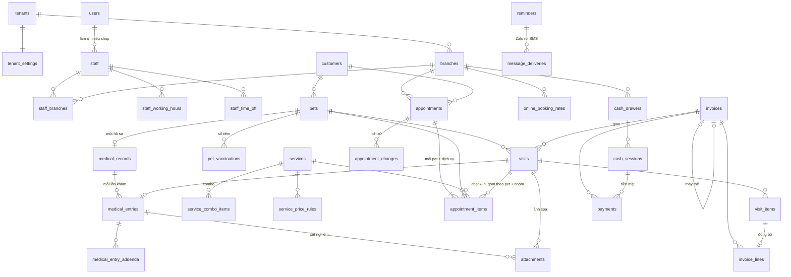
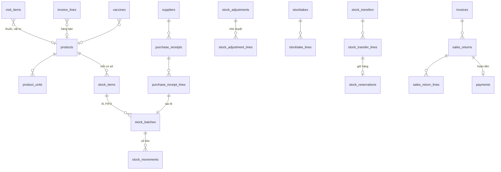
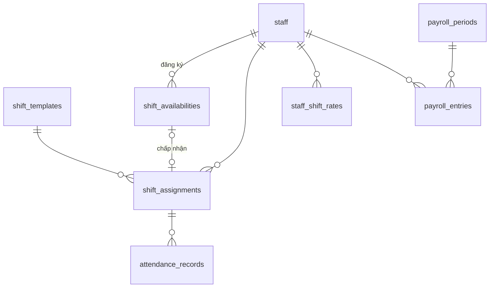

# Lược đồ cơ sở dữ liệu: Pet Spa & Thú y (PawBook)

Tài liệu chốt chính thức. Nguồn nghiệp vụ: `analysis/so-do-nghiep-vu/nghiep-vu-da-chot.md` và sơ đồ ở `analysis/so-do-nghiep-vu/`. Bản cũ ở `old/design/`.

- Nhãn giai đoạn: **MVP**, **GĐ2** (kho), **GĐ3** (ca, chấm công, lương), **Sau V1** (chỉ ghi lại, chưa tạo bảng).
- Mọi quyết định trong file đã chốt; không còn câu hỏi mở.

---

## 1. Quy ước chung

**Nền tảng:** MySQL 8.0.16+ (InnoDB, utf8mb4_0900_ai_ci), Laravel 12. Một DB dùng chung, phân tách bằng `tenant_id`.

| Chủ đề | Quy ước |
|---|---|
| Khóa chính | `id BIGINT UNSIGNED AUTO_INCREMENT`. Bảng có URL lộ ra ngoài (`tenants`, `branches`, `customers`, `pets`, `appointments`, `visits`, `invoices`, `stock_transfers`) thêm `public_id CHAR(26)` (ULID) để không dò được ID tuần tự. |
| Tenant | Mọi bảng nghiệp vụ có `tenant_id NOT NULL` + `UNIQUE(tenant_id, id)`. Mọi index ghép, kể cả PK của bảng nối (`staff_branches`, `branch_services`, `service_combo_items`), bắt đầu bằng `tenant_id`; mọi unique nghiệp vụ kèm `tenant_id`. Bảng con vẫn lặp `tenant_id` để global scope và FK ghép áp dụng đồng nhất. Bảng có cột đa hình (`attachments`, `reminders`, `activity_logs`) không có FK: Action kiểm đối tượng cùng tenant trước khi ghi. |
| Thứ tự khóa | Mọi transaction khóa theo thứ tự cố định để không deadlock: `customers` → `booking_capacity_locks` (ngày, nhóm tăng dần; medical trước grooming) → `tenant_usage`; `invoices` → `visits` → `stock_items` (product_id tăng dần). |
| FK | Giữa hai bảng tenant dùng **FK ghép** `(tenant_id, x_id) → x(tenant_id, id)`: code sai cũng không gắn được dữ liệu tenant A vào tenant B. |
| Cơ sở | `branch_id` có FK ghép nhưng **không** là ranh giới cô lập (không global scope): nhân viên tra được tồn kho cơ sở khác. Lọc theo cơ sở làm ở query + Policy. |
| Thời gian | Thời điểm lưu `DATETIME` **UTC** (không dùng `TIMESTAMP`). Giờ "đồng hồ treo tường" (ca làm, giờ mở cửa) lưu `TIME` local. Ngày nghiệp vụ (ngày hàng đợi, ngày hóa đơn) lưu `DATE` local. Mọi cơ sở cùng múi giờ, đặt ở `tenants.timezone`. |
| Tiền, số lượng | Tiền `DECIMAL(12,2)`; số lượng kho `DECIMAL(12,3)`. Không float. |
| Xóa | Soft delete (`deleted_at`) cho danh mục và hồ sơ: `customers`, `pets`, `services`, `products`, `staff`, `branches`, `suppliers`. Chứng từ (hóa đơn, phiếu, sổ kho, nhật ký) **không bao giờ xóa**, chỉ hủy bằng trạng thái. |
| Bất biến | Sổ kho, nhật ký, khoản thu là **append-only**: sai thì ghi bút toán mới. Model ném exception ở `updating`/`deleting`. |
| Mã chứng từ | Mọi chứng từ mang mã cơ sở: `{branch.code}-{yyyymmdd}-{seq}`. Số cấp nguyên tử từ bảng đếm (mục 2.10), không dùng `MAX()+1`. |

Tên bảng tiếng Anh, nghĩa tiếng Việt:

| Bảng | Nghĩa |
|---|---|
| `tenants` | shop (một chủ, nhiều cơ sở) |
| `branches` | cơ sở |
| `customers` | khách (chủ nuôi) |
| `pets` | thú cưng |
| `visits` | lượt dịch vụ (Visit): một lần khám/spa/tiêm của một pet |
| `invoices` | hóa đơn |

---

## 2. Danh sách bảng

### 2.1 Nền tảng (dùng chung, không có `tenant_id` nghiệp vụ) — MVP

| Bảng | Cột chính | Ràng buộc / ghi chú |
|---|---|---|
| `plans` | id, code, name, `max_branches SMALLINT`, `max_staff SMALLINT`, `max_appointments_per_month INT`, features JSON | UNIQUE(code). NULL = không giới hạn. `max_staff` đếm nhân viên có tài khoản đang `active` (kể cả chủ shop) **cộng lời mời còn hạn**; kiểm khi mời, khi nhận lời mời và khi kích hoạt lại nhân viên, khóa hàng `tenants` (`FOR UPDATE`) để 2 thao tác song song không vượt. Loại hình shop (spa / thú y / cả hai) chỉ dùng để gợi ý dịch vụ mẫu lúc tạo shop, không lưu. |
| `tenants` | id, public_id, name, `slug VARCHAR(63)`, `timezone VARCHAR(64)` (IANA), locale, `currency CHAR(3)`, plan_id, `status ENUM(trial,active,past_due,suspended,cancelled)`, `plan_expires_at DATETIME NULL`, suspended_at, suspended_reason, contact_name, contact_phone, admin_note, created_by_admin_id | UNIQUE(slug), UNIQUE(public_id); IDX(status, plan_expires_at). Slug không trùng segment route trung tâm (admin, app, login…). Cài đặt shop ở `tenant_settings`. Vòng đời: `trial`/`active` → quá `plan_expires_at` thành `past_due` (ân hạn 7 ngày, vẫn dùng bình thường, banner đỏ) → hết ân hạn thành `suspended` (xem được, không ghi, Site ngừng nhận lịch, không gửi nhắc khách) → gia hạn thì `active` ngay. `cancelled` = shop biến mất (404). Đổi trạng thái bằng `UPDATE … WHERE status = :expected`. |
| `tenant_settings` | tenant_id PK, `booking_cancel_cutoff_hours SMALLINT` (mặc định 24), `booking_reschedule_cutoff_hours SMALLINT` (24), `return_window_days SMALLINT` (7), `default_tax_rate DECIMAL(5,2)`, `customer_session_days SMALLINT` (30), `walk_in_priority_minutes SMALLINT` (15), `payroll_period_kind ENUM(week,month)` (GĐ3), `expiry_alert_days SMALLINT` (30, GĐ2), `logo_path NULL`, `site_cover_path NULL`, `site_intro TEXT NULL`, `site_show_products BOOL` (GĐ2), `zalo_config JSON NULL`, `sms_config JSON NULL` (cast `encrypted:array`, không bao giờ trả ra frontend), `terms_content MEDIUMTEXT NULL`, terms_updated_at | Một dòng mỗi shop, tạo cùng shop. Tách khỏi `tenants` để bảng `tenants` chỉ chứa dữ liệu nền tảng, chủ shop không ghi vào. Cấu hình Zalo OA / SMS brandname của shop (S12.4) và nội dung Site (S12.5) nằm ở đây. |
| `users` | id, name, `email VARCHAR(191)`, password, email_verified_at, last_tenant_id | UNIQUE(email). Danh tính toàn cục: một người làm được ở nhiều shop. |
| `species`, `breeds` | species: id, code, name. breeds: id, species_id, name, `default_size ENUM(xs,s,m,l,xl)` | Danh mục chung, seed sẵn. |
| `public_holidays` | id, `country CHAR(2)`, date, name | UNIQUE(country, date). GĐ3. |
| `roles`, `permissions`, `model_has_roles`, `model_has_permissions`, `role_has_permissions` | spatie/laravel-permission, **teams mode** `team_id = tenant_id` | `permissions` chung (danh mục do hệ thống định nghĩa, shop không tạo); `roles` theo shop, thêm cột `display_name VARCHAR(50)` (mục 3.1). |
| `platform_admins` | id, name, email, password, two_factor_secret (mã hóa), two_factor_confirmed_at, `role ENUM(super_admin,support)`, is_active, last_login_at, last_login_ip | UNIQUE(email). Admin đầu tiên tạo bằng lệnh artisan; admin sau do super-admin mời (A6 → A7). Không có trang đăng ký. Bảng + guard + cookie phiên riêng. |
| `platform_admin_invitations` | id, email, `role ENUM(super_admin,support)`, `token_hash CHAR(64)`, invited_by_admin_id, expires_at, accepted_at, revoked_at | UNIQUE(token_hash); IDX(email). Lời mời admin (A6), nhận ở A7 `/admin/invite/{token}`: đặt mật khẩu rồi bắt buộc bật 2FA. Token 32 byte, lưu sha256, 1 lần, hạn 72 giờ. |
| `tenant_subscriptions` | id, tenant_id, plan_id, starts_at, ends_at, amount, paid_at NULL, payment_ref, note, created_by_admin_id | IDX(tenant_id, ends_at). Mỗi lần bán/gia hạn một dòng; `tenants.plan_id` + `plan_expires_at` là bản tóm tắt, cập nhật cùng transaction. |
| `impersonation_sessions` | id, platform_admin_id, tenant_id, target_user_id, reason, `token_hash CHAR(64)`, started_at, ended_at, expires_at, ip, user_agent | UNIQUE(token_hash). Token 1 lần, 60 giây; phiên tối đa 30 phút. |
| `platform_audit_logs` | id, platform_admin_id, impersonation_session_id, tenant_id, `action VARCHAR(64)`, subject_type, subject_id, `changes JSON`, ip, created_at | Append-only. IDX(tenant_id, created_at). |
| `jobs`, `failed_jobs`, `cache`, `sessions` | Hạ tầng Laravel | Payload job mang `tenant_id`. |

Bảng nền tảng có `tenant_id` (`tenant_subscriptions`, `impersonation_sessions`, `platform_audit_logs`) là dữ liệu **về** shop, không phải **của** shop: không dùng global scope tenant, chỉ truy cập từ khu `/admin`.

### 2.2 Cơ sở, nhân viên, lịch trực — MVP

| Bảng | Cột chính | Ràng buộc / ghi chú |
|---|---|---|
| `branches` | id, public_id, tenant_id, `code VARCHAR(20)`, name, address, phone, `opening_hours JSON` (giờ mở cửa theo thứ), `allowed_ips JSON NULL` (chấm công GĐ3), is_active, deleted_at | UNIQUE(tenant_id, code). Shop luôn có ít nhất một cơ sở. |
| `staff` | id, tenant_id, `user_id NULL`, `primary_branch_id`, display_name, phone, `title VARCHAR(50) NULL` (chức danh hiển thị), license_no NULL, qualifications NULL (bác sĩ), `pin_hash NULL` (chấm công kiosk, GĐ3), color, `status ENUM(active,disabled)`, deleted_at | UNIQUE(tenant_id, user_id). **Quyền lấy từ role**, không từ chức danh. `user_id NULL` = người không có tài khoản (bảo vệ, lao công). |
| `staff_branches` | tenant_id, staff_id, branch_id, `is_primary BOOL` | PK(tenant_id, staff_id, branch_id). Cơ sở chính + cơ sở phụ do chủ gán. Nhân viên chỉ thao tác ở cơ sở có trong bảng này (trừ quyền `branches.all`). |
| `invitations` | id, tenant_id, email, `role_names JSON` (mã role, một hoặc nhiều), `primary_branch_id NULL`, `branch_ids JSON` (cơ sở phụ), `token_hash CHAR(64)`, `invited_by_staff_id NULL`, `invited_by_admin_id NULL`, expires_at, accepted_at, revoked_at | UNIQUE(token_hash); IDX(tenant_id, email). CHECK đúng một trong hai người mời. Dùng cho cả chủ shop (admin mời, role `owner`, gán mọi cơ sở) và nhân viên (chủ mời). Nhận lời mời: tạo `staff` + gán role + `staff_branches` trong một transaction; role hoặc cơ sở đã bị xóa từ lúc mời thì bỏ qua và báo người mời. Role `owner` chỉ admin mời được. |
| `staff_working_hours` | id, tenant_id, staff_id, branch_id, `weekday TINYINT`, `start_time TIME`, `end_time TIME`, `service_group ENUM(medical,grooming) NULL`, effective_from, effective_to | IDX(tenant_id, branch_id, weekday). Lịch trực mặc định theo tuần. `service_group` = khung này trực nhóm nào, dùng để **đếm người trực** cho hạn mức đặt online; NULL = không tính (lễ tân, thu ngân, kho). Một người đi làm = **một** người trực: người có cả role bác sĩ và spa chỉ được tính vào nhóm ghi ở khung đó, không đếm vào cả hai nhóm. Không cho một người có 2 khung chồng giờ (kể cả khác cơ sở): kiểm ở Action, khóa hàng `staff`. |
| `staff_time_off` | id, tenant_id, staff_id, starts_at, ends_at (UTC), reason, created_by | IDX(tenant_id, staff_id, starts_at). Nghỉ thì giảm số người trực. |
| `branch_closures` | id, tenant_id, `branch_id NULL` (NULL = cả shop), `date DATE`, reason | UNIQUE(tenant_id, branch_id, date). Ngày nghỉ của cơ sở. |

### 2.3 Khách, thú cưng — MVP

| Bảng | Cột chính | Ràng buộc / ghi chú |
|---|---|---|
| `customers` | id, public_id, tenant_id, name, `phone VARCHAR(20) NULL` (E.164), `phone_suffix CHAR(4) GENERATED STORED` (= 4 số cuối), email NULL, address NULL, `is_system BOOL`, `system_branch_id NULL`, notes, deleted_at | UNIQUE(tenant_id, phone); UNIQUE(tenant_id, system_branch_id); IDX(tenant_id, name); IDX(tenant_id, phone_suffix) cho tìm "4 số cuối" (tránh `LIKE '%3456'` quét cả bảng). **SĐT là khóa khách, dùng chung mọi cơ sở.** Hồ sơ hệ thống "Thú hoang / vô chủ" mỗi cơ sở một (`is_system = 1`, phone NULL). CHECK `phone IS NOT NULL OR is_system = 1`. Khách đăng nhập Site bằng SĐT + OTP (guard `customer`). |
| `pets` | id, public_id, tenant_id, customer_id, species_id, breed_id NULL, name, sex, birth_date NULL, `weight_kg DECIMAL(5,2) NULL`, `size ENUM(xs,s,m,l,xl)`, is_neutered, `allergies TEXT NULL`, `chronic_conditions TEXT NULL`, `behavior_notes VARCHAR(255) NULL` (lưu ý an toàn: "cắn người", "sợ máy sấy"), `is_stray BOOL`, deleted_at | IDX(tenant_id, customer_id); IDX(tenant_id, name) cho tìm toàn cục theo tên pet; **UNIQUE(tenant_id, customer_id, id)** để bảng khác dùng FK ghép `(tenant_id, customer_id, pet_id)`, bảo đảm pet đúng của khách đó. `allergies`, `chronic_conditions`, `behavior_notes` là **cảnh báo** (badge an toàn): mọi vai trò có quyền xem pet đều thấy. |
| `customer_otps` | id, tenant_id, phone, `code_hash CHAR(64)`, `purpose ENUM(login,booking)`, expires_at, attempts, consumed_at, ip | IDX(tenant_id, phone, expires_at). OTP 6 số, hết hạn 5 phút, sai 5 lần khóa 15 phút, gửi qua SMS. Chống lạm dụng SMS: gửi lại sau 60 giây, tối đa 5 lần/giờ mỗi SĐT và 20 lần/giờ mỗi IP (rate limiter key có tiền tố tenant). SĐT chưa có hồ sơ: xác minh xong nhập tên để tạo `customers` (khách tự đăng ký; 2 request cùng SĐT: UNIQUE + bắt lỗi duplicate rồi đọc lại). |

### 2.4 Dịch vụ — MVP

| Bảng | Cột chính | Ràng buộc / ghi chú |
|---|---|---|
| `services` | id, tenant_id, `code VARCHAR(30)`, name, `service_group ENUM(medical,grooming)`, `is_combo BOOL`, `duration_min SMALLINT`, `buffer_min SMALLINT`, `price DECIMAL(12,2)`, is_public (hiện trên Site), is_active, deleted_at | UNIQUE(tenant_id, code). Khám, tiêm, xét nghiệm, chẩn đoán hình ảnh = `medical`; tắm, cắt tỉa = `grooming`. Giá chung mọi cơ sở, áp tại thời điểm thêm vào Visit. |
| `service_combo_items` | tenant_id, combo_service_id, item_service_id, sort_order | PK(tenant_id, combo_service_id, item_service_id). Combo có mã, giá riêng. **Chỉ có combo spa** (vd cắt tỉa + tắm gội): combo và mọi dịch vụ con phải là `grooming` (kiểm ở Action); không lồng combo. Khám + spa cùng lần đến là các dịch vụ riêng (Visit riêng), gom chung một hóa đơn. |
| `service_price_rules` | id, tenant_id, service_id, species_id NULL, breed_id NULL, size NULL, `duration_min SMALLINT NULL`, `price DECIMAL(12,2) NULL` | UNIQUE(tenant_id, service_id, species_id, breed_id, size). Thời lượng/giá theo loài, giống, cỡ; cụ thể nhất thắng: giống → loài + cỡ → loài → mặc định của dịch vụ. |
| `branch_services` | tenant_id, branch_id, service_id | PK(tenant_id, branch_id, service_id). Dịch vụ nào có ở cơ sở nào (đặt lịch kiểm). Không có dòng nào cho một dịch vụ = có ở mọi cơ sở. |

### 2.5 Lịch hẹn — MVP

| Bảng | Cột chính | Ràng buộc / ghi chú |
|---|---|---|
| `appointments` | id, public_id, tenant_id, branch_id, customer_id, `starts_at`, `ends_at` (UTC, = giờ kết thúc muộn nhất của các dòng), `source ENUM(online,staff)`, `status ENUM(confirmed,checked_in,cancelled,no_show)`, `preferred_staff_id NULL`, customer_note, `send_reminders BOOL` (mặc định 1; lễ tân tick "Không gửi nhắc" ở S2 thì 0), `idempotency_key CHAR(36) NULL`, created_by_staff_id NULL, cancelled_at, cancelled_by_type ENUM(customer,staff,system) NULL, cancel_reason, no_show_at | UNIQUE(public_id); UNIQUE(tenant_id, idempotency_key); **UNIQUE(tenant_id, id, customer_id, branch_id)** làm đích FK ghép cho dòng; IDX(tenant_id, branch_id, starts_at) cho lịch ngày; IDX(tenant_id, customer_id, starts_at). **Một lịch của một khách, có thể nhiều pet** (vd khách gọi "lát mang 2 bé đến khám"). Nhắc hẹn gửi một tin cho cả lịch. |
| `appointment_items` | id, tenant_id, appointment_id, branch_id (chép), customer_id (chép), pet_id, service_id, `service_group ENUM(medical,grooming)` (chép từ dịch vụ), `starts_at`, `ends_at` (đã cộng buffer), `duration_min`, `reference_price DECIMAL(12,2)`, `status ENUM(booked,checked_in,cancelled,no_show)`, `assigned_staff_id NULL`, `visit_id NULL` (Visit tạo lúc check-in) | IDX(appointment_id); **IDX(tenant_id, branch_id, service_group, starts_at, ends_at, status)** cho đếm hạn mức; IDX(tenant_id, pet_id, starts_at); IDX(tenant_id, visit_id). FK ghép `(tenant_id, appointment_id, customer_id, branch_id) → appointments`: `customer_id`, `branch_id` chép không lệch khỏi lịch. FK ghép `(tenant_id, customer_id, pet_id) → pets`: mọi pet trong lịch phải của đúng khách đó. UNIQUE(appointment_id, pet_id, service_id). Check-in: các dòng cùng pet + cùng nhóm gom vào **một** Visit (pet khám + tiêm = 1 Visit khám; khám + spa = 2 Visit); dòng đã có `visit_id` thì bỏ qua (check-in 2 lần idempotent). **Mỗi dòng = một pet + một dịch vụ (hoặc combo spa)**; một pet vừa khám vừa spa = 2 dòng. `branch_id`, `customer_id`, `starts_at` chép từ lịch để index và FK chạy trên chính bảng này; đổi giờ lịch thì cập nhật các dòng trong cùng transaction. |
| `appointment_changes` | id, tenant_id, appointment_id, `appointment_item_id NULL` (NULL = cả lịch), `action ENUM(rescheduled,cancelled,restored,checked_in,no_show,reassigned,item_added,item_removed)`, `old_starts_at NULL`, `new_starts_at NULL`, `actor_type ENUM(customer,staff,system)`, actor_staff_id NULL, reason, created_at | IDX(tenant_id, appointment_id). Lịch sử đổi giờ, hủy (sơ đồ 3a "đổi giờ, lưu lịch sử"). Append-only. |
| `online_booking_rates` | id, tenant_id, branch_id, service_group, `ratio DECIMAL(4,3)`, `weekday TINYINT NULL`, `start_time TIME NULL`, `end_time TIME NULL` | IDX(tenant_id, branch_id, service_group). Tỉ lệ đặt online theo cơ sở × nhóm; dòng có thứ/giờ = ghi đè cho ca đó, cụ thể nhất thắng. Không có dòng = không nhận đặt online nhóm đó. |
| `booking_capacity_locks` | tenant_id, branch_id, service_group, `date DATE` | PK(tenant_id, branch_id, service_group, date). Hàng để khóa khi đặt/dời lịch (mục 5.1). Không chứa dữ liệu nghiệp vụ. Hàng được tạo **ngoài** transaction đặt lịch (`INSERT IGNORE` autocommit) rồi mới khóa `FOR UPDATE` trong transaction. |

Quy tắc:
- **Một lịch, nhiều pet**: lịch gắn một khách; mỗi pet + dịch vụ là một dòng `appointment_items`. Đặt online hay lễ tân đặt đều chọn được nhiều pet trong một lần.
- **Hạn mức tính theo dòng**: mỗi dòng còn hiệu lực chiếm **một chỗ** của nhóm của nó. Khách đặt online 2 bé khám cùng giờ cần còn 2 chỗ khám; thiếu thì báo hết chỗ cả lịch (không lưu một nửa). Lịch có dòng khám + dòng spa thì kiểm cả hai nhóm.
- Một pet không đến hoặc khách bỏ một pet: hủy dòng đó (`cancelled`), các dòng khác giữ. Trạng thái lịch: `checked_in` khi có ít nhất một dòng đã đến; `cancelled` / `no_show` khi mọi dòng như vậy.
- Lịch chỉ để tham khảo, nhắc hẹn, phân người trực: không cọc, không thu trước. Tạo ra là `confirmed`.
- `reference_price` chỉ để hiển thị "giá tham khảo, có thể thay đổi". Tính tiền theo giá lúc thêm vào Visit.
- Chiếm chỗ: dòng `booked` và `checked_in` của lịch chưa hủy. Hủy, không đến thì nhả chỗ.
- Khách tự hủy/dời trên Site khi còn ≥ `booking_cancel_cutoff_hours` / `booking_reschedule_cutoff_hours` (mặc định 24 giờ). Kiểm ở server.
- Lịch online không gán người (`appointment_items.assigned_staff_id` NULL); phân người khi khách đến. Lễ tân đặt thì gán được từng dòng.
- Cuối ngày (giờ shop) job đánh dấu `no_show` cho dòng còn `booked`; lễ tân đánh dấu sớm được; không phạt.

### 2.6 Visit, hàng đợi, bệnh án, tiêm — MVP

| Bảng | Cột chính | Ràng buộc / ghi chú |
|---|---|---|
| `visits` | id, public_id, tenant_id, branch_id, `customer_id NULL`, `pet_id NULL`, `invoice_id NULL`, `service_group ENUM(medical,grooming)`, `visit_date DATE` (local), `queue_no SMALLINT`, `status ENUM(waiting,in_progress,done,cancelled)`, `is_emergency BOOL`, `emergency_label VARCHAR(100) NULL` (vd "Chó cấp cứu 14:05" khi chưa có hồ sơ), `priority_at DATETIME` (thời điểm dùng để sắp hàng đợi), assigned_staff_id NULL, reason (lý do đến, tình trạng ban đầu), `weight_kg DECIMAL(5,2) NULL` (cân lúc đến), checked_in_at, started_at, finished_at, cancelled_reason, created_by | UNIQUE(tenant_id, branch_id, visit_date, queue_no); IDX(tenant_id, branch_id, visit_date, status, service_group); IDX(tenant_id, invoice_id); IDX(tenant_id, pet_id, visit_date). FK ghép `(tenant_id, customer_id, pet_id)`. CHECK `is_emergency = 1 OR (customer_id IS NOT NULL AND pet_id IS NOT NULL)`. Liên kết lịch hẹn nằm ở `appointment_items.visit_id` (một Visit gom nhiều dòng cùng pet, cùng nhóm). Visit có hẹn: `priority_at` = giờ bắt đầu sớm nhất của các dòng. |
| `visit_items` | id, tenant_id, visit_id, `item_type ENUM(service,medication,consumable)`, service_id NULL, product_id NULL (GĐ2), `name` (chép lúc thêm), `quantity DECIMAL(12,3)`, `unit_price DECIMAL(12,2)`, `is_billable BOOL`, `suggested_quantity NULL` (định mức gợi ý, GĐ2), product_unit_id NULL, unit_factor, batch_id NULL (chọn lô tay, GĐ2), performed_by, notes, created_at | IDX(tenant_id, visit_id). CHECK `service` thì có service_id; `medication`/`consumable` thì có product_id. Thuốc kê, dịch vụ phát sinh (xét nghiệm…) thêm ở đây khi khách đồng ý (báo giá miệng, không lưu xác nhận). Vật tư trong dịch vụ: `is_billable = 0`. |
| `medical_records` | id, tenant_id, pet_id, `record_no VARCHAR(20)`, opened_at, opened_by | UNIQUE(tenant_id, pet_id); UNIQUE(tenant_id, record_no). **Hồ sơ bệnh án**: mỗi pet một hồ sơ, số hồ sơ cấp ở lần khám đầu, dùng chung mọi cơ sở. |
| `medical_entries` | id, tenant_id, medical_record_id, `visit_id NULL` (NULL = bệnh sử khám nơi khác), author_staff_id, symptoms, vitals JSON NULL (thân nhiệt, nhịp tim…), diagnosis, treatment, `care_instructions TEXT` (khách thấy), `internal_notes TEXT NULL` (**không bao giờ hiện trên Site**), `follow_up_on DATE NULL`, `referral_note NULL` (chuyển tuyến), recorded_at, `editable_until DATETIME` (= recorded_at + 24 giờ) | IDX(tenant_id, medical_record_id, recorded_at); UNIQUE(tenant_id, visit_id). **Dòng chi tiết**: mỗi lần khám một dòng. Chỉ người lập sửa, trong 24 giờ; sau đó chỉ thêm bổ sung. |
| `medical_entry_addenda` | id, tenant_id, medical_entry_id, author_staff_id, body, created_at | Ghi chú bổ sung sau 24 giờ. Append-only. |
| `attachments` | id, tenant_id, `attachable_type ENUM(medical_entry,visit)`, attachable_id, `kind ENUM(lab_result,imaging,intake_photo,return_photo,other)`, `is_shared_with_customer BOOL` (mặc định 0), disk, path, mime, size_bytes, original_name, uploaded_by, created_at | IDX(tenant_id, attachable_type, attachable_id). Kết quả xét nghiệm, ảnh chụp chiếu (ảnh, PDF) gắn dòng bệnh án; ảnh lúc nhận/trả của spa gắn Visit. Site chỉ thấy file bác sĩ tick "Chia sẻ cho khách" và ảnh spa. File private, tải qua URL ký có hạn, đường dẫn chứa `tenant_id`. |
| `vaccines` | id, tenant_id, name, `kind ENUM(vaccine,dewormer)`, species_id, manufacturer, `product_id NULL` (GĐ2, nối kho) | IDX(tenant_id, species_id). |
| `care_protocols`, `care_protocol_steps` | protocol: id, tenant_id, name, species_id, vaccine_id, is_active. step: id, tenant_id, protocol_id, step_no, min_age_days, offset_days, is_recurring, repeat_every_days | UNIQUE(protocol_id, step_no). Phác đồ mẫu. |
| `pet_vaccinations` | id, tenant_id, pet_id, `visit_id NULL`, vaccine_id, protocol_id NULL, step_no NULL, administered_on DATE, administered_by, batch_no, `batch_expires_on DATE NULL`, `next_due_on DATE NULL`, superseded_at NULL, `status ENUM(given,postponed)`, postpone_reason NULL | IDX(tenant_id, pet_id, vaccine_id); IDX(tenant_id, superseded_at, next_due_on) cho job nhắc chạy theo từng shop và màn S7. Sổ tiêm. Hoãn tiêm = dòng `postponed` với ngày hẹn mới ở `next_due_on`. GĐ2: có `vaccines.product_id` thì trừ kho khi hoàn tất Visit, tự điền số lô. |

Quy tắc Visit:
- Visit **độc lập hóa đơn**: trạng thái cuối là `done`; đã thu tiền hay chưa xem ở hóa đơn.
- Một pet vừa khám vừa spa = 2 Visit (2 số thứ tự).
- Nhận ca: `UPDATE visits SET status='in_progress', assigned_staff_id=? WHERE id=? AND status='waiting'`; affected = 0 → người khác đã nhận.
- Hàng đợi sắp theo: `is_emergency DESC`, rồi `priority_at`. Khách có hẹn đến trong ±`walk_in_priority_minutes` (15) quanh giờ hẹn: `priority_at` = giờ hẹn; đến muộn hơn: `priority_at` = giờ check-in như khách vãng lai. Cấp cứu chen đầu, các số đang chờ lùi một bậc, `queue_no` trên phiếu giữ nguyên.
- Cấp cứu: tạo Visit ngay với `emergency_label`, hồ sơ khách và pet bổ sung song song. Không hoàn tất được Visit hay hóa đơn khi chưa gắn `customer_id`, `pet_id` (kiểm ở Action).
- Hoàn tất Visit (`done`): GĐ2 trừ kho thuốc + vật tư theo số thực tế; tạo nhắc tái khám từ `follow_up_on`; mở khóa dòng bệnh án 24 giờ.
- Groomer thấy pet có bệnh → lễ tân tạo thêm Visit khám, gắn cùng hóa đơn chưa hoàn thành.
- Quyền xem bệnh án: bác sĩ mọi cơ sở và chủ shop xem đầy đủ; lễ tân, spa, quản lý chi nhánh chỉ thấy cảnh báo + ngày khám; thu ngân, kho không thấy. Khách trên Site thấy ngày khám, chẩn đoán, hướng dẫn, thuốc đã kê, sổ tiêm, tái khám, file được chia sẻ; không thấy `internal_notes`.
- Nhận, hoàn tất Visit khám chỉ người có role Bác sĩ (chủ shop không tự làm nếu không gán thêm role này); Visit spa: Nhân viên spa hoặc chủ shop.

### 2.7 Hóa đơn, thanh toán, ca thu ngân — MVP

| Bảng | Cột chính | Ràng buộc / ghi chú |
|---|---|---|
| `invoices` | id, public_id, tenant_id, branch_id, `code VARCHAR(30) NULL` (cấp khi hoàn thành), `kind ENUM(service,retail)`, `customer_id NULL`, `payer_name NULL`, `payer_phone NULL`, `status ENUM(draft,completed,void)`, `business_date DATE` (ngày mở, local), subtotal, tax_amount, total, `discount_amount` (luôn 0 ở V1, giữ cho khuyến mãi sau V1), `open_draft_key VARCHAR(64) GENERATED` (= `customer_id:branch_id:business_date` khi `status='draft' AND kind='service' AND payer_name IS NULL`, NULL khi khác), completed_at, completed_by, voided_at, voided_by, void_reason, `replaces_invoice_id NULL`, created_by | UNIQUE(tenant_id, code); **UNIQUE(tenant_id, open_draft_key)**: mỗi khách mỗi cơ sở mỗi ngày chỉ một hóa đơn dịch vụ chưa hoàn thành. Hóa đơn bán lẻ và hóa đơn thú hoang có người trả (gắn hồ sơ hệ thống) không tính vào khóa này, nên không đụng nhau. IDX(tenant_id, branch_id, status, business_date); IDX(tenant_id, branch_id, completed_at). CHECK `kind='service'` thì `customer_id NOT NULL`. |
| `invoice_lines` | id, tenant_id, invoice_id, `line_type ENUM(visit_item,product,custom)`, `visit_item_id NULL`, `pet_id NULL`, product_id NULL, product_unit_id NULL, unit_factor, `name` (chép), quantity, unit_price, tax_rate, line_total, `unit_cost DECIMAL(12,2) NULL` (giá vốn, GĐ2, chỉ chủ thấy), created_by | IDX(tenant_id, invoice_id); IDX(tenant_id, visit_item_id). `custom` = dòng gõ tay (tên + giá, không trừ kho). |
| `payments` | id, tenant_id, invoice_id NULL, sales_return_id NULL, `kind ENUM(payment,refund,transfer_out,transfer_in)`, `method ENUM(cash,bank_transfer,qr,card)`, `amount DECIMAL(12,2)` (> 0), reference (mã giao dịch), `cash_session_id NULL`, `transfer_payment_id NULL` (khoản gốc được chuyển), received_by_staff_id, paid_at, `idempotency_key CHAR(36)` | UNIQUE(tenant_id, idempotency_key); IDX(tenant_id, invoice_id); IDX(tenant_id, cash_session_id). CHECK `kind NOT IN ('payment','refund') OR method <> 'cash' OR cash_session_id IS NOT NULL`. **Append-only, không bao giờ đổi `invoice_id`.** `transfer_out`/`transfer_in` là bút toán chuyển tiền đã thu từ bản bị sửa sang bản thay thế (chép `method`, không gắn ca): không tính vào Thực thu, không vào tiền mặt dự kiến của ca. Đã thu của một hóa đơn = Σ payment + Σ transfer_in − Σ refund − Σ transfer_out. |
| `cash_drawers` | id, tenant_id, branch_id, name, is_active | UNIQUE(tenant_id, branch_id, name). Két tiền; mỗi cơ sở ít nhất một. |
| `cash_sessions` | id, tenant_id, branch_id, drawer_id, `status ENUM(open,closed)`, opened_by, opened_at, opening_amount, closed_by, closed_at, expected_cash, counted_cash, difference, difference_reason, `open_key BIGINT GENERATED` (= drawer_id khi `open`, NULL khi đóng) | UNIQUE(open_key): mỗi két chỉ một ca mở. IDX(tenant_id, branch_id, opened_at). Nhiều người thu chung ca; mỗi khoản ghi `received_by_staff_id`. Chênh lệch ≠ 0 bắt buộc lý do, báo chủ. |

Quy tắc:
- Không cọc, không trả một phần, không công nợ: hoàn thành = thu đủ một lần (có thể nhiều phương thức).
- **Mở hóa đơn khi tiếp nhận**: tạo Visit thì gắn vào hóa đơn `draft` của khách tại cơ sở hôm nay (chưa có thì tạo). Nhiều pet → nhiều Visit, một hóa đơn. Lễ tân thêm hàng mua, dòng gõ tay. Tìm nháp bằng `open_draft_key … FOR UPDATE`; chưa có thì INSERT, trùng unique (2 lễ tân cùng lúc) thì đọc lại và khóa bản vừa tạo.
- **Thứ tự khóa**: mọi thao tác đổi tiền của hóa đơn nháp (thêm/sửa/xóa `visit_items` tính tiền, thêm dòng, gắn/gỡ Visit, hoàn thành, hủy) khóa `invoices` trước rồi mới tới `visits`. Nhờ vậy không có dòng nào lọt vào sau khi hóa đơn đã chốt.
- Visit bị hủy khi hóa đơn còn nháp: gỡ các dòng `visit_item` của Visit đó khỏi hóa đơn.
- **Thú hoang**: Visit không tự mở hóa đơn; có người trả thì lễ tân tạo hóa đơn riêng (`kind=service`, gắn hồ sơ hệ thống của cơ sở) ghi `payer_name`, `payer_phone`.
- **Bán lẻ có SĐT**: SĐT khớp khách có sẵn thì gắn `customer_id`; không khớp thì chỉ lưu `payer_phone`, không tạo hồ sơ.
- Hóa đơn chưa hoàn thành từ ngày trước **không tự hủy**. Hôm sau khách đến thì mở hóa đơn mới. **Cảnh báo dọn nháp**: đầu mỗi ngày (giờ shop) job gửi `notifications` cho lễ tân, thu ngân của cơ sở và chủ shop: "Còn N hóa đơn chưa hoàn thành từ ngày trước"; màn thu ngân và dashboard có thẻ cảnh báo kèm danh sách để hoàn thành hoặc hủy (có lý do). Truy vấn: `status='draft' AND business_date < hôm nay` (IDX(tenant_id, branch_id, status)).
- Dòng `visit_item` đồng bộ một chiều từ `visit_items` (`is_billable = 1`) khi hóa đơn còn `draft`. Ở quầy thu, dòng này **chỉ đọc**; bỏ dịch vụ thì sửa ở Visit. Dòng `product`, `custom` lễ tân sửa tự do.
- **Không giảm giá tay.** Khuyến mãi theo chiến dịch và giảm theo hạng thành viên: sau V1.
- Hoàn thành (một transaction): khóa hóa đơn (phải `draft`) → mọi Visit gắn hóa đơn phải `done` hoặc `cancelled` → có tiền mặt thì cần ca thu ngân đang mở → ghi `payments` (tổng = `total`) → cấp `code` → `completed` → GĐ2 trừ kho dòng `product` → nhật ký. Bấm 2 lần không ghi 2 lần (idempotency).
- Hủy hóa đơn chưa hoàn thành: lễ tân/thu ngân, bắt buộc lý do, báo chủ, có trong báo cáo ngày. Visit gắn hóa đơn được gỡ `invoice_id`.
- **Chủ sửa hóa đơn đã hoàn thành** (một transaction, khóa bản cũ): bản cũ `void` (giữ số, lý do) → bản thay thế (số mới, `replaces_invoice_id`) chép dòng → chuyển `visits.invoice_id` sang bản mới → ghi cặp bút toán `transfer_out` (bản cũ) / `transfer_in` (bản mới) bằng đúng số đã thu, theo từng phương thức (không sửa dòng `payments` cũ) → chủ sửa dòng → chênh lệch thu thêm (`payment`) hoặc trả lại (`refund`, tiền mặt cần ca đang mở) → hoàn thành. Báo cáo không sửa ngược ngày cũ: bản cũ vẫn tính ở ngày hoàn thành gốc; ngày sửa ghi −tổng bản cũ (bản `void` có `completed_at`, tính theo `voided_at`) + tổng bản thay thế. Không sửa dòng của bản đã `completed`. Hóa đơn đã có phiếu trả hàng (GĐ2) thì không sửa được.
- **Doanh thu** = tổng hóa đơn `completed` trước thuế theo ngày hoàn thành (bản thay thế tính ngày sửa; trả hàng trừ vào ngày trả). "Thực thu" (Σ `payment` − Σ `refund` theo ngày, bỏ qua bút toán chuyển) là chỉ số dòng tiền riêng, ghi nhãn rõ.
- Hóa đơn chỉ mua hàng (`retail`): không cần hồ sơ khách. Không được có dòng dịch vụ hay thuốc kê đơn (kiểm ở Action).

### 2.8 Nhắc hẹn, tin nhắn, thông báo — MVP

| Bảng | Cột chính | Ràng buộc / ghi chú |
|---|---|---|
| `reminders` | id, tenant_id, `remindable_type ENUM(appointment,pet_vaccination,medical_entry,visit)`, remindable_id, customer_id, `purpose ENUM(appointment_confirm,appointment_24h,appointment_2h,vaccine_due,follow_up,pickup_ready)`, `send_at DATETIME`, `status ENUM(pending,processing,sent,failed,skipped)`, sent_at, `dedupe_key VARCHAR(191)` | UNIQUE(tenant_id, dedupe_key); IDX(status, send_at) (job quét chung mọi shop, nằm trong danh sách được phép bỏ scope). **Cái gì cần nhắc, khi nào.** `pickup_ready` gắn Visit spa. Lịch bị hủy/dời: nhắc cũ `skipped`, tạo nhắc mới. Lịch `send_reminders = 0` chỉ không tạo nhắc 24h/2h (vẫn gửi xác nhận nếu đặt online). Nhắc có `send_at` đã qua lúc tạo (đặt sát giờ) thì không tạo. |
| `message_deliveries` | id, tenant_id, reminder_id NULL, customer_otp_id NULL, `channel ENUM(zalo,sms)`, to_phone, template_code, `status ENUM(queued,sent,failed)`, provider_message_id, error, `cost DECIMAL(10,2) NULL`, attempted_at | IDX(tenant_id, reminder_id). **Mỗi lần gửi thật một dòng.** Thứ tự: gửi Zalo ZNS trước; lỗi hoặc SĐT không dùng Zalo thì gửi SMS; không gửi cả hai. OTP gửi SMS. Không có email/Telegram cho khách. |
| `notifications` | Bảng Laravel + cột `tenant_id`; **notifiable là `staff`** (không phải `users`) | IDX(tenant_id, notifiable_id, read_at). Thông báo trong CMS cho nhân viên: hủy hóa đơn, chênh lệch ca, cảnh báo kho, phiếu chờ duyệt, Visit chờ thanh toán, cần gọi khách. Gắn `staff` để người làm ở 2 shop không thấy thông báo shop này khi đang mở shop kia. |
| `activity_logs` | id, tenant_id, branch_id NULL, actor_staff_id NULL, `impersonation_session_id NULL`, `action VARCHAR(64)`, subject_type, subject_id, `changes JSON`, reason NULL, ip, created_at | IDX(tenant_id, subject_type, subject_id); IDX(tenant_id, created_at). Append-only. Bắt buộc ghi: hủy/sửa hóa đơn, hoàn tiền, trả hàng, điều chỉnh kho, duyệt phiếu, đổi giá, đổi quyền, sửa bệnh án, đóng ca có chênh lệch. Thao tác trong phiên đăng nhập thay mang `impersonation_session_id`: S32 hiện "Admin … thực hiện thay". |
| `tenant_usage` | tenant_id, `period CHAR(7)`, appointments_count | PK(tenant_id, period). Quota gói `max_appointments_per_month`: đếm **mọi lịch** (online + lễ tân) theo tháng tạo lịch (giờ shop), tính theo lịch không theo dòng; hủy không trả lại suất (chặn đặt-hủy lặp). Tăng nguyên tử có điều kiện, là bước khóa cuối của đặt lịch. |

### 2.9 Kho — GĐ2

| Bảng | Cột chính | Ràng buộc / ghi chú |
|---|---|---|
| `suppliers` | id, tenant_id, name, phone, tax_code, address, deleted_at | IDX(tenant_id, name). |
| `product_categories` | id, tenant_id, parent_id NULL, name, `expiry_alert_days NULL` | |
| `products` | id, tenant_id, category_id, `sku VARCHAR(50)`, barcode NULL, name, `kind ENUM(medication,consumable,retail)` (chỉ để phân nhóm, báo cáo), `is_sellable BOOL` (bán lẻ được), `requires_prescription BOOL`, `base_unit VARCHAR(20)` (đơn vị nhỏ nhất), `sale_price DECIMAL(12,2)`, `is_batch_tracked BOOL`, `expiry_alert_days NULL`, `default_reorder_level NULL`, `replaces_product_id NULL` (mã hàng lỗi bán giảm, trỏ mã gốc), is_public, is_active, deleted_at | UNIQUE(tenant_id, sku). Danh mục chung mọi cơ sở. **Giá bán một giá hiện hành**, chủ tự chỉnh, không theo lô, không theo giá vốn. |
| `product_units` | id, tenant_id, product_id, name (thùng, lốc), `factor DECIMAL(12,3)`, barcode NULL, `sale_price NULL` | UNIQUE(tenant_id, product_id, name). Kho chỉ lưu đơn vị nhỏ nhất; quy đổi ở biên. |
| `service_consumables` | id, tenant_id, service_id, product_id, size NULL, quantity | UNIQUE(tenant_id, service_id, product_id, size). Định mức chỉ để điền sẵn; trừ theo số thực tế. |
| `stock_items` | id, tenant_id, branch_id, product_id, `on_hand DECIMAL(12,3)`, `reserved DECIMAL(12,3)`, `reorder_level NULL` | UNIQUE(tenant_id, branch_id, product_id); IDX(tenant_id, product_id). **Hàng bị khóa** khi trừ/giữ/chuyển. Khả dụng = on_hand − reserved. |
| `stock_batches` | id, tenant_id, branch_id, product_id, batch_no, `expires_on DATE NULL`, `quantity DECIMAL(12,3)`, `unit_cost DECIMAL(12,2) NULL`, `received_at DATETIME`, purchase_receipt_line_id NULL, source_batch_id NULL (lô gốc khi chuyển kho) | IDX(tenant_id, branch_id, product_id, received_at, id). **Xuất FIFO theo lô nhập**: `ORDER BY received_at, id`, bỏ lô quá hạn. Tổng `quantity` các lô = `on_hand`. Hàng không theo lô có một lô ngầm. HSD chỉ có tháng/năm lưu ngày cuối tháng. `unit_cost` NULL tới khi chủ điền giá. |
| `stock_movements` | id, tenant_id, branch_id, product_id, batch_id, `type ENUM(purchase,sale,visit_usage,transfer_out,transfer_in,adjustment,stocktake,customer_return,write_off,relabel_out,relabel_in)`, `quantity DECIMAL(12,3)` (âm = xuất), `unit_cost NULL`, source_type, source_id, reason NULL, created_by, created_at | IDX(tenant_id, branch_id, product_id, created_at); IDX(tenant_id, source_type, source_id). **Sổ kho append-only**, mỗi lô một dòng. Nguồn duy nhất cho giá vốn và đối soát tồn. |
| `purchase_receipts` | id, tenant_id, branch_id (cơ sở nhận), supplier_id NULL, code, `status ENUM(posted,costed,cancelled)`, supplier_invoice_ref, `total_cost NULL`, received_at, posted_by, costed_by NULL, costed_at NULL | UNIQUE(tenant_id, code); IDX(tenant_id, status). **Phiếu nhập 2 bước**: (1) nhân viên kho cơ sở nhận lập phiếu: sản phẩm, số lượng, lô, hạn, không thấy giá; lưu là `posted`, tạo lô + movement + **cộng tồn ngay**; (2) chủ mở phiếu điền giá → `costed`, cập nhật giá lô. Đã `posted` thì không sửa số lượng; sai thì lập phiếu điều chỉnh. |
| `purchase_receipt_lines` | id, tenant_id, receipt_id, product_id, product_unit_id NULL, unit_factor, batch_no, expires_on, quantity, `base_quantity`, `unit_cost NULL` | API của nhân viên kho không bao giờ có khóa `unit_cost`. |
| `stock_adjustments`, `stock_adjustment_lines` | adj: id, tenant_id, branch_id, code, `type ENUM(shrinkage,write_off,correction)`, `status ENUM(pending_approval,approved,rejected)`, reason, created_by, decided_by, decided_at, reject_reason. line: product_id, batch_id, quantity, `reason_code ENUM(damaged,rodent,expired,lost,other)`, note | IDX(tenant_id, branch_id, status). **Phiếu hao hụt**: kho lập, có lý do → **chờ duyệt** (chủ hoặc quản lý chi nhánh) → duyệt mới ghi sổ kho. |
| `stocktakes`, `stocktake_lines` | stocktake: id, tenant_id, branch_id, `status ENUM(counting,pending_approval,approved,rejected)`, counted_by, decided_by. line: product_id, batch_id, system_qty, counted_qty, reason | Kiểm kê theo lô; chênh lệch có lý do, duyệt mới ghi sổ. |
| `stock_transfers`, `stock_transfer_lines` | transfer: id, public_id, tenant_id, from_branch_id, to_branch_id, code, `status ENUM(requested,approved,in_transit,received,received_short,returned,cancelled)`, requested_by, approved_by, shipped_at, received_at, shipper_name, shipper_phone, `for_customer_id NULL`, note. line: product_id, batch_id NULL, qty_requested, qty_shipped, qty_received | CHECK from ≠ to. Lô chuyển giữ số lô, hạn, giá vốn, `received_at` gốc. Nhận thiếu → `received_short` + điều chỉnh có lý do. |
| `stock_reservations` | id, tenant_id, branch_id, product_id, quantity, `reason ENUM(transfer,customer_hold)`, transfer_line_id NULL, customer_id NULL, expires_at, `status ENUM(active,consumed,released,expired)`, created_by | IDX(tenant_id, branch_id, product_id, status); IDX(status, expires_at). Chỉ giữ hàng khi chuyển kho cho khách (sơ đồ 10b). Kê thuốc, thêm dòng hóa đơn **không** giữ hàng. |
| `stock_alerts` | id, tenant_id, branch_id, product_id, batch_id NULL, `type ENUM(low_stock,out_of_stock,near_expiry,expired)`, `status ENUM(open,acknowledged,resolved)`, snapshot_qty, threshold, opened_at, last_notified_at, resolved_at, `open_key GENERATED` | UNIQUE(open_key): mỗi sự việc một cảnh báo mở. Báo qua `notifications` cho chủ + người có quyền `inventory.alerts` của cơ sở; không dùng Zalo/SMS. |
| `sales_returns`, `sales_return_lines` | return: id, tenant_id, branch_id, code, invoice_id (gốc, completed), `is_overdue BOOL`, reason, created_by. line: invoice_line_id, quantity, `condition ENUM(intact,defective,expired)`, `disposition ENUM(restocked,pending_owner,written_off,relabeled,returned_to_supplier)`, decided_by NULL, decided_at NULL | IDX(tenant_id, invoice_id); IDX(tenant_id, branch_id, disposition). Chỉ trả **sản phẩm**. Hạn `return_window_days`; quá hạn chỉ chủ. `intact` → cộng tồn đúng lô gốc; `defective` → chờ chủ xử lý (chưa cộng tồn); `expired` → hủy. Hoàn tiền = `payments` kind `refund` gắn `sales_return_id`, trừ doanh thu ngày trả. Không vượt số đã mua trừ số đã trả (khóa hóa đơn gốc). |

Quy tắc kho:
- **Trừ kho**: thuốc + vật tư trong Visit trừ khi **hoàn tất Visit**; hàng bán trừ khi **hóa đơn hoàn thành**. Lúc kê/thêm dòng chỉ kiểm còn đủ, không giữ; lúc trừ mà thiếu thì từ chối.
- **Giá vốn = giá lô thực xuất** (FIFO). Lô chưa có giá: movement để `unit_cost` NULL, báo cáo lợi nhuận đánh dấu "thiếu giá nhập".
- **Giá vốn chỉ người có `inventory.view_cost`** (mặc định chủ, giao được): cột giá vốn không nằm trong API Resource mặc định.
- Tra tồn cơ sở khác: chỉ số khả dụng + hạn gần nhất, không giá vốn.
- Hàng lỗi: chủ chọn hủy (`write_off`), trả nhà cung cấp, hoặc chuyển sang mã riêng bán giảm (`relabel_out` mã gốc + `relabel_in` mã mới, giữ giá vốn lô).
- Chọn lô tay khác FIFO: cần quyền `inventory.override_batch` + lý do.

### 2.10 Bảng đếm số — MVP

| Bảng | Cột chính | Ghi chú |
|---|---|---|
| `branch_daily_counters` | tenant_id, branch_id, `date DATE`, `name ENUM(queue,invoice,return,receipt,adjustment,transfer)`, `last_value INT` | PK(tenant_id, branch_id, date, name). `INSERT … ON DUPLICATE KEY UPDATE last_value = LAST_INSERT_ID(last_value + 1)`. Mã hóa đơn cấp lúc hoàn thành trong cùng transaction nên không thủng số. |
| `tenant_counters` | tenant_id, `name VARCHAR(30)` (`medical_record`), last_value | PK(tenant_id, name). Số hồ sơ bệnh án `HS-000123`. |

### 2.11 Ca làm, chấm công, lương — GĐ3

| Bảng | Cột chính | Ràng buộc / ghi chú |
|---|---|---|
| `shift_templates` | id, tenant_id, branch_id, name, start_time, end_time, crosses_midnight, active_weekdays | UNIQUE(tenant_id, branch_id, name). |
| `shift_availabilities` | id, tenant_id, branch_id, staff_id, work_date, shift_template_id, `status ENUM(submitted,accepted,declined,withdrawn)`, reviewed_by | UNIQUE(tenant_id, staff_id, work_date, shift_template_id). Nhân viên đăng ký ca. |
| `shift_assignments` | id, tenant_id, branch_id, staff_id, work_date, shift_template_id, start_time, end_time, `service_group NULL`, `rate DECIMAL(12,2) NULL` (chép) | UNIQUE(tenant_id, staff_id, work_date, shift_template_id). Ca trực gắn một cơ sở. Ngày có xếp ca thì thay `staff_working_hours` khi đếm người trực. Không 2 ca chồng giờ dù khác cơ sở (Action, khóa hàng `staff`). Đổi ca: chủ sửa tay, ghi nhật ký. |
| `coverage_requirements` | id, tenant_id, branch_id, weekday NULL, shift_template_id, role_name, min_count | Thiếu người thì cảnh báo. |
| `staff_shift_rates` | id, tenant_id, staff_id, shift_template_id, rate, effective_from, effective_to | Lương V1 = đơn giá ca × số ca chấm công hợp lệ. |
| `attendance_devices` | id, tenant_id, branch_id, name, token_hash, last_seen_at, revoked_at | Kiosk cho người không có tài khoản. |
| `attendance_records` | id, tenant_id, branch_id, staff_id, work_date, shift_assignment_id NULL, clock_in_at, clock_out_at NULL, `method ENUM(cms,pin_kiosk)`, device_id NULL, ip, user_agent, `is_off_schedule BOOL`, `status ENUM(open,closed,auto_closed,pending_approval,approved,rejected)`, worked_minutes, decided_by, decision_reason | IDX(tenant_id, staff_id, work_date). Cơ sở lấy từ ca đang trực (kiểm IP nếu cơ sở có cài); không có ca thì nhân viên chọn cơ sở, ghi ngoài lịch, chủ duyệt mới tính. |
| `payroll_periods` | id, tenant_id, starts_on, ends_on, `status ENUM(draft,locked)`, locked_by, locked_at | UNIQUE(tenant_id, starts_on); kỳ không chồng ngày (kiểm ở Action); kiểu kỳ theo `tenant_settings.payroll_period_kind`. |
| `payroll_entries` | id, tenant_id, period_id, staff_id, shift_count, shift_pay, `breakdown JSON` | UNIQUE(period_id, staff_id). |
| `sensitive_access_logs` | id, tenant_id, user_id, resource, `action ENUM(unlock,view,export,update)`, ip, user_agent, created_at | Ai mở trang lương, lúc nào. |

### 2.12 Sau V1 (chưa tạo bảng)

Thành viên, tích điểm, hạng (`customer_memberships`, `loyalty_transactions`); khuyến mãi theo chiến dịch (`promotions`, `promotion_items`); lương tháng, phụ cấp, thưởng/phạt (`salary_profiles`, `payroll_adjustments`); chứng từ trả nhà cung cấp; lưu chuồng; tài nguyên phòng/bàn grooming; domain riêng cho shop; thu phí gói tự động.

---

## 3. Phân quyền

### 3.1 Role mẫu

Khi tạo shop sinh sẵn 7 role (spatie, `team_id = tenant_id`): `owner` (Chủ shop), `branch_manager` (Quản lý chi nhánh), `receptionist` (Lễ tân), `cashier` (Thu ngân), `vet` (Bác sĩ), `groomer` (Nhân viên spa), `inventory` (Nhân viên kho). Cột `name` là mã ổn định cho code (role shop tạo sinh `custom_{id}`), tên shop thấy và đổi được là `display_name`. Chủ sửa quyền từng role, tạo role mới; role `owner` không sửa/xóa được. Danh mục quyền nằm trong code, shop không tạo hay đổi tên quyền; quyền mới thêm sau mặc định tắt ở mọi role trừ `owner`. **Quyền nhạy cảm** (`inventory.view_cost`, `purchase.cost`, `invoices.amend`, `branches.all`, `payroll.view`) mặc định chỉ `owner`, chủ giao được cho role khác: UI hiện badge "Nhạy cảm" + modal xác nhận, ghi `activity_logs`. Quyền `roles.manage` không giao được (chỉ `owner`), chặn nhân viên tự nâng quyền. Một người nhiều role thì cộng quyền. Ma trận quyền chi tiết: `design/design.md`.

### 3.2 Quyền có ảnh hưởng tới dữ liệu trả về

| Quyền | Mặc định | Tác dụng ở tầng dữ liệu |
|---|---|---|
| `medical.view_full` | vet, owner | Trả `MedicalEntryResource` đầy đủ; role khác chỉ nhận cảnh báo + ngày khám. |
| `medical.view_alerts` | receptionist, groomer, branch_manager | Cảnh báo dị ứng, bệnh nền, ngày khám. |
| `inventory.view_cost` | owner | Có cột giá vốn, giá trị tồn, lợi nhuận. |
| `purchase.cost` | owner | Điền giá phiếu nhập. |
| `inventory.approve` | owner, branch_manager | Duyệt hao hụt, kiểm kê. |
| `invoices.void_draft` | receptionist, cashier, branch_manager | Hủy hóa đơn chưa hoàn thành. |
| `invoices.amend` | owner | Sửa hóa đơn đã hoàn thành. |
| `returns.create` / `returns.overdue` | receptionist, cashier, branch_manager / owner | Trả hàng trong hạn / quá hạn. |
| `reports.view_today` / `reports.view_branch` / `reports.view_all` | receptionist / branch_manager / owner | Doanh thu hôm nay cơ sở mình / cơ sở mình mọi khoảng ngày / mọi cơ sở. Server tự ép khoảng ngày theo quyền. |
| `branches.all` | owner | Xem, thao tác mọi cơ sở. |
| `payroll.view` | owner (gán thêm được) | Trang lương, có mở khóa 10 phút. |

Mọi kiểm tra quyền làm ở backend; ẩn trên UI không đủ. Test dataset "role × endpoint → không có khóa nhạy cảm trong response".

---

## 4. ERD

### 4.1 Lõi MVP

### 4.2 Kho (GĐ2)

### 4.3 Ca, chấm công, lương (GĐ3)

---

## 5. Rủi ro và cách chặn

### 5.1 Đặt vượt hạn mức online (race condition)
**Vấn đề:** 2 khách cùng thấy "còn 1 chỗ" rồi cùng lưu. MySQL không có exclusion constraint.

**Cách làm** (Action `BookAppointment`, dùng chung Site và lễ tân):
0. **Trước transaction** (autocommit): `INSERT IGNORE` hàng `booking_capacity_locks(tenant, branch, group, date)` cho mọi nhóm có trong lịch. Không làm bước này trong transaction: 2 transaction cùng `INSERT IGNORE` trúng khóa trùng sẽ cùng giữ khóa S rồi cùng xin nâng lên X ở bước 3 → deadlock.
1. Idempotency: `idempotency_key` đã có → trả lịch cũ.
2. `SELECT … FOR UPDATE` hàng `customers` của khách (tuần tự hóa các lịch của cùng một khách để bước 6 không bị 2 request cùng lọt). Kiểm mọi pet thuộc khách, dịch vụ có ở cơ sở, cơ sở mở cửa, giờ nằm trong khung trực.
3. `SELECT … FOR UPDATE` các hàng `booking_capacity_locks` của **mọi nhóm có trong lịch** (khám, spa), theo thứ tự cố định (medical trước grooming) để không deadlock. Khóa một hàng đã tồn tại, không khóa dải `appointments` → tránh gap lock và deadlock ở REPEATABLE READ.
4. Hạn mức mỗi khung 15 phút trong khoảng hẹn = `floor(số người trực của nhóm × ratio)`. Người trực đếm từ `shift_assignments` (GĐ3) hoặc `staff_working_hours` theo `service_group`, trừ `staff_time_off`, `branch_closures`.
5. Site: với mỗi nhóm, (số dòng online đang chiếm chỗ chồng giờ + số dòng mới của nhóm đó) > hạn mức ở bất kỳ khung nào → `SlotTakenException` cho cả lịch + gợi ý giờ gần nhất đủ chỗ. Lễ tân: không chặn; tổng lịch chồng giờ > số người trực thì trả cờ cảnh báo, vẫn lưu.
6. Kiểm từng pet không có dòng lịch khác chồng giờ (an toàn nhờ khóa khách ở bước 2).
7. Quota gói (khóa cuối, giữ ngắn nhất vì là hàng nóng của cả shop): `INSERT … ON DUPLICATE KEY UPDATE` hàng tháng rồi `UPDATE tenant_usage SET appointments_count = appointments_count + 1 WHERE … AND appointments_count < ?`; affected = 0 → từ chối.
8. Tạo lịch `confirmed` + các `appointment_items`, ghi `appointment_changes`, phát event sau commit (tạo nhắc hẹn). Quota gói đếm theo lịch, không theo dòng.

Deadlock hoặc lock wait timeout: retry tối đa 3 lần (`DB::transaction(..., attempts: 3)`). Dời lịch, thêm dòng, khôi phục lịch đã hủy dùng cùng đường (bỏ bước 7); đổi sang ngày/nhóm khác thì khóa mọi hàng cũ và mới theo thứ tự (ngày, nhóm) tăng dần. **Test concurrency** (bắt buộc, điểm nhấn CV): 20 tiến trình, mỗi tiến trình một kết nối MySQL, cùng đặt vào khung còn 1 chỗ → đúng 1 thành công; thêm ca lịch 2 pet vào khung còn 1 chỗ → bị từ chối, không lưu dòng nào.

### 5.2 Lộ dữ liệu giữa các shop
- Trait `BelongsToTenant`: global scope + tự gán `tenant_id`; tạo model khi chưa có tenant → exception (fail closed).
- FK ghép `(tenant_id, x_id)` ở DB.
- Validation `Rule::exists(...)->where('tenant_id', …)`.
- Job mang `tenant_id`, middleware đặt context trước `handle()`; scheduler lặp từng shop.
- Cache key, lock key, đường dẫn file có tiền tố `t:{tenant_id}`.
- `public_id` ULID cho URL công khai; phiên khách Site gắn với shop của slug (middleware so `customer.tenant_id` với shop của slug mỗi request).
- Thông báo CMS gắn `staff` (không gắn `users`), quyền spatie đặt `team_id` theo shop đang mở: người làm ở 2 shop không thấy chéo.
- Test: user shop A gọi mọi endpoint với ID của shop B → 404. Test kiến trúc cấm `withoutGlobalScopes()` ngoài danh sách cho phép.

### 5.3 Lộ dữ liệu nhạy cảm trong cùng shop
Giá vốn, lương, bệnh án đầy đủ, ghi chú nội bộ: API Resource riêng theo quyền (mục 3.2); Site không bao giờ trả `internal_notes`; báo cáo ép khoảng ngày ở server theo quyền; trang lương mở khóa 10 phút + `sensitive_access_logs`.

### 5.4 Múi giờ
App và kết nối MySQL chạy UTC. Chuyển UTC ↔ giờ shop chỉ ở biên (form, hiển thị, tính khung, giờ gửi nhắc). Ca làm `TIME` local chuyển theo từng ngày cụ thể (không cộng offset cố định). "Hôm nay" của shop query theo khoảng UTC `[đầu ngày local, đầu ngày kế)`, không dùng `DATE(starts_at)`. Test với múi giờ có DST.

### 5.5 Trừ kho đồng thời (GĐ2)
Mọi thay đổi tồn đi qua một service `StockLedger`: khóa `stock_items` theo `product_id` tăng dần → kiểm khả dụng → chọn lô FIFO → trừ lô + `on_hand` → ghi movement. Đổi trạng thái phiếu bằng `UPDATE … WHERE status = :expected` (nhận phiếu chuyển 2 lần không cộng đôi). Test: 10 request bán món còn 1 → đúng 1 thành công. Lệch lô giữa sổ và kệ: màn hình hiện lô sẽ xuất, chọn lô tay có quyền, kiểm kê theo lô.

### 5.6 Hóa đơn và tiền
Hoàn thành, hủy, sửa, trả hàng đều khóa hóa đơn (`FOR UPDATE`) và kiểm trạng thái. `payments` có `idempotency_key`, append-only (sửa hóa đơn dùng bút toán `transfer_out`/`transfer_in`, không đổi `invoice_id`). Thứ tự khóa `invoices` → `visits`. Hóa đơn `completed` bất biến (Action từ chối + model guard + test). Ca thu ngân: `open_key` unique chặn mở 2 ca một két; thu tiền mặt khi chưa mở ca → từ chối.

### 5.7 Admin nền tảng
Bảng, guard, cookie riêng; không cột quyền nền tảng trên `users`; 2FA bắt buộc; admin chỉ thấy số tổng hợp, muốn xem dữ liệu shop phải đăng nhập thay (lý do bắt buộc, 30 phút, log mọi thao tác ghi, chủ shop xem được lịch sử).

---

## 6. ADR nên viết

1. Một DB + `tenant_id` + FK ghép (so với DB riêng mỗi shop).
2. Hạn mức đặt online bằng khóa một hàng đếm theo (cơ sở, nhóm, ngày) (so với khóa hàng nhân viên, bảng slot unique, `GET_LOCK`).
3. Lưu UTC `DATETIME` + giờ ca `TIME` local.
4. Cơ sở là `branch_id` + FK ghép, không global scope.
5. Lịch hẹn tách Visit, Visit tách hóa đơn; hóa đơn bất biến sau hoàn thành (hủy + bản thay thế).
6. Sổ kho append-only, xuất FIFO theo lô nhập, giá vốn = giá lô (so với FEFO, bình quân gia quyền); phiếu nhập 2 bước.
7. Tin nhắn khách: tách "cần nhắc gì" (`reminders`) khỏi "đã gửi qua kênh nào" (`message_deliveries`), Zalo trước SMS sau.
8. Admin nền tảng cùng app, guard riêng, đăng nhập thay bằng token 1 lần.

---

## 7. Đổi tên so với bản cũ

Để đối chiếu với code cũ trên nhánh `dev` và tài liệu trong `old/`:

| Bản cũ | Bản này | Lý do |
|---|---|---|
| `owners` | `customers` | Tránh nhầm với chủ shop (role `owner`). |
| `tenant_closures` | `branch_closures` | Ngày nghỉ theo cơ sở. |
| `service_duration_rules` | `service_price_rules` | Chứa cả thời lượng và giá. |
| `medical_records` (dòng) + `pets.record_no` | `medical_records` (hồ sơ) + `medical_entries` (dòng) | Đúng mô hình "một hồ sơ, nhiều dòng". |
| `medical_record_addenda` | `medical_entry_addenda` | Theo tên bảng dòng. |
| `pet_care_records` | `pet_vaccinations` | Rõ nghĩa sổ tiêm; thêm `visit_id`, trạng thái hoãn. |
| `reminders` (có channel) | `reminders` + `message_deliveries` | Gửi Zalo rồi SMS dự phòng cần ghi từng lần gửi. |
| `appointments` (1 pet + 1 dịch vụ) | `appointments` (đầu lịch) + `appointment_items` (mỗi pet + dịch vụ) | Một lịch nhiều pet. `price` → `reference_price`, `staff_id` → `assigned_staff_id` trên dòng, `source=portal` → `online`. |
| `invoices.kind=visit`, `owner_id` | `kind=service`, `customer_id` + `payer_name` | Thêm người trả cho thú hoang. |
| `tenants` (cột cài đặt) | `tenant_settings` | Tách cài đặt shop khỏi dữ liệu nền tảng. |
| `staff.position`, `is_bookable` | bỏ; `title` + `staff_working_hours.service_group` | Quyền theo role; người trực đếm theo khung trực. |
| `services.category` (có boarding) | `services.service_group` (medical, grooming) | Lưu chuồng ngoài V1. |
| `stock_items.avg_cost` | bỏ | Giá vốn theo lô. |
| `purchase_receipts.status` draft | bỏ `draft` | Lưu phiếu là cộng tồn ngay. |
| `visits.appointment_item_id` (UNIQUE) | `appointment_items.visit_id` | Một Visit gom mọi dòng cùng pet, cùng nhóm (khám + tiêm = 1 Visit). |
| Mới | `appointment_items`, `appointment_changes`, `branch_services`, `tenant_counters`, `message_deliveries`, `platform_admin_invitations` | Lịch sử đổi lịch; dịch vụ theo cơ sở; số hồ sơ; nhật ký gửi tin; mời admin nền tảng. |
| Bỏ | `staff_services`, `loyalty_transactions`, `salary_profiles`, `payroll_adjustments`, `is_member` | Không còn dùng hoặc sau V1. |
