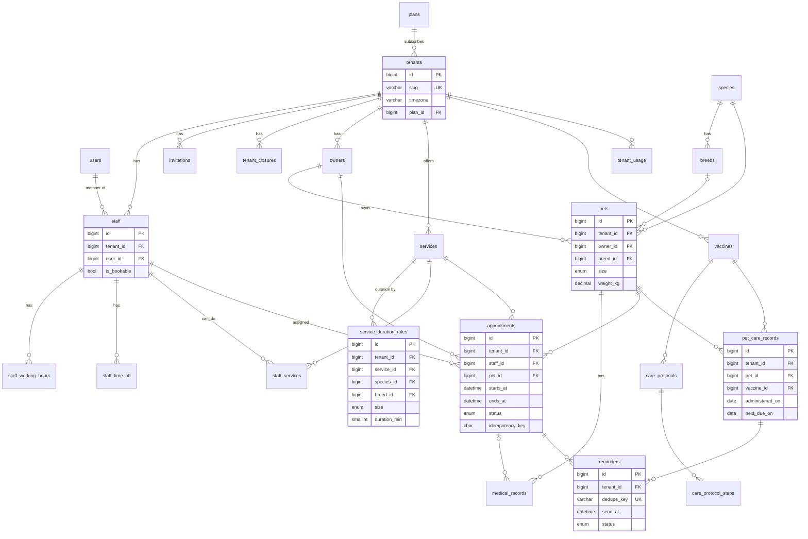

# Lược đồ DB MVP: Pet Spa & Vet Booking

MySQL 8 (InnoDB, utf8mb4), một DB dùng chung, phân tách bằng `tenant_id`.

**Quy ước chung**
- PK `BIGINT UNSIGNED AUTO_INCREMENT`. Bảng lộ ra URL công khai (`appointments`, `owners`) thêm `public_id CHAR(26)` (ULID) để tránh dò ID tuần tự.
- Mọi thời điểm lưu `DATETIME` theo **UTC** (không dùng `TIMESTAMP`: bị convert theo session tz và giới hạn 2038). Giờ "đồng hồ treo tường" (ca làm việc) lưu `TIME` + timezone của tenant.
- Bảng tenant: mọi index ghép **bắt đầu bằng `tenant_id`**; mọi unique nghiệp vụ đều kèm `tenant_id`.
- FK giữa hai bảng tenant dùng **FK ghép `(tenant_id, x_id)` → `(tenant_id, id)`** (mỗi bảng tenant có `UNIQUE(tenant_id, id)`). Lý do: FK đơn chỉ đảm bảo bản ghi tồn tại, không đảm bảo cùng tenant; FK ghép chặn rò rỉ ngay ở tầng DB.
- `deleted_at` (soft delete) cho `owners`, `pets`, `services`, `staff`: lịch sử hẹn/y tế không được mất tham chiếu.

---

## 1. Danh sách bảng

### 1.1 Bảng dùng chung toàn hệ thống (không có `tenant_id`)

| Bảng | Cột chính | Index / ghi chú |
|---|---|---|
| `tenants` | id, public_id, name, `slug VARCHAR(63)`, `timezone VARCHAR(64)` (IANA, vd `Asia/Ho_Chi_Minh`), `locale`, `currency CHAR(3)`, plan_id FK, stripe_id, trial_ends_at, status ENUM(active,suspended), created_at | UNIQUE(slug), UNIQUE(stripe_id). Chính là "gốc" tenant. |
| `users` | id, name, `email VARCHAR(191)`, password, email_verified_at, last_tenant_id | UNIQUE(email). User là danh tính toàn cục: 1 người có thể làm ở nhiều tiệm. |
| `plans` | id, code, name, `max_staff SMALLINT`, `max_appointments_per_month INT`, stripe_price_id, features JSON | UNIQUE(code) |
| `species` | id, code (dog, cat…), name | UNIQUE(code). Seed sẵn. |
| `breeds` | id, species_id FK, name, `default_size ENUM(xs,s,m,l,xl)` | UNIQUE(species_id, name). Catalog chung, tenant không sửa. |
| `stripe_webhook_events` | id, `event_id VARCHAR(255)`, type, payload JSON, processed_at | UNIQUE(event_id) → webhook idempotent. |
| `subscriptions`, `subscription_items` | Bảng của Cashier, billable = `tenants` (cột `tenant_id` ở đây là owner của subscription, không phải scope dữ liệu) | Theo Cashier. |
| `roles`, `permissions`, `model_has_roles`… | spatie/laravel-permission bật **teams mode**, `team_id = tenant_id` | `permissions` chung; `roles` có thể chung (owner, vet, groomer, receptionist) với `team_id NULL`; gán role theo `team_id`. |
| `jobs`, `failed_jobs`, `cache`, `sessions` | Hạ tầng Laravel | Payload job tự mang `tenant_id`. |

### 1.2 Bảng có `tenant_id`

Tất cả có `tenant_id BIGINT UNSIGNED NOT NULL` FK → `tenants.id`, `created_at/updated_at`, và `UNIQUE(tenant_id, id)`.

**Nhân sự & lịch làm việc**

| Bảng | Cột chính | Index |
|---|---|---|
| `staff` (membership) | id, tenant_id, user_id FK, `display_name`, `is_bookable BOOL`, `color`, status ENUM(active,disabled), deleted_at | UNIQUE(tenant_id, user_id); IDX(tenant_id, is_bookable, status). Là bảng nối user↔tenant, đồng thời là **hàng bị khóa** khi đặt lịch (mục 5). |
| `invitations` | id, tenant_id, email, role, `token_hash CHAR(64)`, invited_by FK staff, expires_at, accepted_at | UNIQUE(token_hash); IDX(tenant_id, email) |
| `staff_working_hours` | id, tenant_id, staff_id, `weekday TINYINT` (0-6), `start_time TIME`, `end_time TIME`, effective_from DATE NULL, effective_to DATE NULL | IDX(tenant_id, staff_id, weekday). Cho phép nhiều dòng/ngày (ca gãy). |
| `staff_time_off` | id, tenant_id, staff_id, `starts_at DATETIME`, `ends_at DATETIME` (UTC), reason, created_by | IDX(tenant_id, staff_id, starts_at) |
| `tenant_closures` | id, tenant_id, `date DATE` (ngày local), reason | UNIQUE(tenant_id, date) |

**Khách hàng & thú cưng**

| Bảng | Cột chính | Index |
|---|---|---|
| `owners` | id, public_id, tenant_id, name, `phone VARCHAR(20)` (E.164), email NULL, telegram_chat_id NULL, notes, deleted_at | UNIQUE(tenant_id, phone); IDX(tenant_id, name); UNIQUE(public_id) |
| `pets` | id, tenant_id, owner_id, species_id FK (global), breed_id FK NULL (global), name, sex, `birth_date DATE NULL`, `weight_kg DECIMAL(5,2)`, `size ENUM(xs,s,m,l,xl)`, is_neutered, allergies TEXT, deleted_at | IDX(tenant_id, owner_id); FK ghép (tenant_id, owner_id) |
| `medical_records` | id, tenant_id, pet_id, appointment_id NULL, vet_staff_id, diagnosis, treatment, notes, recorded_at | IDX(tenant_id, pet_id, recorded_at). Quyền sửa: chỉ vet (Policy). |

**Dịch vụ**

| Bảng | Cột chính | Index |
|---|---|---|
| `services` | id, tenant_id, name, category ENUM(grooming,medical,boarding), `default_duration_min SMALLINT`, `buffer_min SMALLINT` (dọn dẹp sau ca), `default_price DECIMAL(12,2)`, is_public, is_active, deleted_at | IDX(tenant_id, is_active) |
| `service_duration_rules` | id, tenant_id, service_id, species_id NULL, breed_id NULL, size ENUM NULL, `duration_min`, `price DECIMAL(12,2) NULL`, `priority TINYINT` | UNIQUE(tenant_id, service_id, species_id, breed_id, size) |
| `staff_services` | tenant_id, staff_id, service_id | PK(staff_id, service_id); IDX(tenant_id, service_id). Ai làm được dịch vụ gì (phục vụ "bất kỳ nhân viên"). |

**Lịch hẹn**

| Bảng | Cột chính | Index |
|---|---|---|
| `appointments` | id, public_id, tenant_id, owner_id, pet_id, service_id, staff_id, `starts_at DATETIME`, `ends_at DATETIME` (đã cộng buffer), `duration_min` + `price` (**snapshot** tại lúc đặt), status ENUM(pending,confirmed,checked_in,completed,cancelled,no_show), source ENUM(staff,portal), `idempotency_key CHAR(36) NULL`, cancelled_at, notes | **IDX(staff_id, starts_at, ends_at, status)**: kiểm tra chồng lịch. IDX(tenant_id, starts_at): lịch theo ngày của tiệm. IDX(tenant_id, pet_id, starts_at): lịch sử pet + check trùng pet. UNIQUE(tenant_id, idempotency_key): chống double-submit. UNIQUE(public_id). |

Snapshot `duration_min`/`price`: đổi quy tắc dịch vụ sau này không được làm "dịch chuyển" lịch hẹn đã đặt.

**Tiêm phòng / tẩy giun**

| Bảng | Cột chính | Index |
|---|---|---|
| `vaccines` | id, tenant_id, name, `kind ENUM(vaccine,dewormer)`, species_id, manufacturer | IDX(tenant_id, species_id). Theo tenant vì mỗi phòng khám dùng hãng/loại khác nhau (có thể seed từ mẫu chung). |
| `care_protocols` | id, tenant_id, name, species_id, vaccine_id, is_active | IDX(tenant_id, species_id) |
| `care_protocol_steps` | id, tenant_id, protocol_id, `step_no TINYINT`, `min_age_days SMALLINT NULL`, `offset_days SMALLINT` (cách mũi trước), `is_recurring BOOL`, `repeat_every_days SMALLINT NULL` | UNIQUE(protocol_id, step_no) |
| `pet_care_records` | id, tenant_id, pet_id, protocol_id NULL, vaccine_id, step_no, `administered_on DATE`, administered_by staff_id, batch_no, `next_due_on DATE NULL`, `superseded_at DATETIME NULL` | IDX(tenant_id, pet_id, vaccine_id); **IDX(next_due_on, superseded_at)** cho scheduler quét toàn hệ thống. |

**Nhắc hẹn / thông báo**

| Bảng | Cột chính | Index |
|---|---|---|
| `reminders` | id, tenant_id, `remindable_type/id` (appointment hoặc pet_care_record), channel ENUM(email,telegram,zalo), `send_at DATETIME`, status ENUM(pending,sent,failed,skipped), attempts, sent_at, last_error, **`dedupe_key VARCHAR(191)`** | UNIQUE(dedupe_key) (vd `appt:123:24h:email`); IDX(status, send_at) cho worker. |
| `tenant_usage` | tenant_id, `period CHAR(7)` (`2026-10`), appointments_count | PK(tenant_id, period). Đếm quota gói, tăng atomic. |

---

## 2. ERD

Ảnh render sẵn: [erd.png](erd.png)




---

## 3. Có `tenant_id` hay dùng chung?

- **Dùng chung:** `tenants`, `users`, `plans`, `species`, `breeds`, `permissions`/`roles` (spatie teams), `stripe_webhook_events`, bảng Cashier, bảng hạ tầng (`jobs`, `cache`, `sessions`).
- **Có `tenant_id`:** tất cả còn lại: `staff`, `invitations`, `staff_working_hours`, `staff_time_off`, `tenant_closures`, `owners`, `pets`, `medical_records`, `services`, `service_duration_rules`, `staff_services`, `appointments`, `vaccines`, `care_protocols`, `care_protocol_steps`, `pet_care_records`, `reminders`, `tenant_usage`.
- Bảng con (`care_protocol_steps`, `staff_services`) vẫn **lặp `tenant_id`** dù suy ra được từ cha: để global scope áp dụng đồng nhất và FK ghép hoạt động, đổi lại một cột 8 byte.

---

## 4. Mô hình hóa nghiệp vụ

### 4.1 Thời lượng dịch vụ động theo giống/cỡ
- Bảng quy tắc `service_duration_rules`, **không dùng JSON**: validate được, có FK, query được.
- Thứ tự resolve (cụ thể nhất thắng): `breed` → `species + size` → `species` → `services.default_duration_min`. Một query `ORDER BY (breed_id IS NOT NULL) DESC, (size IS NOT NULL) DESC LIMIT 1`.
- `pets.size` lưu sẵn (gợi ý từ `breeds.default_size` + `weight_kg`, nhân viên sửa được), vì cân nặng thay đổi và cỡ là quyết định nghiệp vụ, không phải công thức.
- Kết quả được **snapshot** vào `appointments.duration_min/price`; `ends_at = starts_at + duration + buffer`.

### 4.2 Lịch làm việc + ngày nghỉ nhân viên
- **Ca cố định hàng tuần**: `staff_working_hours` (weekday + `TIME` local). Lưu giờ local, không UTC: "9h sáng thứ 2" phải luôn là 9h dù đổi giờ DST.
- **Ngoại lệ**: `staff_time_off` (khoảng `DATETIME` UTC, nghỉ cả ngày hoặc vài giờ) + `tenant_closures` (ngày lễ toàn tiệm).
- **Tính slot trống** cho ngày D: ca tuần (convert sang UTC theo `tenants.timezone` cho đúng ngày D) − time_off − closures − appointments đang active → chia theo bước 15 phút với độ dài dịch vụ đã resolve. Tính trong PHP, không lưu bảng slot (tránh phải sinh/đồng bộ trước hàng triệu dòng).
- Để sau MVP: `staff_schedule_overrides` (ca đặc biệt cho 1 ngày), tài nguyên phòng/bàn grooming.

### 4.3 Phác đồ tiêm phòng / tẩy giun định kỳ
- **Mẫu** (`care_protocols` + `care_protocol_steps`) tách khỏi **thực tế** (`pet_care_records`). Vd Vaccine 7 bệnh chó: step 1 `min_age_days=42`, step 2 `offset_days=21`, step 3 `offset_days=21`, step 4 `is_recurring`, `repeat_every_days=365`. Tẩy giun: 1 step recurring 90 ngày.
- Khi ghi một mũi: tính `next_due_on` từ step kế tiếp (hoặc lặp lại) rồi lưu; đánh dấu record cũ của cùng vaccine `superseded_at` để scheduler chỉ thấy mũi mới nhất.
- Scheduler hàng ngày: `WHERE next_due_on BETWEEN today AND today+7 AND superseded_at IS NULL` (dùng index ở trên), tạo `reminders` với `dedupe_key = care:{record_id}:{offset}:{channel}` → chạy lại bao nhiêu lần cũng không nhắc trùng.
- `next_due_on` là `DATE` theo ngày local của tenant (lịch tiêm theo "ngày", không theo giờ).

---

## 5. Ba rủi ro lớn nhất

### 5.1 Race condition: double-booking
**Vấn đề:** 2 request cùng check "slot trống" rồi cùng insert. MySQL không có exclusion constraint như Postgres.

**Giảm thiểu (đề xuất):** khóa bi quan trên **một hàng `staff`**, không khóa theo range `appointments`:
```php
DB::transaction(function () use ($data) {
    Staff::whereKey($data->staffId)->lockForUpdate()->first();   // serialize theo nhân viên
    $overlap = Appointment::where('staff_id', $data->staffId)
        ->whereIn('status', Appointment::BLOCKING)
        ->where('starts_at', '<', $data->endsAt)
        ->where('ends_at', '>', $data->startsAt)
        ->exists();
    if ($overlap) throw new SlotTakenException();
    Appointment::create([...]);
});
```
- Khóa 1 hàng đã tồn tại tránh gap lock / next-key lock trên `appointments` (nguồn deadlock phổ biến ở REPEATABLE READ).
- "Nhân viên bất kỳ": thử từng nhân viên trong **transaction riêng** (lock → check → insert → commit, fail thì sang người kế), không giữ nhiều lock cùng lúc → không deadlock.
- Kiểm tra cả trùng lịch của **pet** trong cùng transaction.
- Kèm `idempotency_key` để double-click/retry không tạo 2 lịch.
- Quota gói cũng là race: `UPDATE tenant_usage SET appointments_count = appointments_count + 1 WHERE tenant_id=? AND period=? AND appointments_count < ?`, affected = 0 thì từ chối.
- Bắt buộc có **test concurrency** (bắn song song N request vào cùng slot, assert đúng 1 thành công). Đây là điểm đáng show trên CV.

Phương án thay thế: bảng `appointment_slots` với `UNIQUE(staff_id, slot_start)` theo bước 15 phút, cho đảm bảo cứng ở DB nhưng phải insert/xóa nhiều dòng và khóa cứng granularity. Để dành làm ADR so sánh.

### 5.2 Rò rỉ dữ liệu giữa tenant
**Vấn đề:** quên global scope ở 1 query, route model binding lấy ID của tenant khác, validation `exists:pets,id` không check tenant, job queue chạy không có context tenant, cache key trùng.

**Giảm thiểu:**
- Trait `BelongsToTenant`: global scope + tự gán `tenant_id` khi `creating`; ném exception nếu tạo model khi chưa có tenant context (fail closed).
- **FK ghép `(tenant_id, x_id)`** ở DB: dù code sai cũng không thể gắn pet tenant A vào owner tenant B.
- Validation: `Rule::exists('pets','id')->where('tenant_id', tenant()->id)`.
- Job implement `TenantAware` (serialize `tenant_id`, middleware set context trước khi `handle()`); scheduler lặp qua từng tenant hoặc query có chủ đích `withoutGlobalScope` và chỉ ở chỗ đó.
- Cache/lock key luôn prefix `t:{tenant_id}:`.
- `public_id` ULID cho URL công khai; Larastan rule hoặc test cấm `withoutGlobalScopes()` ngoài whitelist.
- Pest dataset test: user tenant A gọi mọi endpoint với ID của tenant B → luôn 404.

### 5.3 Timezone
**Vấn đề:** tenant ở tz khác server; giờ ca làm việc là giờ local; DST làm 1 ngày có 23/25 giờ; nhắc "9h sáng" bị lệch; `TIMESTAMP` tự convert theo session.

**Giảm thiểu:**
- `config('app.timezone') = 'UTC'`, MySQL connection `timezone => '+00:00'`, cột `DATETIME` lưu UTC.
- `tenants.timezone` (IANA). Convert UTC ↔ local **chỉ ở biên**: input form, hiển thị, tính slot, tính giờ gửi nhắc.
- Ca làm việc `TIME` local, convert theo từng ngày cụ thể (`CarbonImmutable::parse("$date $time", $tz)->utc()`), không cộng offset cố định.
- "Lịch theo ngày" của tiệm query theo khoảng UTC `[startOfDay local → UTC, endOfDay local → UTC)`, không dùng `DATE(starts_at)`.
- Test với tz có DST (`America/New_York`) dù khách chính ở VN.

---

## Gợi ý ADR
1. Một DB + `tenant_id` + FK ghép (vs DB riêng mỗi tenant).
2. Chống double-booking bằng lock hàng `staff` (vs bảng slot unique).
3. Lưu UTC `DATETIME` + giờ ca local `TIME`.
