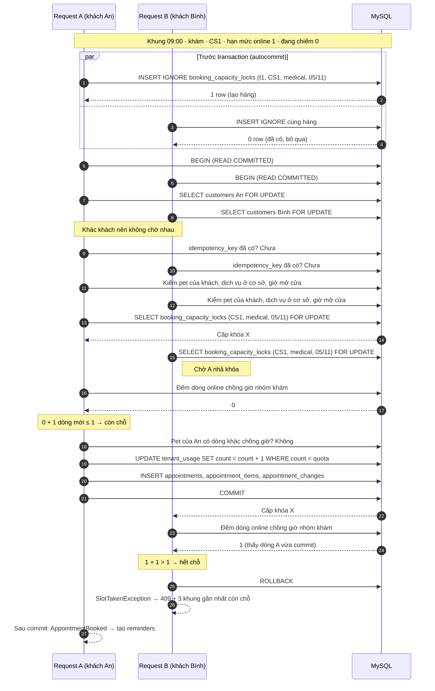
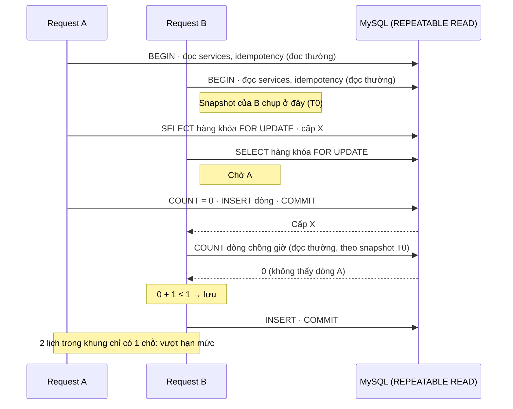
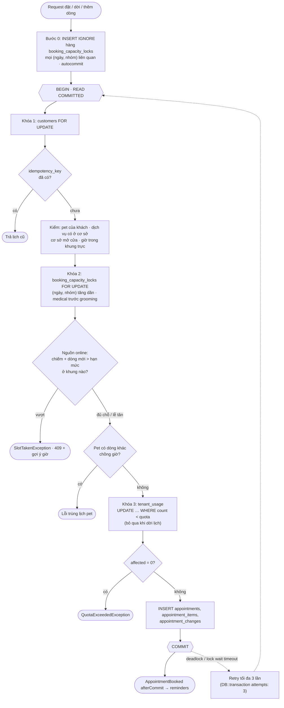

# Sơ đồ đặt lịch đồng thời (chống vượt hạn mức online)

Minh họa cho `design/db-schema.md` mục 5.1 và `design/adr/0002-booking-capacity-lock.md`. Action `BookAppointment` dùng chung cho Site và lễ tân. Bản xem trực quan: `design/so-do-dat-lich.html`.

> **Lưu ý:** sơ đồ 1 và 4 vẽ theo **2 đề xuất trong ADR-0002 đang chờ xác nhận**: (a) transaction chạy `READ COMMITTED`, (b) kiểm `idempotency_key` sau khi khóa `customers`. Lý do ở sơ đồ 3.

---

## 1. Hai khách cùng đặt vào khung còn 1 chỗ

Khung 09:00 nhóm khám ở CS1 có 3 bác sĩ trực, tỉ lệ online 1/3, nên hạn mức online = floor(3 × 1/3) = 1 chỗ. Hiện chưa có lịch nào.

Điểm cần thấy:
- Chỉ **một hàng** bị khóa cho cả ngày × nhóm × cơ sở. Không khóa dải `appointment_items`, nên không có gap lock.
- Hai khách khác nhau chỉ chờ nhau ở hàng khóa hạn mức. Cùng khách thì chờ nhau từ hàng `customers` (chặn 1 pet bị đặt 2 lịch chồng giờ ở 2 nhóm khác nhau).
- `tenant_usage` là hàng nóng của cả shop nên khóa **cuối cùng**, giữ ngắn nhất.
- Lễ tân đặt (`source=staff`) đi cùng đường nhưng không bị chặn ở bước đếm; vượt số người trực thì chỉ trả cờ cảnh báo.

---

## 2. Vì sao không `INSERT IGNORE` hàng khóa trong transaction

Hàng khóa đã tồn tại từ trước. Nếu `INSERT IGNORE` nằm trong transaction, bản ghi trùng làm InnoDB đặt khóa **S** lên hàng đó.

Cách chặn: `INSERT IGNORE` chạy **autocommit trước** transaction. Khóa S nhả ngay khi câu lệnh xong. Trong transaction chỉ còn `SELECT … FOR UPDATE`.

---

## 3. Lỗ hổng nếu giữ REPEATABLE READ (lý do của đề xuất a)

InnoDB ở REPEATABLE READ (mặc định) chụp snapshot ở **câu đọc thường đầu tiên** trong transaction, không phải lúc lấy khóa. `SELECT … FOR UPDATE` đọc bản mới nhất, nhưng câu `COUNT` đếm chỗ là đọc thường, nên vẫn đọc theo snapshot cũ.

Mục 5.1 hiện tại có bước 1 (kiểm idempotency) và bước 2 (kiểm dịch vụ, giờ mở cửa) đều là đọc thường, nằm **trước** bước khóa 3. Nên lỗi này xảy ra thật. Test 20 tiến trình có thể bắt được, nhưng chập chờn tùy thời điểm.

Cách chặn (đề xuất a trong ADR-0002): đặt `isolation_level = READ COMMITTED` cho kết nối MySQL của app (Laravel `config/database.php`, khóa `isolation_level`). Ở READ COMMITTED mỗi câu đọc thường lấy snapshot mới, nên câu đếm chạy sau khi có khóa luôn thấy dữ liệu đã commit. Đặt ở mức kết nối, không dùng `SET TRANSACTION` trước `DB::transaction()`, vì `SET TRANSACTION` chỉ áp cho **một** transaction kế tiếp, lần retry do deadlock sẽ quay lại REPEATABLE READ.

---

## 4. Thứ tự các bước và chỗ khóa

Dời lịch sang ngày hoặc nhóm khác: bước 0 tạo hàng cho cả (ngày, nhóm) cũ và mới, bước khóa 2 khóa tất cả theo (ngày, nhóm) tăng dần, nên 2 lần dời chéo ngày đồng thời không deadlock.
