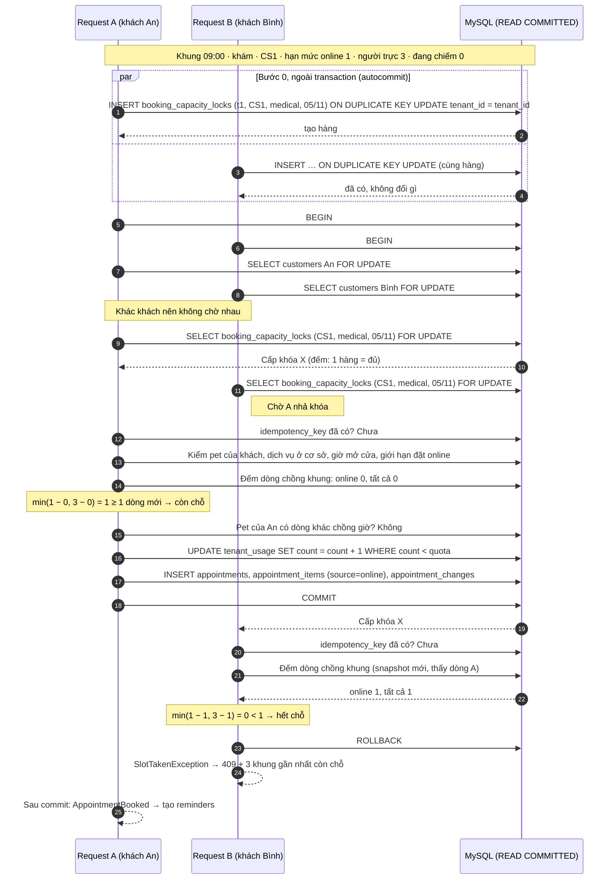
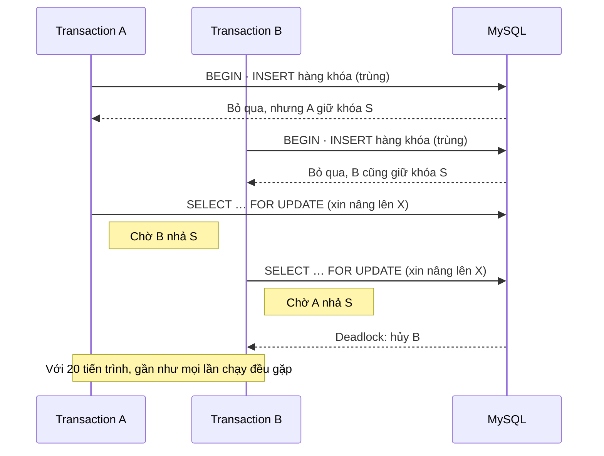
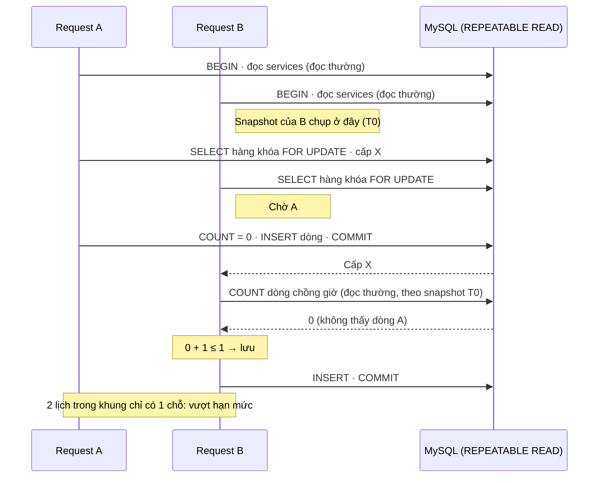
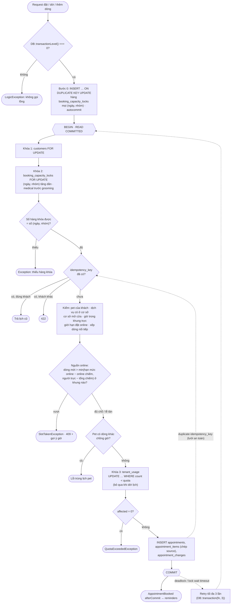

# Sơ đồ đặt lịch đồng thời (chống vượt hạn mức online)

Minh họa cho `docs/database/db-schema.md` mục 5.1 và `docs/adr/0002-booking-capacity-lock.md`. Action `BookAppointment` dùng chung cho Site và lễ tân. Bản xem trực quan: `docs/design/so-do-dat-lich.html`.

> **Đã chốt (27/10/2026):** kết nối MySQL chạy `READ COMMITTED` (ADR-0002 a); kiểm `idempotency_key` sau khi khóa `customers` và khóa hạn mức (ADR-0002 b); chỗ online còn = `min(hạn mức online − dòng online đang chiếm, người trực − tổng dòng đang chiếm)`; pet vừa khám vừa spa trong một lịch chạy nối tiếp (mặc định khám trước). Nguyên tắc: **khóa trước, đọc sau**.

---

## 1. Hai khách cùng đặt vào khung còn 1 chỗ

Khung 09:00 nhóm khám ở CS1 có 3 bác sĩ trực, tỉ lệ online 1/3, nên hạn mức online = floor(3 × 1/3) = 1 chỗ. Hiện chưa có lịch nào.

Điểm cần thấy:
- Chỉ **một hàng** bị khóa cho cả ngày × nhóm × cơ sở. Không khóa dải `appointment_items`, nên không có gap lock.
- Mọi câu đọc dùng để quyết định (idempotency, đếm chỗ, chồng giờ pet) chạy **sau** khi đã giữ khóa.
- Hai khách khác nhau chỉ chờ nhau ở hàng khóa hạn mức. Cùng khách thì chờ nhau từ hàng `customers` (chặn 1 pet bị đặt 2 lịch chồng giờ ở 2 nhóm khác nhau, và chặn 2 request trùng `idempotency_key`).
- `tenant_usage` là hàng nóng của cả shop nên khóa **cuối cùng**, giữ ngắn nhất.
- Lễ tân đặt (`source=staff`) đi cùng đường nhưng không bị chặn ở bước đếm; vượt số người trực thì chỉ trả cờ cảnh báo. Dòng lễ tân vẫn làm giảm chỗ online qua vế `người trực − tổng dòng`.

---

## 2. Vì sao tạo hàng khóa ngoài transaction, và không dùng `INSERT IGNORE`

Nếu câu tạo hàng nằm **trong** transaction, bản ghi trùng làm InnoDB đặt khóa **S** lên hàng đó.

Cách chặn:
- Bước 0 chạy **autocommit trước** `DB::transaction`; code assert `DB::transactionLevel() === 0` để không ai gọi lồng trong transaction khác. Khóa của câu INSERT nhả ngay khi câu lệnh xong. Trong transaction chỉ còn `SELECT … FOR UPDATE`.
- Dùng `INSERT … ON DUPLICATE KEY UPDATE tenant_id = tenant_id`, không dùng `INSERT IGNORE`: `INSERT IGNORE` biến cả lỗi FK (branch của shop khác) thành cảnh báo, câu lệnh "thành công" mà không có hàng.
- Sau `SELECT … FOR UPDATE`, **đếm số hàng khóa được**; thiếu (hàng bị xóa, sai tham số) thì ném exception thay vì chạy tiếp mà không có khóa.

---

## 3. Lỗ hổng nếu giữ REPEATABLE READ (lý do chọn READ COMMITTED)

InnoDB ở REPEATABLE READ (mặc định) chụp snapshot ở **câu đọc thường đầu tiên** trong transaction, không phải lúc lấy khóa. `SELECT … FOR UPDATE` đọc bản mới nhất, nhưng câu `COUNT` đếm chỗ là đọc thường, nên vẫn đọc theo snapshot cũ.

Chỉ cần một câu đọc thường bất kỳ chạy trước khi lấy khóa (model binding, kiểm quyền, middleware, hay chính code của Action) là lỗi xảy ra. Sắp xếp "khóa trước, đọc sau" giảm rủi ro nhưng không đủ, vì không kiểm soát được mọi câu đọc trước đó trong cùng transaction.

Cách chặn: `isolation_level = READ COMMITTED` ở kết nối MySQL của app (`config/database.php`). Ở READ COMMITTED mỗi câu đọc thường lấy snapshot mới, nên câu đếm chạy sau khi có khóa luôn thấy dữ liệu đã commit. Đặt ở mức kết nối, không dùng `SET TRANSACTION` trước `DB::transaction()`, vì `SET TRANSACTION` chỉ áp cho **một** transaction kế tiếp, lần retry do deadlock sẽ quay lại REPEATABLE READ. Server cần `binlog_format=ROW` (mặc định MySQL 8.4).

Test giữ lâu dài: chạy đúng kịch bản trên bằng 2 kết nối, một kết nối RR (test chứng minh vượt hạn mức) và một kết nối RC (đúng hạn mức).

---

## 4. Thứ tự các bước và chỗ khóa

Dời lịch sang ngày hoặc nhóm khác: bước 0 tạo hàng cho cả (ngày, nhóm) cũ và mới, bước khóa 2 khóa tất cả theo (ngày, nhóm) tăng dần, nên 2 lần dời chéo ngày đồng thời không deadlock.

Pet vừa khám vừa spa trong một lịch: hai dòng xếp nối tiếp (mặc định khám trước, spa bắt đầu khi khám kết thúc), mỗi dòng có `starts_at` riêng và được đếm ở khung của chính nó. Nếu hai dòng rơi vào 2 ngày khác nhau (khám sát nửa đêm) thì bước 0 và khóa 2 gồm cả hai ngày.
