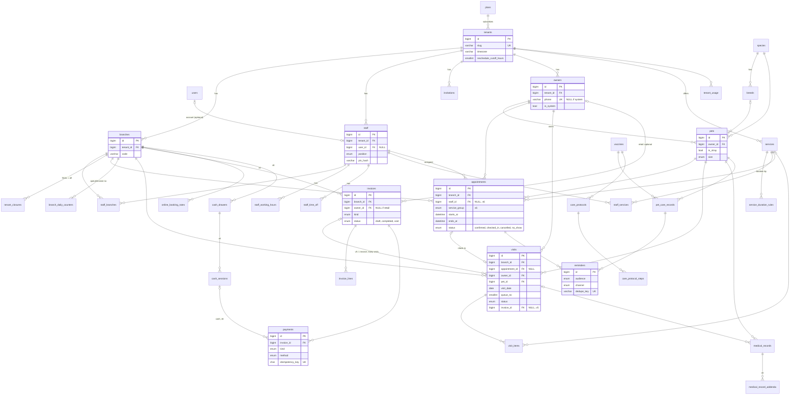
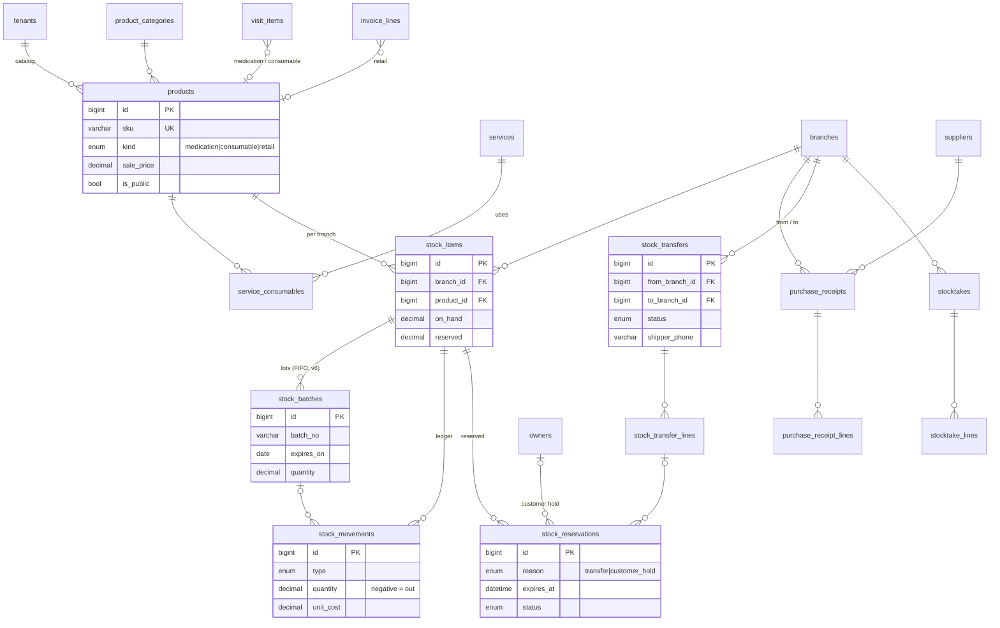
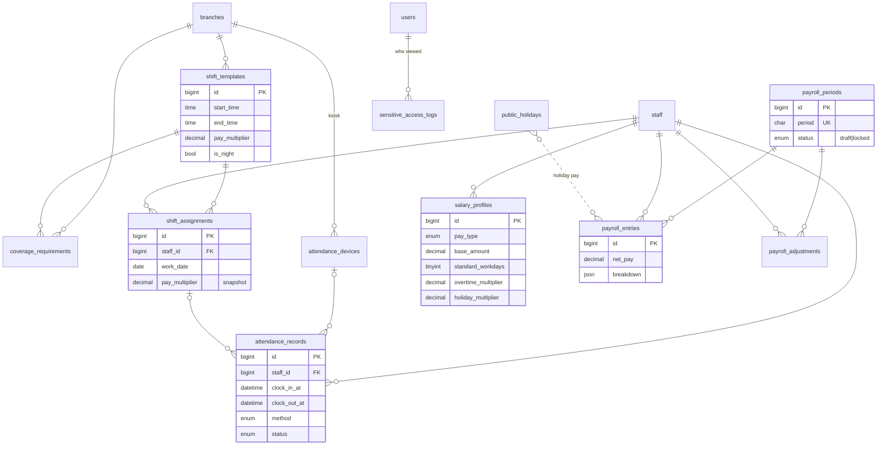
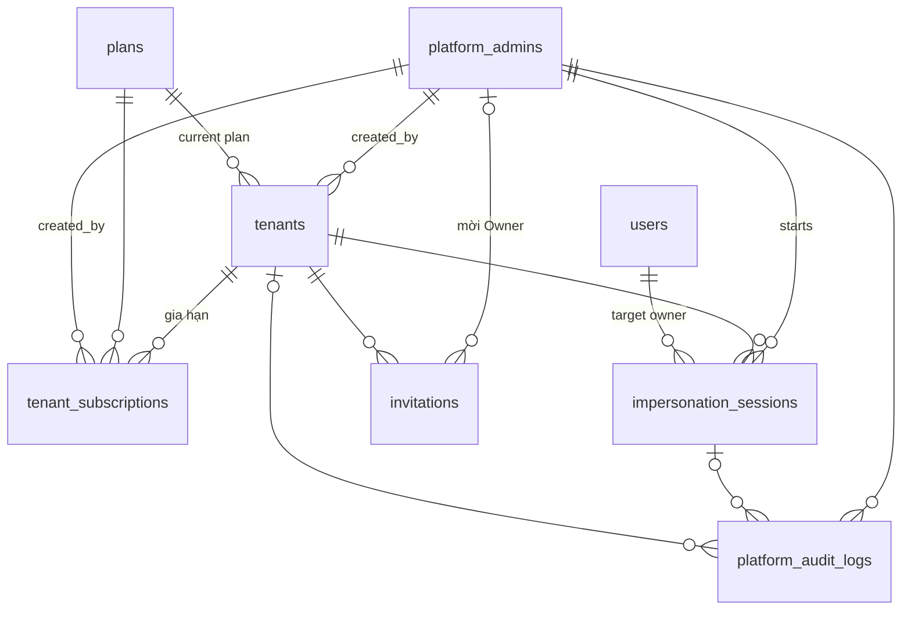

# Lược đồ DB: Pet Spa & Vet Booking

MySQL 8 (InnoDB, utf8mb4), một DB dùng chung, phân tách bằng `tenant_id`.

> **v2 (17/10/2026), theo nghiệp vụ chủ tiệm mô tả.** Thêm: đa chi nhánh, tiếp nhận + hàng đợi + lượt khám, hóa đơn & thanh toán (**MVP**); kho, thuốc theo lô, bán hàng, điều chuyển giữa chi nhánh (**Giai đoạn 2**); xếp ca, chấm công, lương (**Giai đoạn 3**). Bảng mới ở mục 1.3-1.5, nghiệp vụ ở 4.4-4.8, rủi ro mới ở 5.4-5.5. Những chỗ đánh dấu **[Mặc định, cần xác nhận]** là lựa chọn tạm, sửa được. ERD vẽ lại thành 3 ảnh ở mục 2.

> **v3 (17/10/2026): quản trị nền tảng (super-admin).** Thêm khu `/admin` trong **cùng app Laravel**; thứ tự đã chốt: **admin có trước, admin tạo shop**, không có tự đăng ký. Admin dùng để tạo shop, tạo tài khoản Owner, gán gói + hạn dùng, tạm khóa, đăng nhập thay (impersonate) có log. Bảng mới ở mục 1.6, nghiệp vụ 4.9, rủi ro 5.6, ERD 2.4. Chỗ mới đánh dấu **(v3)**; **[Mặc định, cần xác nhận]** như v2.

> **v4 (19/10/2026): lô & cận date cho mọi hàng có HSD (không chỉ thuốc), quy đổi thùng/gói.** Vẫn thuộc **Giai đoạn 2**. Sửa `products`, `stock_batches`, `stock_movements`, `purchase_receipt_lines`, thêm `product_units` (mục 1.4); nghiệp vụ 4.7 (khối "Lô & cận date"); rủi ro 5.4. Chỗ mới đánh dấu **(v4)**. ERD ảnh chưa vẽ lại.

> **v5 (19/10/2026): theo bản tổng hợp nghiệp vụ user đã trao đổi lại** (`analysis/doi-chieu-nghiep-vu-chatgpt.md`, 22 điểm, user chọn bản mới cho mọi điểm). Chính: hóa đơn `draft` → `completed`, mở nháp ngay khi tiếp nhận, một hóa đơn gom nhiều thú cưng, in nháp "Tạm tính"; bán lẻ được thuốc không kê đơn; combo dịch vụ + mã dịch vụ; vật tư tiêu hao theo lượng thực tế (định mức chỉ gợi ý); lãi gộp lấy giá vốn từ sổ kho; phương pháp giá vốn **chưa chốt**; trả hàng; nhật ký thao tác trong shop; chứng chỉ bác sĩ; nhân viên đăng ký ca; chấm công trên CMS; lương theo đơn giá ca; người được ủy quyền xem lương; địa chỉ khách + thành viên/tích điểm; trang Điều khoản; lưu chuồng ra khỏi V1. Chỗ mới đánh dấu **(v5)**; **[Cần nghiên cứu]** = nghiệp vụ đã nêu nhưng chưa chốt cách làm, không được tự chốt khi code. Giai đoạn giữ như cũ (MVP / GĐ2 / GĐ3). ERD ảnh chưa vẽ lại.

> **v6 (20/10/2026): nghiệp vụ user chốt nhóm 1–14** (`analysis/so-do-nghiep-vu/nghiep-vu-da-chot.md`, ma trận quyền ở sơ đồ 9 của `so-do-nghiep-vu.html`; đối chiếu `analysis/mau-thuan-tai-lieu-v5.md`). Chính: **7 role mẫu**, Owner quản lý role, một người nhiều role; bệnh án: bác sĩ xem đầy đủ, lễ tân/spa chỉ cảnh báo, có **số hồ sơ** + dòng chi tiết theo lượt, người lập sửa trong 24h, ghi chú nội bộ không hiện Site, đính kèm file; lịch hẹn chỉ để tham khảo: **bỏ `pending`, `completed`**, lịch online không gán người, **hạn mức đặt online = floor(số người trực × tỉ lệ)** theo cơ sở × nhóm (thay khóa hàng `staff`), tự đánh dấu không đến cuối ngày, giá trên lịch là giá tham khảo; lượt khám **độc lập hóa đơn** (bỏ `invoiced`), cấp cứu chen đầu hàng đợi; hóa đơn không cọc, không nợ, **không giảm giá tay**, có dòng gõ tay, lễ tân/thu ngân hủy nháp có lý do, Owner sửa hóa đơn hoàn tất = hủy + bản thay thế; **ca thu ngân theo két** (MVP); trả hàng kiểm tay 3 tình trạng, hạn 7 ngày; thuốc + vật tư trừ kho khi hoàn tất lượt; **thành viên/tích điểm sau V1**; nhắc khách qua **Zalo ZNS + SMS** (bỏ email, Telegram); khách tự hủy/dời trước 24h. Chỗ sửa ghi **(v6)**. Kho (15.1, 15.2, 16.1): **xuất FIFO theo lô nhập** (thay FEFO v4/v5), giá vốn = giá lô xuất, chỉ Owner xem; giá bán một giá hiện hành; phiếu nhập 2 bước (kho lập không thấy giá, cộng tồn ngay → Owner điền giá); phiếu hao hụt chờ duyệt. Không còn câu hỏi mở từ thread sơ đồ.

**Quy ước chung**
- PK `BIGINT UNSIGNED AUTO_INCREMENT`. Bảng lộ ra URL công khai (`appointments`, `owners`) thêm `public_id CHAR(26)` (ULID) để tránh dò ID tuần tự.
- Mọi thời điểm lưu `DATETIME` theo **UTC** (không dùng `TIMESTAMP`: bị convert theo session tz và giới hạn 2038). Giờ "đồng hồ treo tường" (ca làm việc) lưu `TIME` + timezone của tenant.
- Bảng tenant: mọi index ghép **bắt đầu bằng `tenant_id`**; mọi unique nghiệp vụ đều kèm `tenant_id`.
- FK giữa hai bảng tenant dùng **FK ghép `(tenant_id, x_id)` → `(tenant_id, id)`** (mỗi bảng tenant có `UNIQUE(tenant_id, id)`). Lý do: FK đơn chỉ đảm bảo bản ghi tồn tại, không đảm bảo cùng tenant; FK ghép chặn rò rỉ ngay ở tầng DB.
- `deleted_at` (soft delete) cho `owners`, `pets`, `services`, `staff`, `branches`, `products`: lịch sử hẹn/y tế/hóa đơn không được mất tham chiếu.
- **Chi nhánh không phải ranh giới cô lập như tenant.** `branch_id` có FK ghép `(tenant_id, branch_id)` → `branches(tenant_id, id)`, nhưng **không** có global scope fail-closed: nhân viên chi nhánh 1 được tra tồn kho chi nhánh 2. Lọc theo chi nhánh làm ở query + Policy (chi nhánh đang chọn trong session), không làm ở global scope.
- Tiền: `DECIMAL(12,2)`, không float. Số lượng tồn kho: `DECIMAL(12,3)` (thuốc tính theo ml/viên lẻ).

---

## 1. Danh sách bảng

### 1.1 Bảng dùng chung toàn hệ thống (không có `tenant_id`)

| Bảng | Cột chính | Index / ghi chú |
|---|---|---|
| `tenants` | id, public_id, name, `slug VARCHAR(63)`, `timezone VARCHAR(64)` (IANA, vd `Asia/Ho_Chi_Minh`), `locale`, `currency CHAR(3)`, plan_id FK, stripe_id (sau MVP), status (v3: enum mới + `plan_expires_at`, thay `trial_ends_at`, xem 1.6), `reschedule_cutoff_hours SMALLINT` (khách tự dời lịch phải trước giờ hẹn ít nhất N giờ, mặc định 24), `cancel_cutoff_hours SMALLINT` ((v6) mặc định 24), `default_tax_rate DECIMAL(5,2)`, (v6) `return_window_days SMALLINT` (hạn trả hàng, mặc định 7), (v5) `terms_content MEDIUMTEXT NULL` + `terms_updated_at` (trang Điều khoản sử dụng trên Site, Owner soạn), created_at | UNIQUE(slug), UNIQUE(stripe_id). Chính là "gốc" tenant = **một chủ** (có thể nhiều chi nhánh). Timezone đặt ở tenant: mọi chi nhánh cùng múi giờ ((v6) đã chốt). |
| `users` | id, name, `email VARCHAR(191)`, password, email_verified_at, last_tenant_id | UNIQUE(email). User là danh tính toàn cục: 1 người có thể làm ở nhiều tiệm. |
| `plans` | id, code, name, `max_staff SMALLINT`, `max_appointments_per_month INT`, stripe_price_id, features JSON | UNIQUE(code) |
| `species` | id, code (dog, cat…), name | UNIQUE(code). Seed sẵn. |
| `breeds` | id, species_id FK, name, `default_size ENUM(xs,s,m,l,xl)` | UNIQUE(species_id, name). Catalog chung, tenant không sửa. |
| `stripe_webhook_events` | id, `event_id VARCHAR(255)`, type, payload JSON, processed_at | UNIQUE(event_id) → webhook idempotent. |
| `subscriptions`, `subscription_items` | Bảng của Cashier, billable = `tenants` (cột `tenant_id` ở đây là owner của subscription, không phải scope dữ liệu) | Theo Cashier. |
| `roles`, `permissions`, `model_has_roles`… | spatie/laravel-permission bật **teams mode**, `team_id = tenant_id` | `permissions` chung. (v6) `roles` **theo tenant** (`team_id = tenant_id`): khi tạo shop sinh sẵn **7 role mẫu** `owner` (Chủ shop), `branch_manager` (Quản lý chi nhánh), `receptionist` (Lễ tân), `cashier` (Thu ngân), `vet` (Bác sĩ), `groomer` (Nhân viên spa), `inventory` (Nhân viên kho) theo ma trận quyền (design.md mục 13); Owner sửa quyền từng role và tạo role mới. **Một người nhiều role thì cộng quyền** (vd Owner kiêm bác sĩ = `owner` + `vet`). Role `owner` không sửa/xóa được. |
| `jobs`, `failed_jobs`, `cache`, `sessions` | Hạ tầng Laravel | Payload job tự mang `tenant_id`. |

### 1.2 Bảng có `tenant_id`

Tất cả có `tenant_id BIGINT UNSIGNED NOT NULL` FK → `tenants.id`, `created_at/updated_at`, và `UNIQUE(tenant_id, id)`.

**Nhân sự & lịch làm việc**

| Bảng | Cột chính | Index |
|---|---|---|
| `branches` | id, public_id, tenant_id, `code VARCHAR(20)`, name, address, phone, `allowed_ips JSON NULL` (IP/WiFi tiệm, cho chấm công GĐ3), is_active, deleted_at | UNIQUE(tenant_id, code). MVP UI chỉ cần 1 chi nhánh, nhưng mọi bảng vận hành có `branch_id` ngay từ đầu (thêm sau rất đắt: backfill + đổi index). |
| `staff` (hồ sơ nhân viên) | id, tenant_id, `user_id FK NULL`, `home_branch_id`, `display_name`, phone, `position ENUM(vet,groomer,receptionist,assistant,security,cleaner,other)`, `is_bookable BOOL`, `color`, `pin_hash VARCHAR(255) NULL` (PIN chấm công), status ENUM(active,disabled), deleted_at, (v5) `license_no VARCHAR(50) NULL`, `qualifications TEXT NULL` (bằng cấp, chứng chỉ hành nghề; chỉ bắt buộc nhập với `position = vet` ở form, spa/groomer không cần) | UNIQUE(tenant_id, user_id); IDX(tenant_id, is_bookable, status). **Nhân viên ≠ tài khoản**: bảo vệ, lao công có `user_id NULL`, chấm công bằng PIN (v5: người có tài khoản chấm trên CMS, xem 4.8). (v6) **Quyền lấy theo role**, không theo `position`; `position` chỉ để hiển thị, phủ ca và cho nhân viên không tài khoản. `home_branch_id` = cơ sở chính, `staff_branches` = cơ sở chính + phụ do Owner gán. (v6) Không còn là hàng bị khóa khi đặt lịch (khóa theo hạn mức, mục 5.1). |
| `staff_branches` | tenant_id, staff_id, branch_id | PK(staff_id, branch_id); IDX(tenant_id, branch_id). Nhân viên làm được ở chi nhánh nào. |
| `invitations` | id, tenant_id, email, role ((v6) role chính; Owner thêm role khác sau khi nhận), `token_hash CHAR(64)`, `invited_by` FK staff **NULL**, (v3) `invited_by_admin_id` FK platform_admins NULL, expires_at, accepted_at, revoked_at | UNIQUE(token_hash); IDX(tenant_id, email). (v3) Dùng cho cả Owner (admin mời khi tạo shop, role `owner`) lẫn nhân viên (Owner mời); CHECK đúng một trong `invited_by` / `invited_by_admin_id`. |
| `staff_working_hours` | id, tenant_id, staff_id, branch_id, `weekday TINYINT` (0-6), `start_time TIME`, `end_time TIME`, effective_from DATE NULL, effective_to DATE NULL | IDX(tenant_id, staff_id, weekday). Cho phép nhiều dòng/ngày (ca gãy). Từ GĐ3, ngày nào có `shift_assignments` thì availability lấy theo ca được xếp, bảng này là ca mặc định. (v6) Là nguồn **đếm số người trực** theo cơ sở × nhóm (vet → khám/tiêm, groomer → spa) cho hạn mức đặt online (4.11); trừ người có `staff_time_off`. Một người không có 2 khung chồng giờ ở 2 cơ sở (kiểm ở Action). |
| `staff_time_off` | id, tenant_id, staff_id, `starts_at DATETIME`, `ends_at DATETIME` (UTC), reason, created_by | IDX(tenant_id, staff_id, starts_at) |
| `tenant_closures` | id, tenant_id, `branch_id NULL` (NULL = cả chuỗi), `date DATE` (ngày local), reason | UNIQUE(tenant_id, branch_id, date) |

**Khách hàng & thú cưng**

| Bảng | Cột chính | Index |
|---|---|---|
| `owners` | id, public_id, tenant_id, name, `phone VARCHAR(20) NULL` (E.164), email NULL, (v5) `address VARCHAR(255) NULL` (chỉ mức cần để liên hệ/giao nhận; không thu CCCD), (v6) bỏ `telegram_chat_id`, `zalo_user_id` (ZNS gửi theo SĐT), `is_system BOOL`, `system_branch_id NULL`, (v5) `is_member BOOL` + `member_since DATE NULL` ((v6) **sau V1**: V1 không có thành viên/tích điểm, chưa tạo cột), notes, deleted_at | UNIQUE(tenant_id, phone); UNIQUE(tenant_id, system_branch_id); IDX(tenant_id, name); UNIQUE(public_id). **SĐT là khóa khách, dùng chung mọi chi nhánh.** `phone` chỉ NULL với hồ sơ hệ thống "Thú hoang/vô chủ" (mỗi chi nhánh một, `is_system=1`); CHECK `phone IS NOT NULL OR is_system = 1`. MySQL cho nhiều NULL trong UNIQUE nên không đụng unique SĐT. |
| `pets` | id, tenant_id, owner_id, species_id FK (global), breed_id FK NULL (global), name, `is_stray BOOL`, sex, `birth_date DATE NULL`, `weight_kg DECIMAL(5,2)`, `size ENUM(xs,s,m,l,xl)`, is_neutered, allergies TEXT, deleted_at | IDX(tenant_id, owner_id); FK ghép (tenant_id, owner_id). Thú hoang: gắn owner hệ thống, tên mặc định "Thú hoang #n" (sửa được), vẫn đủ loài + cân nặng ước lượng để lên lượt khám. |
| `customer_otps` | id, tenant_id, phone, `code_hash CHAR(64)`, expires_at, attempts TINYINT, consumed_at, ip | IDX(tenant_id, phone, expires_at). Đăng nhập portal bằng SĐT + OTP SMS: OTP 5 phút, tối đa 5 lần nhập sai, rate limit gửi theo SĐT + IP. (v6) **OTP lần đầu = khách tự đăng ký**: SĐT chưa có hồ sơ thì xác minh xong nhập tên để tạo `owners`; lễ tân vẫn tạo hồ sơ tại quầy. (v6) OTP gửi SMS (môi trường demo: driver log + mã cố định). |
| `pets` (cột thêm, v6) | `record_no VARCHAR(20)` (**số hồ sơ bệnh án**, cấp khi tạo pet, vd `HS-000123`) | UNIQUE(tenant_id, record_no). Mỗi pet một hồ sơ bệnh án dùng chung mọi cơ sở. |
| `medical_records` (v6: **dòng chi tiết** của hồ sơ) | id, tenant_id, pet_id, `visit_id NULL` (NULL = bệnh sử khám ở nơi khác), vet_staff_id (người lập), diagnosis, treatment, `care_instructions TEXT` (hướng dẫn chăm sóc, khách thấy), `internal_notes TEXT NULL` (**ghi chú nội bộ, không bao giờ hiện trên Site**), `follow_up_on DATE NULL` (lịch tái khám), recorded_at, `editable_until DATETIME` (= recorded_at + 24h) | IDX(tenant_id, pet_id, recorded_at); IDX(tenant_id, visit_id). Mỗi lần khám **một dòng**. (v6) Bỏ `appointment_id`. Chỉ **người lập** sửa dòng của mình, trong 24h (Policy + kiểm `editable_until`); sau đó chỉ thêm ghi chú bổ sung. Thuốc đã kê lấy từ `visit_items` của lượt. Quyền xem: vet mọi cơ sở xem đầy đủ; lễ tân, spa, quản lý chi nhánh chỉ thấy cảnh báo (dị ứng, bệnh nền) + ngày khám; thu ngân, kho không thấy. |
| `medical_record_addenda` **(v6)** | id, tenant_id, medical_record_id, author_staff_id, body, created_at | IDX(tenant_id, medical_record_id). Ghi chú bổ sung sau 24h, append-only. |
| `attachments` **(v6)** | id, tenant_id, `attachable_type/attachable_id` (`medical_record`, `visit`), `kind ENUM(lab_result,imaging,before,after,other)`, disk, path, mime, size_bytes, original_name, uploaded_by, created_at | IDX(tenant_id, attachable_type, attachable_id). Kết quả xét nghiệm / chẩn đoán hình ảnh (ảnh, PDF) gắn dòng bệnh án; ảnh lúc nhận/trả của spa gắn lượt (tùy chọn). File lưu private, tải qua URL ký có hạn, đường dẫn có `tenant_id`. |

**Dịch vụ**

| Bảng | Cột chính | Index |
|---|---|---|
| `services` | id, tenant_id, (v5) `code VARCHAR(30)`, name, category ENUM(grooming,medical,boarding), (v5) `is_combo BOOL`, `default_duration_min SMALLINT`, `buffer_min SMALLINT` (dọn dẹp sau ca), `default_price DECIMAL(12,2)`, is_public, is_active, deleted_at | IDX(tenant_id, is_active); (v5) UNIQUE(tenant_id, code). (v5) `boarding` (lưu chuồng) **ngoài V1**: giữ giá trị enum, nhưng UI/seed V1 không tạo dịch vụ lưu chuồng. (v6) Nhóm đặt lịch suy ra từ `category`: `medical` (khám, tiêm, xét nghiệm) → nhóm khám; `grooming` → nhóm spa. Giá bán dùng chung mọi cơ sở. |
| `service_combo_items` **(v5)** | tenant_id, combo_service_id, item_service_id, `sort_order TINYINT` | PK(combo_service_id, item_service_id); FK ghép cả hai về `services`. Combo (vd C = tắm A + cắt tỉa B) có **mã và giá riêng** (`services.default_price` của combo, không bắt buộc bằng tổng con). Không cho combo lồng combo (kiểm ở Action). |
| `service_duration_rules` | id, tenant_id, service_id, species_id NULL, breed_id NULL, size ENUM NULL, `duration_min`, `price DECIMAL(12,2) NULL`, `priority TINYINT` | UNIQUE(tenant_id, service_id, species_id, breed_id, size) |
| `staff_services` | tenant_id, staff_id, service_id | PK(staff_id, service_id); IDX(tenant_id, service_id). Ai làm được dịch vụ gì (phục vụ "bất kỳ nhân viên"). |

**Lịch hẹn**

| Bảng | Cột chính | Index |
|---|---|---|
| `appointments` | id, public_id, tenant_id, branch_id, owner_id, pet_id, service_id, (v6) `service_group ENUM(medical,grooming)` (snapshot từ dịch vụ), (v6) `staff_id NULL` (lịch online không gán người; phân khi khách đến), (v6) `preferred_staff_id NULL` (khách ghi người mong muốn), `starts_at DATETIME`, `ends_at DATETIME` (đã cộng buffer), `duration_min` + `price` (snapshot; (v6) **chỉ là giá tham khảo**, tính tiền theo giá lúc thêm vào lượt), (v6) status ENUM(confirmed,checked_in,cancelled,no_show), source ENUM(staff,portal), `idempotency_key CHAR(36) NULL`, cancelled_at, (v6) `no_show_marked_by NULL` (NULL = job cuối ngày), notes | (v6) **IDX(tenant_id, branch_id, service_group, starts_at, ends_at, status)**: đếm lịch chồng giờ cho hạn mức. IDX(staff_id, starts_at, ends_at, status): lịch của từng người. IDX(tenant_id, branch_id, starts_at): lịch theo ngày của chi nhánh. IDX(tenant_id, pet_id, starts_at): lịch sử pet + check trùng pet. UNIQUE(tenant_id, idempotency_key): chống double-submit. UNIQUE(public_id). |

Snapshot `duration_min`: đổi quy tắc dịch vụ sau này không được làm "dịch chuyển" lịch hẹn đã đặt. (v6) `price` chỉ để hiển thị "giá tham khảo, có thể thay đổi theo tình hình thực tế".
`checked_in` = khách đã đến và **đã có lượt khám** (`visits.appointment_id`); là trạng thái cuối của lịch đã đến (v6: không có "Hoàn thành"). Lịch hẹn là kế hoạch, lượt khám là việc thực tế (mục 4.5). Lịch đặt luôn `confirmed` ngay (không có "Chờ xác nhận"). Cuối ngày (giờ tiệm) job đánh dấu `no_show` cho lịch còn `confirmed`; lễ tân đánh dấu sớm được; không phạt.

| Bảng | Cột chính | Index |
|---|---|---|
| `online_booking_rates` **(v6)** | id, tenant_id, branch_id, `service_group ENUM(medical,grooming)`, `ratio DECIMAL(4,3)` (vd 0.333), `weekday TINYINT NULL`, `start_time TIME NULL`, `end_time TIME NULL` (NULL = mặc định cả ngày; có giá trị = ghi đè cho ca/khung giờ đó) | IDX(tenant_id, branch_id, service_group). Hạn mức lịch **online** cùng lúc = `floor(số người trực của nhóm × ratio)` (vd 3 bác sĩ × 1/3 = 1). Ghi đè cụ thể nhất thắng. Không có dòng nào → không nhận đặt online nhóm đó. |
| `booking_capacity_locks` **(v6)** | tenant_id, branch_id, service_group, `date DATE` (local) | PK(tenant_id, branch_id, service_group, date). Hàng để `lockForUpdate` khi đặt/dời lịch (mục 5.1); tạo bằng `INSERT IGNORE` trước khi khóa. Không chứa dữ liệu nghiệp vụ. |

**Tiêm phòng / tẩy giun**

| Bảng | Cột chính | Index |
|---|---|---|
| `vaccines` | id, tenant_id, name, `kind ENUM(vaccine,dewormer)`, species_id, manufacturer | IDX(tenant_id, species_id). Theo tenant vì mỗi phòng khám dùng hãng/loại khác nhau (có thể seed từ mẫu chung). |
| `care_protocols` | id, tenant_id, name, species_id, vaccine_id, is_active | IDX(tenant_id, species_id) |
| `care_protocol_steps` | id, tenant_id, protocol_id, `step_no TINYINT`, `min_age_days SMALLINT NULL`, `offset_days SMALLINT` (cách mũi trước), `is_recurring BOOL`, `repeat_every_days SMALLINT NULL` | UNIQUE(protocol_id, step_no) |
| `pet_care_records` | id, tenant_id, pet_id, protocol_id NULL, vaccine_id, step_no, `administered_on DATE`, administered_by staff_id, batch_no, `next_due_on DATE NULL`, `superseded_at DATETIME NULL` | IDX(tenant_id, pet_id, vaccine_id); **IDX(next_due_on, superseded_at)** cho scheduler quét toàn hệ thống. |

**Nhắc hẹn / thông báo**

| Bảng | Cột chính | Index |
|---|---|---|
| `reminders` | id, tenant_id, `remindable_type/id` (appointment hoặc pet_care_record), `audience ENUM(owner,branch_staff)`, channel ENUM(zalo,sms,in_app) ((v6) bỏ email, telegram), `send_at DATETIME`, status ENUM(pending,sent,failed,skipped), attempts, sent_at, last_error, **`dedupe_key VARCHAR(191)`** | UNIQUE(dedupe_key) (vd `appt:123:24h:zalo`); IDX(status, send_at) cho worker. (v6, đã chốt) **Nhắc khách qua Zalo (ZNS) và SMS**: gửi ZNS theo SĐT trước (mẫu tin đã duyệt với Zalo OA của shop), ZNS lỗi hoặc SĐT không dùng Zalo thì gửi SMS (đã chốt: Zalo trước, không gửi được mới SMS; không gửi cả hai). Áp dụng nhắc lịch hẹn, nhắc tiêm/tẩy giun, xác nhận đặt lịch. Nhà cung cấp ZNS/SMS cấu hình theo shop (chi phí tin nhắn do shop chịu); môi trường local/demo dùng driver log. `branch_staff` + `in_app` = thông báo cho lễ tân chi nhánh "gọi xác nhận khách có lịch ngày mai" (gửi trước 1 ngày, vào bảng `notifications` của Laravel, có thêm cột tenant_id). |
| `tenant_usage` | tenant_id, `period CHAR(7)` (`2026-10`), appointments_count | PK(tenant_id, period). Đếm quota gói, tăng atomic. |

### 1.3 MVP v2: tiếp nhận, lượt khám, hóa đơn (có `tenant_id`)

| Bảng | Cột chính | Index / ghi chú |
|---|---|---|
| `branch_daily_counters` | tenant_id, branch_id, `date DATE` (local), `last_queue_no SMALLINT`, `last_invoice_no INT` | PK(tenant_id, branch_id, date). Cấp số thứ tự hàng đợi + số hóa đơn trong ngày bằng `INSERT ... ON DUPLICATE KEY UPDATE last_queue_no = LAST_INSERT_ID(last_queue_no + 1)` (nguyên tử, không `MAX()+1`). |
| `visits` (lượt khám / lượt spa) | id, public_id, tenant_id, branch_id, owner_id, pet_id, `appointment_id NULL`, `kind ENUM(medical,grooming)` (tiêm = medical), `visit_date DATE` (local), `queue_no SMALLINT`, (v6) status ENUM(waiting,in_progress,done,cancelled), (v6) `is_emergency BOOL`, `emergency_at DATETIME NULL`, `assigned_staff_id NULL`, reason, checked_in_at, started_at, finished_at, created_by | UNIQUE(tenant_id, branch_id, visit_date, queue_no); UNIQUE(tenant_id, appointment_id); IDX(tenant_id, branch_id, visit_date, status) cho màn hàng đợi. **owner_id + pet_id NOT NULL**: khám/spa bắt buộc có hồ sơ. (v6) Lượt **độc lập hóa đơn**: bỏ trạng thái `invoiced`, trạng thái cuối là `done` (đã thanh toán hay chưa xem ở hóa đơn). Một pet vừa khám vừa spa = 2 lượt. **Cấp cứu**: `is_emergency` chen đầu hàng đợi (sắp `is_emergency DESC, emergency_at`), các số đang chờ lùi một bậc, `queue_no` trên phiếu giữ nguyên; pet vào khám ngay, khách làm hồ sơ song song. |
| `visit_items` | id, tenant_id, visit_id, `item_type ENUM(service,medication,consumable,product)`, service_id NULL, product_id NULL (GĐ2), `quantity DECIMAL(12,3)`, `unit_price DECIMAL(12,2)` (snapshot), (v5) `is_billable BOOL` (vật tư tiêu hao trong dịch vụ thường `false`: trừ kho, tính giá vốn, không thành dòng hóa đơn), (v5) `suggested_quantity DECIMAL(12,3) NULL` (định mức gợi ý lúc điền sẵn), (v5) `replaces_product_id NULL` (vật tư thay thế, vd đổi dầu gội do dị ứng), performed_by staff_id, notes | IDX(tenant_id, visit_id). Bác sĩ/groomer ghi dịch vụ, thuốc, vật tư **thực tế** đã dùng. CHECK: đúng một trong service_id/product_id theo item_type. MVP chỉ có `service`; thuốc/vật tư trừ kho từ GĐ2. (v5) Chọn combo = **một** dòng `service` mang `service_id` của combo. (v6) `unit_price` = **giá hiện tại lúc thêm vào lượt** (không lấy giá lịch hẹn). Dịch vụ phát sinh (xét nghiệm, chẩn đoán hình ảnh…) báo giá miệng, khách đồng ý thì thêm dòng; không ghi xác nhận chi phí. |
| `invoices` | id, public_id, tenant_id, branch_id, `code VARCHAR(30) NULL` (vd `Q3-20261017-0042`, **cấp khi completed**; nháp chỉ có public_id), `owner_id NULL`, `kind ENUM(visit,retail)`, (v5) status ENUM(draft,completed,void) (UI v6: Chưa hoàn thành / Hoàn thành / Đã hủy), subtotal, discount_amount ((v6) luôn 0 ở V1: **không giảm giá tay**; giữ cột cho khuyến mãi theo chiến dịch sau V1), tax_amount, total, paid_amount, `completed_at`, `voided_at`, voided_by, void_reason, `replaces_invoice_id NULL`, created_by, completed_by | UNIQUE(tenant_id, code); IDX(tenant_id, branch_id, completed_at) cho doanh thu; IDX(tenant_id, branch_id, status). CHECK: `kind='visit'` thì `owner_id` NOT NULL. (v5) Bỏ `visit_id` / `active_visit_id`: **một hóa đơn gom nhiều lượt khám** (khách mang nhiều pet), liên kết qua `visits.invoice_id`. (v6) Không đặt cọc, không trả một phần, không công nợ: hoàn tất = thu đủ một lần. |
| `visits` (cột thêm, v5) | `invoice_id NULL` FK ghép → `invoices` | IDX(tenant_id, invoice_id). Một lượt khám thuộc tối đa một hóa đơn đang hiệu lực (một cột nên tự đảm bảo); void + lập mới thì chuyển `invoice_id` sang hóa đơn mới trong cùng transaction. |
| `invoice_lines` | id, tenant_id, invoice_id, `line_type ENUM(service,medication,consumable,product,custom)` ((v6) `custom` = dòng gõ tay tên + giá, không trừ kho; dùng ở MVP cho thuốc/khoản chưa có trong danh mục), visit_item_id NULL, (v5) `visit_id NULL`, (v5) `pet_id NULL` (khoản gắn đúng thú cưng; NULL = hàng mua thêm không gắn pet), service_id NULL, product_id NULL, `name` (snapshot), quantity, unit_price, discount_amount, tax_rate, line_total, `unit_cost DECIMAL(12,2) NULL` (giá vốn snapshot, GĐ2, **chỉ Owner thấy**) | IDX(tenant_id, invoice_id); IDX(tenant_id, visit_item_id). |
| `payments` | id, tenant_id, invoice_id, `kind ENUM(payment,refund)`, `method ENUM(cash,bank_transfer,qr,card)`, amount (> 0), reference (mã giao dịch), received_by staff_id, paid_at, `idempotency_key CHAR(36)` | UNIQUE(tenant_id, idempotency_key); IDX(tenant_id, invoice_id). (v5) Ghi trong bước hoàn tất: một lần thu có thể nhiều dòng (tiền mặt + QR), tổng = `total`. (v6) Không đặt cọc, không trả trước một phần. Hoàn tiền = dòng `refund`, không sửa dòng cũ. (v6) `cash_session_id NULL` (bắt buộc với `method = cash`, kể cả hoàn tiền mặt; chưa mở ca thì không thu/hoàn tiền mặt được); `received_by` = người thu (nhiều người thu chung ca). Owner sửa hóa đơn hoàn tất: các dòng payments **chuyển sang bản thay thế** (cập nhật `invoice_id` trong cùng transaction, ghi `activity_logs` trước/sau), chênh lệch thu thêm = dòng `payment` mới, trả lại = dòng `refund`. |
| `cash_drawers` **(v6)** (két) | id, tenant_id, branch_id, name, is_active | UNIQUE(tenant_id, branch_id, name). Mỗi cơ sở ít nhất một két. |
| `cash_sessions` **(v6)** (ca thu ngân) | id, tenant_id, branch_id, drawer_id, status ENUM(open,closed), opened_by, opened_at, `opening_amount DECIMAL(12,2)` (tiền đầu ca), closed_by NULL, closed_at NULL, `expected_cash DECIMAL(12,2) NULL` (= đầu ca + thu tiền mặt − hoàn tiền mặt), `counted_cash DECIMAL(12,2) NULL`, `difference DECIMAL(12,2) NULL`, `difference_reason VARCHAR(255) NULL`, `open_key` (cột sinh = drawer_id khi `open`, NULL khi đóng) | UNIQUE(open_key) → mỗi két chỉ một ca mở. IDX(tenant_id, branch_id, opened_at). Nhiều người thu chung ca; mỗi khoản ghi `payments.received_by`. Chênh lệch ≠ 0 thì bắt buộc lý do. Chuyển khoản/QR/thẻ không vào két nhưng có trong báo cáo ca. Ca thu ngân độc lập với ca làm việc (GĐ3). **MVP.** |
| `activity_logs` **(v5)** | id, tenant_id, branch_id NULL, `actor_staff_id NULL`, `action VARCHAR(64)` (`invoice.completed`, `invoice.voided`, `payment.refunded`, `stock.adjusted`, `stock.returned`, `attendance.edited`, `price.changed`…), `subject_type`, `subject_id`, `changes JSON` (before/after), `reason VARCHAR(255) NULL`, ip, created_at | IDX(tenant_id, subject_type, subject_id); IDX(tenant_id, created_at). Nhật ký thao tác quan trọng trong shop (ai tạo, sửa, xác nhận, hủy). **Append-only** như `platform_audit_logs`. Owner xem ở Cài đặt › Nhật ký. (v6) Bắt buộc ghi: hủy/sửa hóa đơn, trả hàng, điều chỉnh kho, đổi quyền/role, đổi giá, sửa bệnh án, đóng ca thu ngân có chênh lệch. |

**Quy tắc hồ sơ khách theo loại hóa đơn** (theo đính chính của chủ tiệm):
- **Khám bệnh / spa** (`kind='visit'`): bắt buộc đi qua `visits` → bắt buộc có `owner_id` + `pet_id`. Khách vãng lai vẫn phải tạo hồ sơ (SĐT là khóa); thú hoang dùng hồ sơ hệ thống (mục 1.2 `owners`).
- **Chỉ mua hàng** (thức ăn, đồ chơi, thuốc không kê đơn; `kind='retail'`): không cần hồ sơ, `owner_id` NULL. Lễ tân có thể tùy chọn gắn SĐT ((v6) tích điểm sau V1). Hóa đơn bán lẻ và hóa đơn dịch vụ dùng chung mẫu in của shop.
- Ràng buộc 2 lớp: CHECK constraint ở DB (MySQL 8.0.16+ có hiệu lực) + kiểm tra trong Action. (v5) Hóa đơn retail **không được** có dòng `service` hoặc sản phẩm `requires_prescription = true` (thuốc kê đơn phải qua lượt khám); thuốc không kê đơn bán lẻ được. Kiểm tra ở Action vì CHECK không nhìn được bảng con.

### 1.4 Giai đoạn 2: kho, thuốc, bán hàng, điều chuyển (có `tenant_id`)

| Bảng | Cột chính | Index / ghi chú |
|---|---|---|
| `suppliers` | id, tenant_id, name, phone, tax_code, address, deleted_at | IDX(tenant_id, name) |
| `product_categories` | id, tenant_id, parent_id NULL, name, (v4) `expiry_alert_days SMALLINT NULL` | **(v4)** Ngưỡng cận date mặc định cho cả nhóm (vd Thức ăn 60, Thuốc 90, Dầu gội 60). Thứ tự áp: sản phẩm → nhóm → tenant (30). |
| `products` | id, tenant_id, category_id, `sku VARCHAR(50)`, barcode NULL, name, `kind ENUM(medication,consumable,retail)` (thuốc / vật tư dùng trong dịch vụ như dầu gội / hàng bán lẻ như thức ăn, đồ chơi), `unit VARCHAR(20)`, `sale_price DECIMAL(12,2)`, `is_batch_tracked BOOL`, `requires_prescription BOOL`, `is_public BOOL` (trưng bày trên portal, **không bán online**), image_path, is_active, deleted_at, (v4) `expiry_alert_days SMALLINT NULL`, (v4) `default_reorder_level DECIMAL(12,3) NULL` (ngưỡng sắp hết mặc định cho mọi chi nhánh, theo đơn vị nhỏ nhất: thức ăn 10 bịch, dầu gội 2 chai) | UNIQUE(tenant_id, sku); IDX(tenant_id, kind, is_active). Danh mục chung cả chuỗi. **(v4)** `unit` = **đơn vị tồn nhỏ nhất** (gói, viên, ml); mọi số lượng tồn/lô/movement tính theo đơn vị này. `is_batch_tracked` mặc định **true** cho thuốc và mọi hàng có HSD (thức ăn, pate, sữa tắm…); chỉ false cho hàng không HSD (đồ chơi, phụ kiện). `expiry_alert_days` NULL = theo tenant (mặc định 30); thức ăn nên đặt 60-90 **[Mặc định, cần xác nhận]**. Lô mới của cùng sản phẩm **dùng chung SKU**, không tạo SKU mới (tạo SKU mới thì FIFO không so được 2 lô). |
| `product_units` **(v4)** | id, tenant_id, product_id, `name VARCHAR(20)` (thùng, lốc), `factor DECIMAL(12,3)` (1 thùng = 24 gói), barcode NULL, `sale_price DECIMAL(12,2) NULL` (giá bán nguyên thùng, NULL = factor × giá lẻ), `is_purchase_default BOOL` | UNIQUE(tenant_id, product_id, name); UNIQUE(tenant_id, barcode). Đơn vị gốc (`products.unit`, factor 1) không lưu ở đây. Nhập/bán theo thùng đều quy ra gói ở biên (Action), kho chỉ lưu gói. |
| `service_consumables` | id, tenant_id, service_id, product_id, (v5) `size ENUM(xs,s,m,l,xl) NULL` (NULL = mọi cỡ), `quantity DECIMAL(12,3)` | (v5) UNIQUE(tenant_id, service_id, product_id, size). **(v5) Định mức chỉ để gợi ý**: khi groomer/bác sĩ thêm dịch vụ vào lượt, hệ thống điền sẵn dòng `consumable` theo cỡ pet (cụ thể nhất thắng: đúng cỡ → NULL); nhân viên sửa số lượng thực tế, đổi sang vật tư khác (vd pet dị ứng dầu gội) hoặc xóa trước khi hoàn tất lượt. Kho trừ theo **số thực tế**, không theo định mức. Combo: điền theo định mức của từng dịch vụ con. Cách kết hợp định mức với thực tế ngoài cơ chế trên **[Cần nghiên cứu]**. |
| `stock_items` | id, tenant_id, branch_id, product_id, `on_hand DECIMAL(12,3)`, `reserved DECIMAL(12,3)`, ~~`avg_cost`~~ ((v6) bỏ: giá vốn theo lô), `reorder_level DECIMAL(12,3)` ((v4) NULL = dùng `products.default_reorder_level`) | UNIQUE(tenant_id, branch_id, product_id); IDX(tenant_id, product_id) cho tra tồn liên chi nhánh. **Hàng bị khóa** (`lockForUpdate`) khi trừ/giữ/chuyển kho. Khả dụng = on_hand − reserved. |
| `stock_batches` | id, tenant_id, branch_id, product_id, `batch_no`, `expires_on DATE NULL`, `quantity DECIMAL(12,3)`, unit_cost, received_at | (v6) IDX(tenant_id, branch_id, product_id, received_at): xuất **FIFO theo lô nhập** (lô nhập trước bán hết mới lấy lô sau, dù cùng giá bán; thay FEFO của v4/v5). Tổng quantity các lô = stock_items.on_hand (kiểm trong test). **(v6)** Thứ tự cố định: `ORDER BY received_at, id`, bỏ qua lô đã quá hạn. (v6) `unit_cost` **NULL được** cho tới khi Owner điền giá vào phiếu nhập; đây là nguồn giá vốn theo lô. Hàng `is_batch_tracked = false` vẫn có đúng 1 lô ngầm (`batch_no = 'DEFAULT'`, `expires_on NULL`) để code trừ kho chỉ có một đường. NCC không in số lô → tự sinh `batch_no` = mã phiếu nhập. Bao bì chỉ ghi tháng/năm ("12/2026") → lưu **ngày cuối tháng** (31/12/2026) **[Mặc định, cần xác nhận]**. Lô cận date: `expires_on − hôm nay ≤ expiry_alert_days`; lô quá hạn: không xuất được (trừ `write_off`). |
| `stock_movements` (sổ kho, chỉ thêm) | id, tenant_id, branch_id, product_id, batch_id NULL, `type ENUM(purchase,sale,visit_usage,transfer_out,transfer_in,adjustment,stocktake,return,write_off)`, `quantity DECIMAL(12,3)` (âm = xuất), unit_cost, `source_type/source_id` (phiếu nhập, hóa đơn, visit_item, phiếu chuyển…), (v4) `reason VARCHAR(255) NULL`, created_by, created_at | IDX(tenant_id, branch_id, product_id, created_at). Không UPDATE/DELETE; sai thì ghi bút toán điều chỉnh. Nguồn để đối soát on_hand. **(v4)** Một dòng bán lấy từ 2 lô → **2 movement** (mỗi lô một dòng, `batch_id` khác nhau), `source` trỏ tới **dòng** hóa đơn (`invoice_line`), không phải hóa đơn, để trả hàng hoàn đúng lô. `write_off` = hủy hàng hết hạn/hỏng, bắt buộc `reason`; (v6) chỉ sinh ra khi phiếu `stock_adjustments` được duyệt (Owner/quản lý chi nhánh). |
| `purchase_receipts` (phiếu nhập) | id, tenant_id, branch_id ((v6) cơ sở nhận), supplier_id, code, (v6) status ENUM(draft,posted,costed,cancelled), invoice_ref, total_cost NULL, received_at, posted_by (nhân viên kho), (v6) costed_by NULL, costed_at NULL | UNIQUE(tenant_id, code); (v6) IDX(tenant_id, status) cho danh sách "chờ điền giá". **(v6) Hai bước:** (1) nhân viên kho ở cơ sở nhận hàng lập phiếu: sản phẩm, số lượng, lô, hạn, **không thấy giá**; lưu = `posted`: tạo lô + movement `purchase` + **cộng tồn ngay** trong 1 transaction (không có bước cơ sở xác nhận); (2) Owner mở phiếu, **điền đơn giá nhập** từng dòng → `costed`: ghi `purchase_receipt_lines.unit_cost`, `stock_batches.unit_cost`, `total_cost`, `activity_logs`. Phiếu đã `posted` kho không sửa số lượng; sai thì lập phiếu hao hụt/điều chỉnh. |
| `purchase_receipt_lines` | id, tenant_id, receipt_id, product_id, batch_no, expires_on, quantity, unit_cost, (v4) `product_unit_id NULL`, `unit_name` + `unit_factor` (snapshot), `base_quantity DECIMAL(12,3)` (= quantity × factor) | **(v4)** Nhập "2 thùng A1, lô L1, HSD 12/2026" → `base_quantity = 48` gói vào lô L1; giá vốn/gói = unit_cost / factor. `expires_on` bắt buộc khi `is_batch_tracked`. (v6) `unit_cost` NULL tới khi Owner điền (bước 2); API cho nhân viên kho không bao giờ có khóa `unit_cost`. |
| `stock_adjustments` + `stock_adjustment_lines` **(v6)** (phiếu hao hụt / điều chỉnh) | adj: id, tenant_id, branch_id, code, `type ENUM(shrinkage,write_off,correction)`, status ENUM(draft,pending_approval,approved,rejected), reason, created_by (kho), approved_by NULL, approved_at, reject_reason NULL. line: product_id, batch_id, `quantity DECIMAL(12,3)` (âm = giảm), `reason_code ENUM(damaged,rodent,expired,lost,other)`, note | IDX(tenant_id, branch_id, status). Nhân viên kho báo hao hụt (chuột cắn, vỡ, mất), hủy hàng hết hạn hoặc điều chỉnh có lý do → **chờ duyệt** (Owner hoặc quản lý chi nhánh) → duyệt mới ghi movement (`write_off` cho hao hụt/hủy, `adjustment` cho điều chỉnh) qua `StockLedger`. Từ chối thì không đổi tồn. Ghi `activity_logs`. |
| `stock_transfers` (điều chuyển) | id, public_id, tenant_id, `from_branch_id`, `to_branch_id`, code, status ENUM(requested,approved,in_transit,received,cancelled) ((v6) thêm `received_short` (nhận thiếu) và `returned` (trả về nơi gửi) **[Mặc định, cần xác nhận]**), requested_by, approved_by, shipped_at, received_at, `shipper_name`, `shipper_phone`, tracking_ref, note | IDX(tenant_id, to_branch_id, status); IDX(tenant_id, from_branch_id, status). CHECK from ≠ to. |
| `stock_transfer_lines` | id, tenant_id, transfer_id, product_id, `quantity_requested`, `quantity_shipped`, `quantity_received`, batch_id NULL (chọn lô lúc xuất) | Lệch shipped/received → movement `adjustment` + ghi chú (hư hỏng khi vận chuyển). |
| `stock_reservations` (giữ hàng) | id, tenant_id, branch_id, product_id, quantity, `reason ENUM(transfer,customer_hold)`, transfer_line_id NULL, owner_id NULL, visit_id NULL, `expires_at DATETIME`, status ENUM(active,consumed,released,expired), created_by | IDX(tenant_id, branch_id, product_id, status); IDX(status, expires_at) cho job hết hạn. Giữ hàng tăng `stock_items.reserved`. |
| `stock_alerts` **(v4)** | id, tenant_id, branch_id, product_id, batch_id NULL, `type ENUM(low_stock,out_of_stock,near_expiry,expired)`, `status ENUM(open,acknowledged,resolved)`, `snapshot_qty`, `threshold` (ngưỡng lúc phát sinh), opened_at, last_notified_at, acknowledged_by NULL, resolved_at NULL, `open_key` (cột sinh, NULL khi resolved) | UNIQUE(open_key) với `open_key = CONCAT_WS(':', branch_id, product_id, IFNULL(batch_id,0), type)` khi chưa resolved → mỗi sự việc chỉ một cảnh báo mở, không spam mỗi ngày. IDX(tenant_id, branch_id, status, type). |
| `sales_returns` + `sales_return_lines` **(v5, v6)** (khách trả hàng) | return: id, tenant_id, branch_id, invoice_id (hóa đơn gốc, completed), status ENUM(draft,posted), reason, refund_payment_id NULL, `is_overdue BOOL` (quá hạn trả), created_by, posted_by. line: invoice_line_id, quantity, (v6) `condition ENUM(intact,defective,expired)` (lễ tân **kiểm tay**), (v6) `disposition ENUM(restocked,pending_owner,written_off,returned_to_supplier,relabeled) ` | IDX(tenant_id, invoice_id). (v6) Chỉ trả **sản phẩm** (dịch vụ lỗi → Owner sửa hóa đơn). Hạn trả = `tenants.return_window_days` (mặc định 7, Owner cài); quá hạn chỉ Owner làm. Post: `intact` → movement `return` hoàn **đúng lô** (theo movement gốc), cộng tồn ngay; `defective` → vào danh sách **chờ Owner xử lý**, chưa cộng tồn (Owner chọn hủy / trả NCC / chuyển sang mã sản phẩm riêng để bán giá thấp); `expired` → `write_off`. Hoàn tiền mặt (qua ca thu ngân) hoặc chuyển khoản = dòng `payments.refund`, trừ vào doanh thu **ngày trả**; + `activity_logs`. Không vượt số đã bán (kiểm ở Action, lock hóa đơn). Giá vốn hàng trả theo `unit_cost` của movement gốc. Trả hàng cho nhà cung cấp: chỉ là lựa chọn xử lý hàng lỗi, quy trình chứng từ NCC **ngoài V1**. |
| `loyalty_transactions` **(v5; v6: sau V1, chưa tạo bảng)** (tích điểm) | id, tenant_id, owner_id, invoice_id NULL, `points INT` (âm = dùng điểm / trừ khi trả hàng), `reason ENUM(earn,redeem,return,adjust)`, created_by, created_at | IDX(tenant_id, owner_id, created_at). Số dư = SUM(points). Chỉ cho khách `is_member`. Chính sách tích/đổi điểm (tỷ lệ, hạn điểm) **[Cần nghiên cứu]**, đặt ở cài đặt shop. |
| `stocktakes` + `stocktake_lines` (kiểm kê) | stocktake: id, tenant_id, branch_id, status ENUM(counting,posted), counted_at, posted_by. line: product_id, batch_id, `system_qty` (snapshot), `counted_qty` | Post = movement `stocktake` cho phần chênh. (v6) Kho lập, quản lý chi nhánh/Owner duyệt mới ghi sổ. |

Hóa đơn retail và dòng thuốc/vật tư trong `visit_items` dùng `product_id` + trừ kho chi nhánh của hóa đơn/lượt khám.

**(v4)** Từ GĐ2, `invoice_lines` và `visit_items` thêm `product_unit_id NULL`, `unit_name`, `unit_factor` (snapshot) và `batch_id NULL` (chỉ khi nhân viên **chọn tay** lô khác FIFO, xem 4.7). Số lượng trên dòng giữ theo đơn vị bán (1 thùng), kho trừ `quantity × unit_factor` (24 gói).

### 1.5 Giai đoạn 3: ca làm, chấm công, lương (có `tenant_id`)

| Bảng | Cột chính | Index / ghi chú |
|---|---|---|
| `shift_templates` | id, tenant_id, branch_id, name ("Ca sáng", "Ca chiều", "Ca tối"), `start_time TIME`, `end_time TIME` (local), `crosses_midnight BOOL`, `pay_multiplier DECIMAL(4,2)` (v5: chưa dùng ở V1, lương theo đơn giá ca), `is_night BOOL`, (v5) `active_weekdays` (bitmask ngày hoạt động) | UNIQUE(tenant_id, branch_id, name). (v5) Chi nhánh cấu hình số ca/ngày, ngày hoạt động/nghỉ (kết hợp `tenant_closures`). |
| `shift_availabilities` **(v5)** (nhân viên đăng ký ca) | id, tenant_id, branch_id, staff_id, `work_date DATE` (local), shift_template_id, status ENUM(submitted,accepted,declined,withdrawn), note, reviewed_by NULL, reviewed_at | UNIQUE(tenant_id, staff_id, work_date, shift_template_id); IDX(tenant_id, branch_id, work_date). Nhân viên đăng ký ngày/ca có thể làm → Owner xem trên lưới xếp ca, chấp nhận = tạo `shift_assignments` trong cùng transaction. Đổi ca, đi làm khác lịch **[Cần nghiên cứu]**. |
| `staff_shift_rates` **(v5)** (đơn giá ca) | id, tenant_id, staff_id, shift_template_id, `rate DECIMAL(12,2)` (tiền/ca), effective_from DATE, effective_to DATE NULL | IDX(tenant_id, staff_id, shift_template_id, effective_from). Đơn giá **theo từng nhân viên × từng ca** (ca tối có thể cao hơn). Snapshot vào `shift_assignments.rate` khi xếp. |
| `coverage_requirements` (phủ ca) | id, tenant_id, branch_id, `weekday TINYINT NULL` (NULL = mọi ngày), shift_template_id, `position` (vet, groomer, receptionist, security…), `min_count TINYINT` | UNIQUE(tenant_id, branch_id, weekday, shift_template_id, position). Xếp ca thiếu người → cảnh báo. (v5) Là đầu vào cho ước tính nhu cầu nhân sự (vd 2 ca × 5 người = 10 lượt ca/ngày); thuật toán ước tính nâng cao (theo dịch vụ, lượng lịch hẹn, một người làm nhiều ca) **[Cần nghiên cứu]**. |
| `shift_assignments` (xếp ca) | id, tenant_id, branch_id, staff_id, `work_date DATE` (local), shift_template_id, `start_time`, `end_time`, `pay_multiplier` (snapshot từ template), (v5) `rate DECIMAL(12,2) NULL` (snapshot từ `staff_shift_rates`) | UNIQUE(tenant_id, staff_id, work_date, shift_template_id); IDX(tenant_id, branch_id, work_date). Không cho 1 người 2 ca chồng giờ (kiểm ở Action, lock hàng staff). |
| `public_holidays` (dùng chung) | id, country CHAR(2), `date DATE`, name | UNIQUE(country, date). Seed ngày lễ VN; tenant thêm ngày nghỉ riêng qua `tenant_closures`. |
| `attendance_devices` | id, tenant_id, branch_id, name, `token_hash CHAR(64)`, last_seen_at, revoked_at | UNIQUE(token_hash). Máy kiosk ở quầy (tablet), đăng ký bởi Owner. (v5) Chỉ dùng cho nhân viên **không có tài khoản** (bảo vệ, lao công). |
| `attendance_records` (chấm công) | id, tenant_id, branch_id, staff_id, `work_date DATE` (local), shift_assignment_id NULL, `clock_in_at DATETIME`, `clock_out_at DATETIME NULL` (UTC), `method ENUM(cms,pin_kiosk,qr)` (v5: `cms` là cách chính), device_id NULL, ip, user_agent, status ENUM(open,closed,auto_closed,adjusted,pending_approval), (v6) `is_off_schedule BOOL`, `worked_minutes INT NULL`, adjusted_by NULL, adjust_reason | IDX(tenant_id, staff_id, work_date); IDX(status, clock_in_at). Chỉ chấm ngày làm (không có nghỉ phép). (v5) Nhân viên đăng nhập CMS bấm "Chấm công vào/ra"; ghi IP + user agent; nếu chi nhánh có `allowed_ips` thì kiểm IP (Owner bật/tắt). Quên chấm công, xác minh làm đúng ca, quy tắc giờ làm và làm thêm giờ **[Cần nghiên cứu]**; tạm thời quên chấm ra → job đóng lúc hết ca, `auto_closed`, Owner duyệt. (v6) `branch_id` **tự lấy từ ca đang trực** (kiểm IP nếu cơ sở có cài); không có ca thì nhân viên chọn cơ sở, ghi `is_off_schedule = true` + status `pending_approval`, Owner duyệt mới tính công. |
| `salary_profiles` | id, tenant_id, staff_id, `pay_type ENUM(monthly,daily,hourly)`, `base_amount DECIMAL(12,2)` (vd 8.000.000/tháng), `standard_workdays TINYINT` (vd 26), `overtime_multiplier DECIMAL(4,2)` (≥1.50), `holiday_multiplier DECIMAL(4,2)` (≥3.00), `night_extra_rate DECIMAL(4,2)` (≥0.30), effective_from DATE, effective_to NULL | IDX(tenant_id, staff_id, effective_from). Mức sàn theo Bộ luật Lao động 2019 (Điều 98), validate khi lưu. **(v5) Ngoài V1**: lương cố định tháng, phụ cấp, hoa hồng, tăng ca/đêm/lễ **[Cần nghiên cứu]**; V1 chỉ tính theo `staff_shift_rates`. |
| `payroll_periods` | id, tenant_id, (v5) `kind ENUM(week,month)`, `starts_on DATE`, `ends_on DATE`, status ENUM(draft,locked), locked_at, locked_by | (v5) UNIQUE(tenant_id, starts_on, ends_on). Tổng hợp theo **tuần hoặc tháng**. Đã khóa thì không tính lại/sửa công của kỳ đó. |
| `payroll_entries` | id, tenant_id, period_id, staff_id, (v5) `shift_count SMALLINT`, `shift_pay DECIMAL(12,2)` (= Σ rate các ca đã chấm công, số tiền **dự kiến** cho Owner kiểm tra), workdays DECIMAL(5,2), regular_minutes, overtime_minutes, night_minutes, holiday_minutes, base_pay, overtime_pay, night_pay, holiday_pay, bonus_total, deduction_total, advance_total, net_pay, `breakdown JSON` (snapshot công thức + từng ca) | UNIQUE(period_id, staff_id). |
| `payroll_adjustments` | id, tenant_id, period_id, staff_id, `type ENUM(bonus,penalty,advance)`, amount, reason, created_by | IDX(tenant_id, period_id, staff_id). (v5) Thưởng, phạt, khấu trừ **[Cần nghiên cứu]**, chưa làm ở V1. |
| `sensitive_access_logs` | id, tenant_id, user_id, `resource VARCHAR(50)` (`payroll`), action ENUM(unlock,view,export,update), ip, user_agent, created_at | IDX(tenant_id, resource, created_at). Ai đã mở trang lương, lúc nào. |

### 1.6 (v3) Quản trị nền tảng: dùng chung, KHÔNG có global scope tenant

Admin nền tảng **không phải** `users` của tenant: bảng, guard, session riêng. Các bảng `tenant_subscriptions`, `impersonation_sessions`, `platform_audit_logs` có cột `tenant_id` nhưng là dữ liệu **về** tenant (không phải dữ liệu **của** tenant), nên không dùng `BelongsToTenant`; model đặt trong `App\Platform\Models` và được whitelist có tên trong `tests/Arch/TenancyTest.php`.

| Bảng | Cột chính | Index / ghi chú |
|---|---|---|
| `tenants` (cột thêm) | `status ENUM(trial,active,past_due,suspended,cancelled)` (thay enum cũ), `plan_expires_at DATETIME NULL`, `suspended_at DATETIME NULL`, `suspended_reason VARCHAR(255) NULL`, `created_by_admin_id NULL` FK `platform_admins`, `contact_name`, `contact_phone`, `admin_note TEXT` | IDX(status, plan_expires_at) cho job quét hết hạn. Bỏ `trial_ends_at` (dùng `status=trial` + `plan_expires_at`). Domain riêng để sau MVP. **[Mặc định, cần xác nhận]** MVP chưa thu tiền tự động: `stripe_id`, bảng Cashier để phase 8, gói và hạn do admin gán tay. |
| `platform_admins` | id, name, `email VARCHAR(191)`, password, `two_factor_secret` (encrypted), `two_factor_confirmed_at`, `role ENUM(super_admin,support)`, `is_active BOOL`, last_login_at, last_login_ip | UNIQUE(email). Tạo bằng artisan `platform:admin-create`, **không có trang đăng ký**. `support` không được khóa/xóa shop, không đổi gói. |
| `tenant_subscriptions` (gia hạn tay) | id, tenant_id FK, plan_id FK, `starts_at`, `ends_at` (UTC), `amount DECIMAL(12,2)`, `paid_at NULL`, `payment_ref VARCHAR(100) NULL` (mã chuyển khoản), note, created_by_admin_id | IDX(tenant_id, ends_at). Mỗi lần bán/gia hạn một dòng; `tenants.plan_id` + `plan_expires_at` là bản tóm tắt của dòng mới nhất, cập nhật trong cùng transaction. |
| `impersonation_sessions` | id, platform_admin_id, tenant_id, `target_user_id` (Owner được đăng nhập thay), `reason VARCHAR(255)` (bắt buộc), `token_hash CHAR(64)` (dùng 1 lần, hết hạn 60s), `started_at NULL`, `ended_at NULL`, `expires_at` (tối đa 30 phút), ip, user_agent | UNIQUE(token_hash); IDX(tenant_id, started_at). Owner xem được lịch sử này trong Cài đặt. |
| `platform_audit_logs` | id, platform_admin_id NULL, `impersonation_session_id NULL`, tenant_id NULL, `action VARCHAR(64)` (`tenant.created`, `tenant.suspended`, `plan.extended`, `impersonation.started`, `impersonation.write`…), `subject_type`, `subject_id`, `changes JSON` (before/after, đã lọc mật khẩu/token), ip, created_at | IDX(tenant_id, created_at), IDX(platform_admin_id, created_at). **Append-only**: không có route sửa/xóa; model ném exception ở `updating`/`deleting`. |

---

## 2. ERD

Chia 3 sơ đồ cho dễ đọc (bảng chung như `tenants`, `branches`, `staff` lặp lại ở sơ đồ sau). Ảnh render sẵn:
- [erd.png](erd.png): lõi MVP (tenant, chi nhánh, nhân viên, khách, lịch hẹn, lượt khám, hóa đơn, tiêm phòng, nhắc hẹn)
- [erd-inventory.png](erd-inventory.png): Giai đoạn 2, kho và điều chuyển
- [erd-hr.png](erd-hr.png): Giai đoạn 3, ca làm, chấm công, lương

### 2.1 Lõi MVP



### 2.2 Giai đoạn 2: kho



### 2.3 Giai đoạn 3: ca làm, chấm công, lương



### 2.4 (v3) Quản trị nền tảng



---

## 3. Có `tenant_id` hay dùng chung?

- **Dùng chung:** `tenants`, `users`, `plans`, `species`, `breeds`, `permissions`/`roles` (spatie teams), `stripe_webhook_events`, bảng Cashier, bảng hạ tầng (`jobs`, `cache`, `sessions`).
- **Dùng chung (thêm từ v2):** `public_holidays`.
- **(v3) Dùng chung, dữ liệu nền tảng:** `platform_admins`, `tenant_subscriptions`, `impersonation_sessions`, `platform_audit_logs`. Có cột `tenant_id` (trừ `platform_admins`) nhưng **không** dùng `BelongsToTenant`; chỉ truy cập từ khu `/admin` hoặc job nền tảng.
- **Có `tenant_id`:** tất cả còn lại: `branches`, `staff`, `staff_branches`, `invitations`, `staff_working_hours`, `staff_time_off`, `tenant_closures`, `owners`, `pets`, `customer_otps`, `medical_records`, `services`, `service_duration_rules`, `staff_services`, `appointments`, `vaccines`, `care_protocols`, `care_protocol_steps`, `pet_care_records`, `reminders`, `tenant_usage`; MVP v2: `branch_daily_counters`, `visits`, `visit_items`, `invoices`, `invoice_lines`, `payments`; GĐ2: các bảng mục 1.4; GĐ3: các bảng mục 1.5 trừ `public_holidays`; (v5) `service_combo_items` (MVP), `activity_logs` (MVP); (v6) `online_booking_rates`, `booking_capacity_locks`, `medical_record_addenda`, `attachments`, `cash_drawers`, `cash_sessions` (MVP).
- Có thêm `branch_id` (FK ghép, không global scope): `staff_working_hours`, `tenant_closures` (nullable), `appointments`, `visits`, `invoices`, `branch_daily_counters`, toàn bộ bảng kho và ca/chấm công. **Không** có `branch_id`: `owners`, `pets` (khách dùng chung cả chuỗi), `services`, `products` (danh mục chung).
- Bảng con (`care_protocol_steps`, `staff_services`) vẫn **lặp `tenant_id`** dù suy ra được từ cha: để global scope áp dụng đồng nhất và FK ghép hoạt động, đổi lại một cột 8 byte.

---

## 4. Mô hình hóa nghiệp vụ

### 4.1 Thời lượng dịch vụ động theo giống/cỡ
- Bảng quy tắc `service_duration_rules`, **không dùng JSON**: validate được, có FK, query được.
- Thứ tự resolve (cụ thể nhất thắng): `breed` → `species + size` → `species` → `services.default_duration_min`. Một query `ORDER BY (breed_id IS NOT NULL) DESC, (size IS NOT NULL) DESC LIMIT 1`.
- `pets.size` lưu sẵn (gợi ý từ `breeds.default_size` + `weight_kg`, nhân viên sửa được), vì cân nặng thay đổi và cỡ là quyết định nghiệp vụ, không phải công thức.
- Kết quả được **snapshot** vào `appointments.duration_min/price`; `ends_at = starts_at + duration + buffer`.

### 4.2 Lịch làm việc + ngày nghỉ nhân viên
- **Ca cố định hàng tuần**: `staff_working_hours` (weekday + `TIME` local). Lưu giờ local, không UTC: "9h sáng thứ 2" phải luôn là 9h dù đổi giờ DST.
- **Ngoại lệ**: `staff_time_off` (khoảng `DATETIME` UTC, nghỉ cả ngày hoặc vài giờ) + `tenant_closures` (ngày lễ toàn tiệm).
- **Tính slot trống** cho ngày D: ca tuần (convert sang UTC theo `tenants.timezone` cho đúng ngày D) − time_off − closures − appointments đang active → chia theo bước 15 phút với độ dài dịch vụ đã resolve. Tính trong PHP, không lưu bảng slot (tránh phải sinh/đồng bộ trước hàng triệu dòng).
- Để sau MVP: `staff_schedule_overrides` (ca đặc biệt cho 1 ngày), tài nguyên phòng/bàn grooming.

### 4.3 Phác đồ tiêm phòng / tẩy giun định kỳ
- **Mẫu** (`care_protocols` + `care_protocol_steps`) tách khỏi **thực tế** (`pet_care_records`). Vd Vaccine 7 bệnh chó: step 1 `min_age_days=42`, step 2 `offset_days=21`, step 3 `offset_days=21`, step 4 `is_recurring`, `repeat_every_days=365`. Tẩy giun: 1 step recurring 90 ngày.
- Khi ghi một mũi: tính `next_due_on` từ step kế tiếp (hoặc lặp lại) rồi lưu; đánh dấu record cũ của cùng vaccine `superseded_at` để scheduler chỉ thấy mũi mới nhất.
- Scheduler hàng ngày: `WHERE next_due_on BETWEEN today AND today+7 AND superseded_at IS NULL` (dùng index ở trên), tạo `reminders` với `dedupe_key = care:{record_id}:{offset}:{channel}` → chạy lại bao nhiêu lần cũng không nhắc trùng.
- `next_due_on` là `DATE` theo ngày local của tenant (lịch tiêm theo "ngày", không theo giờ).

### 4.4 Đa chi nhánh
- Tenant = một chủ. Chi nhánh là thuộc tính vận hành: lịch, lượt khám, hóa đơn, tồn kho, ca làm thuộc 1 chi nhánh. Khách, thú cưng, dịch vụ, sản phẩm dùng chung cả chuỗi (khách khám ở Q3 hôm nay, mai qua Q7 vẫn thấy hồ sơ).
- Session lưu `current_branch_id` (chỉ chọn trong `staff_branches` của mình; Owner chọn được "Tất cả" ở báo cáo). Query màn vận hành luôn lọc theo chi nhánh hiện tại; riêng **tra tồn liên chi nhánh** đọc mọi chi nhánh (chỉ cột tồn khả dụng, không giá vốn).
- Giá dịch vụ và sản phẩm chung cả chuỗi ((v6) đã chốt; không có giá riêng theo chi nhánh).
- (v6) Nhân viên có cơ sở chính + cơ sở phụ; chỉ xếp lịch khi có ca trực ở cơ sở đó; mỗi ca trực gắn một cơ sở; mọi chứng từ mang mã cơ sở. Tra tồn cơ sở khác chỉ thấy số còn bán được + hạn gần nhất; muốn bán thì chuyển kho hoặc khách qua cơ sở kia.
- (v5) Lịch sử khám, bệnh án, dịch vụ gắn đúng pet + thời điểm + **chi nhánh phát sinh**: `medical_records.visit_id` → `visits.branch_id`; hồ sơ pet hiển thị chi nhánh ở mỗi sự kiện. Nhân viên chỉ thao tác ở chi nhánh trong `staff_branches`, trừ Owner/role có quyền cao hơn.

### 4.5 Tiếp nhận, hàng đợi, lượt khám
- Lịch hẹn (kế hoạch) tách khỏi lượt khám (thực tế): lịch hẹn không có nghĩa khách đã đến; báo cáo đếm riêng hai thứ. Khách có hẹn đến: check-in → tạo `visit` gắn `appointment_id`. Khách vãng lai: lễ tân tìm SĐT → chọn/tạo hồ sơ + pet → tạo `visit` không có hẹn. Thú hoang: chọn hồ sơ hệ thống "Thú hoang/vô chủ" của chi nhánh, tạo pet "Thú hoang #n".
- Số thứ tự: `queue_no` cấp nguyên tử từ `branch_daily_counters` theo ngày local. Màn hàng đợi sắp theo: lịch hẹn đúng giờ trước, vãng lai theo số. Khách có hẹn được ưu tiên trong ±15 phút quanh giờ hẹn ((v6) đã chốt).
- Trạng thái: `waiting` → `in_progress` (bác sĩ/groomer nhận, gán `assigned_staff_id`; nhận bằng `UPDATE ... WHERE status='waiting'` để 2 bác sĩ không bấm nhận cùng một khách) → `done` (đã ghi dịch vụ/thuốc; (v6) trừ kho thuốc + vật tư ở bước này); `cancelled` khi khách bỏ về. (v6) Bỏ `invoiced`: lượt độc lập hóa đơn.
- (v6) **Cấp cứu**: lễ tân bấm "Cấp cứu" → tạo lượt `is_emergency` ngay (pet vào khám), hồ sơ khách hoàn thiện song song; lượt chen đầu hàng đợi, số đang chờ lùi một bậc, số trên phiếu không đổi.
- (v6) Lịch online không gán người: khi check-in, lễ tân/bác sĩ phân người làm (`assigned_staff_id`), tham khảo `preferred_staff_id`.
- (v6) Groomer phát hiện pet có bệnh → lễ tân tạo thêm lượt khám (cùng hóa đơn nháp).
- (v5) Lễ tân ghi **lý do đến + tình trạng ban đầu** do chủ nuôi kể (`visits.reason`, vd "ói từ sáng") để bác sĩ nắm trước; lễ tân không ghi chẩn đoán. Bác sĩ ghi chẩn đoán vào `medical_records`, dịch vụ/thuốc/vật tư vào `visit_items` (giá snapshot). Không gõ lại ở thu ngân.
- (v5) **Mở hóa đơn nháp ngay khi tiếp nhận**: tạo lượt khám thì gắn vào hóa đơn `draft` đang mở của khách tại chi nhánh hôm nay (chưa có thì tạo). Khách mang nhiều pet → nhiều `visits`, **một** hóa đơn; mỗi dòng mang `pet_id`. Trong lúc pet đang khám/spa, lễ tân thêm thức ăn, đồ chơi vào cùng hóa đơn.
- (v5) `visit_items` có `is_billable = true` tự đồng bộ thành `invoice_lines` (khóa theo `visit_item_id`) khi hóa đơn còn `draft`: thêm/sửa/xóa dòng lượt khám thì `lockForUpdate` hóa đơn rồi cập nhật dòng tương ứng; hóa đơn không còn `draft` → từ chối sửa lượt khám.
- Gợi ý / phân công bác sĩ theo chuyên môn: **ngoài V1**.

### 4.6 Hóa đơn & thanh toán
- **(v5) Hai trạng thái nghiệp vụ: `draft` → `completed`** (+ `void` cho hủy). `draft` sửa được theo quyền (khách đổi ý thì bỏ dòng); `completed` = khách đã xác nhận và **thanh toán đủ** (v6: không cọc, không trả một phần, không công nợ).
- (v6) Dòng hóa đơn: dòng từ lượt khám, hàng mua thêm (chọn danh mục) và **dòng gõ tay** (tên + giá). **Không giảm giá tay**; khuyến mãi theo chiến dịch (danh sách sản phẩm, giá khuyến mãi từng món hoặc % cả danh sách) và giảm theo hạng thành viên: **sau V1**.
- (v6) **Hủy hóa đơn chưa hoàn thành**: lễ tân/thu ngân được hủy, bắt buộc lý do; Owner nhận thông báo in-app; báo cáo ngày có mục "Hóa đơn đã hủy". Lượt khám gắn hóa đơn đó được gỡ `invoice_id` để gắn vào nháp mới. Lễ tân **không** sửa hóa đơn `completed`. Khóa ở 3 lớp: Action từ chối, model `updating` guard ném exception khi status ≠ draft, test.
- **In nháp**: in được hóa đơn `draft` để khách kiểm tra; bản in có watermark + tiêu đề **"NHÁP / TẠM TÍNH, chưa phải hóa đơn"**, không có số hóa đơn.
- **Hoàn tất** (`CompleteInvoice`, một transaction): `lockForUpdate` hóa đơn (status phải `draft`) → mọi lượt khám gắn hóa đơn phải `done` (còn `waiting`/`in_progress` → từ chối "Còn dịch vụ chưa ghi nhận xong") → (v6) có tiền mặt thì phải có ca thu ngân đang mở ở cơ sở → ghi các dòng `payments` của lần thu (nhiều phương thức được, tổng = `total`, mỗi dòng `idempotency_key`, tiền mặt gắn `cash_session_id`) → cấp số hóa đơn → `completed` → (v6, GĐ2) trừ kho hàng bán → `activity_logs`. (v6) Không đổi trạng thái lượt khám. Bấm 2 lần không ghi 2 lần.
- Số hóa đơn: `{branch.code}-{yyyymmdd}-{seq}` từ `branch_daily_counters`, cấp **lúc hoàn tất** trong cùng transaction nên không có lỗ hổng do rollback; nháp không chiếm số.
- **(v6) Sau `completed`: chỉ Owner "Sửa"** (đã chốt, không cần phê duyệt thêm): một transaction = `void` bản cũ (lý do, `voided_by`) + lập **bản thay thế** (số mới, `replaces_invoice_id`) với dòng đã sửa + chuyển `visits.invoice_id` và các dòng `payments` sang bản thay thế → chênh lệch: thu thêm (dòng `payment`) hoặc trả lại (dòng `refund`). Doanh thu bản thay thế tính theo ngày sửa. Không sửa dòng của bản cũ. Mọi thao tác ghi `activity_logs`. Trả hàng sản phẩm đi theo `sales_returns` (lễ tân làm trong hạn), không cần sửa hóa đơn.
- **(v6) Ca thu ngân theo két**: thu ngân/lễ tân mở ca (đếm tiền đầu ca) → thu trong ca, mỗi khoản ghi người thu → đóng ca: hệ thống tính tiền mặt dự kiến, nhập số đếm, chênh lệch ≠ 0 bắt buộc lý do → báo cáo ca (tiền mặt, chuyển khoản, QR, thẻ, hoàn tiền).
- Hồ sơ khách theo loại hóa đơn: xem quy tắc ở mục 1.3.

### 4.7 Kho, thuốc, điều chuyển (GĐ2)
- **(v5) Giá nhập theo từng lần nhập/lô** (đã thống nhất): `stock_batches.unit_cost` + `purchase_receipt_lines.unit_cost`, không dùng một giá nhập cố định cho sản phẩm. Giá bán (`products.sale_price`) độc lập với giá nhập, Owner đổi bất kỳ lúc nào (ghi `activity_logs` `price.changed`).
- (v6) Giá nhập ghi trên phiếu nhập; lần nhập sau có thể khác giá; Owner tự quyết có đổi giá bán hay không. (v6, câu 15.1) **Giá bán là một giá hiện hành** (`products.sale_price`) cho mọi hàng còn tồn, Owner tự chỉnh, **không theo lô, không theo giá vốn**. Giá vốn chỉ để Owner xem lợi nhuận, khách và nhân viên không thấy. **Giá vốn = giá của lô đang xuất** (đã chốt): xuất FIFO theo lô nhập, mỗi lô mang giá trên phiếu nhập. **Chỉ Owner** xem giá vốn (`inventory.view_cost`). (v6, câu 15.2, 16.1) **Phiếu nhập hai bước**: Owner làm việc với nhà cung cấp; nhân viên kho ở cơ sở nhận hàng lập phiếu (sản phẩm, số lượng, lô, hạn, không thấy giá), lưu là **cộng tồn ngay**; Owner mở phiếu điền giá nhập. Lô chưa có giá: movement xuất từ lô đó để `unit_cost` NULL, báo cáo lợi nhuận lấy `stock_batches.unit_cost` khi đã điền và hiện cảnh báo "N phiếu nhập chưa điền giá". Nhân viên kho còn sắp xếp, lấy hàng, kiểm kê, **báo hao hụt** (phiếu `stock_adjustments`, chờ duyệt).
- (v5) Phương pháp giá vốn, hai phương án đã xét (v6: **chọn FIFO theo lô**, bình quân không dùng, `stock_items.avg_cost` bỏ):
  - Bình quân gia quyền theo chi nhánh: `avg_cost = (on_hand*avg_cost + qty*unit_cost) / (on_hand + qty)`, xuất kho ghi `unit_cost = avg_cost`.
  - (v6, **đã chọn**) FIFO theo lô: xuất kho ghi `unit_cost` của **lô thực xuất** (đã có movement theo từng lô). Vd vaccine A lô 1 giá 180.000, lô 2 giá 190.000, bán 210.000 → lãi gộp 30.000 hoặc 20.000 tùy lô.
  - Cần quyết thêm: giá vốn khi điều chuyển, chênh lệch kiểm kê, hàng trả lại.
  - Dù chọn cách nào, giá vốn xuất kho ghi vào `stock_movements.unit_cost` (nguồn duy nhất cho báo cáo) và snapshot vào `invoice_lines.unit_cost`.
- **(v5) Báo cáo doanh thu & lãi gộp** (Owner): **Lãi gộp = Doanh thu − Giá vốn hàng bán − Giá vốn vật tư tiêu hao đã dùng**, chưa trừ lương và chi phí vận hành. Doanh thu tính **trước thuế** (thuế báo riêng, không "trừ thuế" khỏi lợi nhuận). Giá vốn lấy từ **sổ kho**: movement `sale` + `visit_usage` (gồm vật tư không tính tiền riêng) trừ `return`. Tách: doanh thu bán lẻ / doanh thu dịch vụ / giá vốn hàng bán / giá vốn vật tư. Lọc: tuần, tháng, khoảng tùy chọn; từng chi nhánh hoặc cả shop.
- (v5) Hai nhóm hàng: **bán trực tiếp** (thức ăn, đồ chơi, thuốc) và **vật tư dùng trong dịch vụ** (sữa tắm, hóa chất, thuốc, vaccine, vật tư y tế) theo `products.kind`; một sản phẩm thuốc có thể vừa bán vừa dùng trong dịch vụ.
- (v5) **Vật tư tiêu hao theo thực tế**: định mức `service_consumables` chỉ điền sẵn (theo cỡ pet), nhân viên sửa lượng/đổi vật tư (cảnh báo dị ứng của pet hiện ngay ở dòng vật tư); trừ kho khi **hoàn tất lượt** theo số thực tế (movement `visit_usage`), không theo định mức.
- **Trừ kho**: trong transaction, `lockForUpdate` dòng `stock_items` (theo `product_id` tăng dần nếu nhiều sản phẩm, tránh deadlock) → kiểm khả dụng → chọn lô **FIFO theo lô nhập** (v6; bỏ lô hết hạn) → trừ lô + on_hand → ghi movement. (v6, đã chốt) **Thuốc + vật tư trong lượt trừ khi hoàn tất lượt**; **hàng bán** (kể cả hàng mua thêm trên hóa đơn lượt khám) trừ khi **hóa đơn hoàn thành**. Lúc kê/thêm dòng chỉ kiểm còn đủ, **không giữ hàng**; lúc trừ mà thiếu thì từ chối và báo.
- (v6) **Hàng lỗi**: Owner xử lý: hủy (`write_off`), trả nhà cung cấp, hoặc chuyển sang **mã sản phẩm riêng** (vd "A1 - hàng lỗi") để bán giá thấp (movement `adjustment` ra mã cũ + vào mã mới, có lý do).
- **Tra tồn liên chi nhánh**: query `stock_items` theo `product_id` mọi chi nhánh, trả `available = on_hand − reserved` + hạn gần nhất. Không trả giá vốn.
- **Luồng hết thuốc ở chi nhánh 1, chi nhánh 2 còn**:
  1. Lễ tân/bác sĩ CN1 tìm thuốc → thấy CN2 còn → hẹn khách ngày mai lấy.
  2. Khách đồng ý → tạo `stock_transfers` (requested, CN2 → CN1) **và** `stock_reservations` ở CN2 (`reason=transfer`) để CN2 không bán mất số đó. Gắn `owner_id`/`visit_id` của khách.
  3. CN2 duyệt (`approved`) → xuất kho, chọn lô FIFO, ghi shipper (`in_transit`, movement `transfer_out`, reservation `consumed`).
  4. CN1 nhận (`received`, movement `transfer_in`, lô giữ nguyên số lô + HSD + (v6) giá nhập của lô gốc) → tạo `stock_reservations` ở CN1 (`reason=customer_hold`, hết hạn mặc định 48h) cho khách.
  5. Khách đến lấy → bán qua hóa đơn, reservation `consumed`. Quá hạn → job chuyển `expired`, nhả `reserved`.
  - Nếu cả chuỗi hết: lập phiếu nhập từ nhà phân phối (`purchase_receipts`), vẫn có thể giữ hàng cho khách khi nhập về.
- Cảnh báo tồn thấp (`on_hand − reserved ≤ reorder_level`) và lô sắp hết hạn (≤ 30 ngày; (v4) ≤ `expiry_alert_days` của sản phẩm nếu có): job hằng ngày → thông báo in-app cho Owner/quản lý chi nhánh.
- **(v4) Lô & cận date cho mọi hàng có HSD** (thức ăn, pate, vật tư, không chỉ thuốc). Ví dụ: thức ăn A1, đơn vị tồn = gói, `product_units`: thùng = 24 gói.
  1. Tháng 10 nhập 1 thùng lô L1 HSD 12/2026 → lô L1: 24 gói. Cuối tháng 11 nhập 1 thùng **cùng SKU A1** lô L2 HSD 06/2027 → lô L2: 24 gói. Tồn A1 = tổng 2 lô; tab "Lô & hạn dùng" thấy 2 dòng.
  2. Bán 30 gói (hoặc 1 thùng + 6 gói): `StockLedger` chọn **FIFO theo lô nhập** (v6) → trừ hết L1 (nhập trước) rồi mới sang L2. Mỗi lô một movement. POS hiện "Xuất từ lô L1 (HSD 31/12/2026)" để nhân viên lấy đúng hàng trên kệ.
  3. Điều chuyển: `ShipTransfer` cũng chọn FIFO; chi nhánh nhận giữ nguyên số lô + HSD (lô ở chi nhánh nhận xếp theo `received_at` gốc).
  4. Từ ngày `HSD − expiry_alert_days`, lô L1 có badge **Cận date**, vào thông báo hằng ngày và danh sách "Cận date" để Owner quyết định giảm giá/đẩy bán. Qua HSD: lô gạch ngang, bỏ qua khi xuất, chỉ xử lý được bằng `write_off` (hủy hàng, có lý do).
  - **Chọn lô tay**: khách cầm gói lô L2 từ kệ (L1 vẫn còn) → nhân viên đổi lô trên dòng, cần permission `inventory.override_batch`, ghi `batch_id` + movement `reason`. (v6) Mặc định luôn FIFO theo lô nhập.
  - **Cơ chế nhắc (v4), áp cho mọi loại hàng** (thức ăn, thuốc, dầu gội, vật tư):
    - **Ngưỡng do Owner đặt**: cận date = `products.expiry_alert_days` → `product_categories.expiry_alert_days` → 30 ngày (thức ăn còn 60 ngày thì nhắc). Sắp hết = `stock_items.reorder_level` (riêng chi nhánh) → `products.default_reorder_level` → không cảnh báo nếu cả hai NULL. Tính theo **đơn vị nhỏ nhất** và **khả dụng** (`on_hand − reserved`), theo từng chi nhánh.
    - **Khi nào kiểm**: sắp hết/hết hàng kiểm **ngay** trong `StockLedger` sau mỗi lần xuất (sau commit, dispatch job tạo alert); nhập/điều chỉnh làm tồn vượt ngưỡng → alert `resolved`. Cận date/quá hạn: job hằng ngày 07:00 giờ tiệm quét lô còn tồn. Lô bán hết hoặc `write_off` → `resolved`.
    - **Ai nhận, qua đâu**: chuông in-app (dùng `reminders` `audience=branch_staff, channel=in_app`) cho Owner + quản lý chi nhánh + lễ tân chi nhánh đó; card "Kho cần xử lý" trên Dashboard S5; tab "Cảnh báo" ở S22. Email tóm tắt hằng ngày cho Owner (1 mail gom tất cả, không mail từng món). Zalo/SMS **không** dùng cho cảnh báo kho **[Mặc định, cần xác nhận]**. Mỗi cảnh báo mở chỉ nhắc lại tối đa 1 lần/ngày.
    - (v6) Xuất theo FIFO nên lô nhập sau mà hạn gần hơn **không** tự được ưu tiên: cảnh báo cận date là cách để Owner xử lý (giảm giá, chọn lô tay có quyền, hủy). Màn hình hiện lô sẽ xuất + badge Cận date để nhân viên lấy đúng.
  - Mã vạch in trên bao bì thường **theo sản phẩm, không theo lô**, nên quét mã không biết lô; hệ thống dựa vào FIFO + kệ xếp hàng nhập trước ra trước. Lệch giữa sổ và thực tế được sửa qua kiểm kê **theo lô** (`stocktake_lines.batch_id`).
- **Giá nhập chỉ Owner thấy**: cột `unit_cost`, `total_cost` không bao giờ nằm trong API Resource mặc định; chỉ `ProductCostResource` khi có permission `inventory.view_cost` (chỉ Owner). Test assert JSON trả cho lễ tân không có khóa `cost` nào.

### 4.8 Ca làm, chấm công, lương (GĐ3)
- (v5) **Hồ sơ nhân viên**: thông tin cá nhân, liên hệ, vai trò, quyền, chi nhánh làm việc; bác sĩ thú y có chứng chỉ/bằng cấp (`staff.license_no`, `qualifications`), nhân viên spa không bắt buộc.
- Owner cấu hình theo chi nhánh: mẫu ca (số ca/ngày, giờ), ngày hoạt động/nghỉ, số người tối thiểu mỗi ca theo vai trò (`coverage_requirements`). Hệ thống ước tính nhu cầu cơ bản (tổng `min_count` theo ngày/ca) và cảnh báo "Thứ 7 ca tối thiếu 1 bác sĩ". Thuật toán ước tính nâng cao **[Cần nghiên cứu]**.
- (v5) **Đăng ký ca**: nhân viên đăng ký ngày/ca có thể làm (`shift_availabilities`) → Owner xem trên lưới, chấp nhận thành `shift_assignments` (lock hàng staff, không 2 ca chồng giờ) → kiểm đủ người theo `coverage_requirements`. Đổi ca, làm khác lịch **[Cần nghiên cứu]**.
- (v5) **Chấm công**: nhân viên **đăng nhập CMS** bấm vào/ra (`method = cms`), gắn ca được xếp gần nhất; ghi IP + user agent, kiểm `branches.allowed_ips` nếu Owner bật. Người không có tài khoản (bảo vệ, lao công) dùng kiosk mã NV + PIN (rate limit, khóa 15 phút sau 5 lần sai). Chỉ ghi ngày đi làm, không có nghỉ phép. Quên chấm, xác minh làm đúng ca, giờ làm/làm thêm **[Cần nghiên cứu]**.
- (v5) **Lương V1 theo ca/buổi**: Owner đặt đơn giá theo **từng nhân viên × từng ca** (`staff_shift_rates`, ca tối có thể cao hơn) → kỳ tuần hoặc tháng: `shift_pay = Σ rate` của các ca có chấm công hợp lệ → hiển thị **số tiền dự kiến** cho Owner kiểm tra, snapshot vào `payroll_entries.breakdown` (từng ca). Lương cố định tháng, phụ cấp, hoa hồng, thưởng/phạt/khấu trừ, số ca/giờ tối thiểu **[Cần nghiên cứu]** (`salary_profiles`, `payroll_adjustments` giữ cho sau).
- Chốt kỳ: `payroll_periods.status=locked` → mọi sửa `attendance_records`, `payroll_adjustments` thuộc kỳ đó bị từ chối.
- **Trang lương** (v5: Owner **hoặc người được ủy quyền**, kiểm bằng permission `payroll.view` ở backend, Owner gán cho role/nhân viên khác; nhân viên thường không xem được lương người khác, không chỉ ẩn menu): middleware `RequireSensitiveUnlock:payroll` bắt nhập lại mật khẩu (**[Mặc định, cần xác nhận]** dùng lại mật khẩu đăng nhập; nếu muốn mật khẩu cấp 2 riêng thì thêm `users.secondary_password_hash`), mở khóa 10 phút (lưu `unlocked_until` trong session, không gia hạn tự động), ghi `sensitive_access_logs` mỗi lần mở khóa/xem/xuất file. Không cache trang lương.
- Thống kê: Lễ tân chỉ xem số liệu **hôm nay của chi nhánh mình**; chặn ở query (server ép khoảng ngày = hôm nay), không chỉ ẩn bộ lọc ngày trên UI.

### 4.9 (v3) Quản trị nền tảng: vòng đời shop

**Kiến trúc** (khớp code nhánh `dev`): một domain, cùng codebase, cùng deploy, tách bằng đường dẫn + guard (chi tiết UI ở design.md 11.4):

| Khu | URL | Guard / provider | Ghi chú |
|---|---|---|---|
| Admin nền tảng | `pawbook.vn/admin` | `platform` / `platform_admins` | Không có middleware `tenant`. Session cookie riêng (`pawbook_admin_session`, đặt bằng middleware trước StartSession) để đăng xuất CMS không đụng phiên admin. |
| Đăng nhập nhân viên, nhận lời mời, tài khoản | `pawbook.vn/login`, `/invite/{token}`, `/settings` | `web` / `users` | Route trung tâm, vì `users` là danh tính toàn cục. **Không có `/register`.** |
| CMS của tiệm | `pawbook.vn/app/{slug}/…` | `web` | Sau `ResolveTenant` (slug + kiểm thành viên qua `staff`). |
| Site của tiệm | `pawbook.vn/{slug}/…` | `customer` / `owners` (OTP) | Phiên khách gắn với tenant: owner trong phiên phải thuộc tenant của slug, nếu không coi như khách vãng lai. |

Vì Site nằm ở `/{slug}`, **slug cấm phải gồm mọi segment route trung tâm** (admin, app, api, login, register, dashboard, settings, invite, forgot-password, reset-password, verify-email…), kiểm bằng test quét danh sách route. Domain riêng cho từng tiệm: **để sau MVP**.

**Tạo shop** (Action `ProvisionTenant`, một transaction): tenant (slug unique + không thuộc danh sách cấm) → chi nhánh đầu tiên → `tenant_subscriptions` đầu tiên (trial N ngày hoặc gói đã bán) → `invitations` role `owner` (`invited_by_admin_id`) → audit `tenant.created`. Sau commit: queue mail lời mời.
- Owner **nhận lời mời** như mọi nhân viên (`/invite/{token}`): email chưa có user → tạo tài khoản + mật khẩu ngay trên trang; đã có user (đang làm ở tiệm khác) → đăng nhập rồi nhận. Nhận = tạo `staff` + role owner + `staff_branches`. Không có user "chưa có mật khẩu".
- **Không có tự đăng ký (đã chốt):** shop chỉ được tạo từ admin; admin đầu tiên tạo bằng `php artisan platform:admin-create`. Thứ tự luôn là: admin → tạo shop → Owner nhận lời mời → Owner mời nhân viên. Sau MVP nếu mở tự đăng ký thì vẫn gọi `ProvisionTenant`, không có đường tạo tenant thứ hai.

**Gói và hạn dùng:** admin "Gia hạn" = thêm dòng `tenant_subscriptions` (gói, từ ngày, đến ngày, số tiền, mã chuyển khoản). Job hằng ngày (chạy qua `TenantContext::withoutTenancy`, chỉ đọc/ghi bảng `tenants`):
- còn ≤ 7 ngày: banner vàng cho Owner + mail nhắc;
- quá hạn: `past_due`, banner đỏ, vẫn dùng bình thường trong **7 ngày ân hạn** **[Mặc định, cần xác nhận]**;
- hết ân hạn: `suspended` tự động, `suspended_reason = 'expired'`.
Đổi trạng thái bằng `UPDATE tenants SET status=? WHERE id=? AND status=?` để job và admin bấm tay không giẫm nhau.

**Tạm khóa** (`suspended`, tay hoặc tự động). `ResolveTenant` hiện 404 mọi status ≠ `active`: đổi thành chỉ 404 khi `cancelled`, rồi middleware `EnsureTenantActive` chạy ngay sau:
- CMS: đăng nhập được, mọi request ghi (POST/PUT/PATCH/DELETE) → 423 + trang "Tài khoản đang tạm khóa, liên hệ …"; xem và xuất dữ liệu vẫn được **[Mặc định, cần xác nhận]**;
- Site: "Tiệm tạm ngưng nhận lịch online";
- job/scheduler: bỏ qua nhắc hẹn của tenant suspended (lịch đã đặt vẫn giữ).
`cancelled`: 404 cả CMS lẫn Site; **không xóa dữ liệu** ở MVP. Mở khóa = về `active` (hoặc `past_due` nếu vẫn quá hạn).

**Admin xem gì:** danh sách shop, trạng thái, gói, hạn, số chi nhánh/nhân viên/lịch tháng này (đếm tổng hợp). **Không** xem khách, pet, hồ sơ y tế, hóa đơn của shop ở màn admin. Muốn xem phải impersonate (có lý do + log). Mọi query chéo tenant chỉ nằm trong `App\Platform\Queries\*` và đi qua `TenantContext::withoutTenancy()`.

**Impersonate:**
1. Admin bấm "Đăng nhập như Owner" → nhập lý do (bắt buộc) → tạo `impersonation_sessions` + audit `impersonation.started`.
2. Mở tab mới tới `/app/{slug}/impersonate/{token}` (token 1 lần, 60s, DB lưu sha256, phải khớp tenant của slug). Cần token vì phiên admin dùng cookie riêng, phiên CMS không đọc được.
3. Đăng xuất user web hiện có (nếu có), đăng nhập guard `web` là Owner, session mang `impersonation_session_id`; banner đỏ cố định "Admin {tên} đang xem với tư cách {Owner} · Thoát". Trong phiên chỉ vào được tiệm đang hỗ trợ (switcher khóa).
4. Trong phiên: chặn đổi mật khẩu/email, mở trang lương (GĐ3), hủy hóa đơn, xóa dữ liệu, mời/khóa nhân viên **[Mặc định, cần xác nhận]**; mọi request ghi khác log `impersonation.write` (route, subject, changes). Hết 30 phút hoặc bấm Thoát → `ended_at`, logout.
5. Owner thấy "Lịch sử truy cập hỗ trợ" trong Cài đặt.

### 4.10 (v5) Combo dịch vụ
- Combo là một dịch vụ (`services.is_combo = true`) có **mã và giá riêng**, gồm dịch vụ con qua `service_combo_items` (vd C = tắm A + cắt tỉa B; giá C do Owner đặt, không bắt buộc bằng A + B).
- Đặt lịch / ghi lượt: chọn combo như **một** dịch vụ, một dòng `visit_items` / `invoice_lines`; không bắt nhân viên bán từng dịch vụ con. Thời lượng combo = `default_duration_min` của combo (Owner đặt, gợi ý = tổng con) và vẫn theo `service_duration_rules` nếu có.
- V1: một nhân viên nhận cả combo (một lịch hẹn, cơ chế khóa hàng `staff` không đổi); thực hiện các công đoạn theo trình tự của tiệm. Chia công đoạn cho nhiều người **ngoài V1**.
- Vật tư: điền sẵn theo định mức của **từng dịch vụ con**; vật tư thay thế trong combo **[Cần nghiên cứu]**.
- Báo cáo doanh thu dịch vụ tính combo như một dịch vụ (không phân bổ giá xuống dịch vụ con ở V1).

### 4.11 (v5, v6) Đặt lịch: hạn mức online và chống đặt vượt
- (v6) Lịch hẹn **chỉ để tham khảo, nhắc hẹn và phân người trực**; không thu cọc, không thu trước. Đặt xong là `confirmed`.
- (v6) **Hạn mức lịch online cùng lúc** ở một cơ sở, một nhóm (khám / spa), một khung giờ = `floor(số người trực của nhóm × ratio)` (`online_booking_rates`, cụ thể nhất thắng). Số người trực tự đếm từ `staff_working_hours` (GĐ3: `shift_assignments`) theo role (vet → khám, groomer → spa) và cơ sở, trừ người nghỉ. Ví dụ 3 bác sĩ trực × 1/3 = 1 lịch online cùng lúc.
- (v6) Đặt online: đếm lịch **online** (`source='portal'`) còn hiệu lực chồng giờ cùng cơ sở + nhóm; đủ hạn mức → báo hết chỗ và gợi ý khung gần nhất. Lịch online **không gán người** (khách ghi người mong muốn).
- (v6) Lễ tân đặt (`source='staff'`): không tính vào hạn mức online; tổng lịch chồng giờ vượt số người trực thì **cảnh báo nhưng vẫn lưu được**. Lễ tân có thể gán người cụ thể.
- Kiểm ở backend trong transaction có khóa (mục 5.1), áp dụng khi **đặt mới, đổi lịch**; hủy, no-show trả lại chỗ vì chỉ trạng thái `BLOCKING` (`confirmed`, `checked_in`) mới chiếm chỗ.
- Năng lực theo tài nguyên khác (phòng, bàn grooming, chuồng) **[Cần nghiên cứu]**, thêm khi cần.

### 4.12 (v5) Website công khai: Điều khoản sử dụng
- Site (`/{slug}`) có trang **Điều khoản sử dụng** (`/{slug}/dieu-khoan`), link ở footer và ở bước xác nhận đặt lịch. Nội dung Owner soạn trong Cài đặt › Site (`tenants.terms_content`), có mẫu gợi ý giải thích dùng tên, SĐT, địa chỉ để liên hệ lịch hẹn/dịch vụ/giao nhận.
- Không bắt lễ tân tích "khách đồng ý" tại quầy. Ghi chú trên màn soạn: nội dung cần chủ shop tự rà soát theo quy định; có trang điều khoản không thay thế nghĩa vụ về dữ liệu cá nhân.

---

## 5. Rủi ro lớn nhất

### 5.1 Race condition: đặt vượt hạn mức (v6)
**Vấn đề:** 2 request cùng đếm "còn 1 chỗ online" rồi cùng insert. MySQL không có exclusion constraint như Postgres.

**(v6) Giảm thiểu:** khóa bi quan trên **một hàng đếm** `booking_capacity_locks(tenant, branch, service_group, date)` (tạo bằng `INSERT IGNORE` rồi `lockForUpdate`), trong cùng transaction đếm lịch online chồng giờ và so với `floor(số người trực × ratio)`; dưới hạn mức thì insert. Khóa 1 hàng đã tồn tại tránh gap lock trên `appointments`. Đặt/dời ở 2 nhóm hoặc 2 ngày: khóa theo thứ tự khóa tăng dần. Lễ tân đặt có gán người cụ thể thì vẫn kiểm trùng lịch của người đó trong cùng transaction (cảnh báo, không chặn khi vượt số người trực). Vẫn kiểm trùng lịch của **pet**, `idempotency_key`, quota gói và **test concurrency** (N request vào khung còn 1 chỗ → đúng 1 thành công) như dưới.

**Bản v5 (khóa hàng `staff`, tham khảo cho ADR):** khóa bi quan trên **một hàng `staff`**, không khóa theo range `appointments`:
```php
DB::transaction(function () use ($data) {
    Staff::whereKey($data->staffId)->lockForUpdate()->first();   // serialize theo nhân viên
    $overlap = Appointment::where('staff_id', $data->staffId)
        ->whereIn('status', Appointment::BLOCKING)
        ->where('starts_at', '<', $data->endsAt)
        ->where('ends_at', '>', $data->startsAt)
        ->exists();
    if ($overlap) throw new SlotTakenException();
    Appointment::create([...]);
});
```
- Khóa 1 hàng đã tồn tại tránh gap lock / next-key lock trên `appointments` (nguồn deadlock phổ biến ở REPEATABLE READ).
- "Nhân viên bất kỳ": thử từng nhân viên trong **transaction riêng** (lock → check → insert → commit, fail thì sang người kế), không giữ nhiều lock cùng lúc → không deadlock.
- Kiểm tra cả trùng lịch của **pet** trong cùng transaction.
- Kèm `idempotency_key` để double-click/retry không tạo 2 lịch.
- Quota gói cũng là race: `UPDATE tenant_usage SET appointments_count = appointments_count + 1 WHERE tenant_id=? AND period=? AND appointments_count < ?`, affected = 0 thì từ chối.
- Bắt buộc có **test concurrency** (bắn song song N request vào cùng slot, assert đúng 1 thành công). Đây là điểm đáng show trên CV.

Phương án thay thế: bảng `appointment_slots` với `UNIQUE(staff_id, slot_start)` theo bước 15 phút, cho đảm bảo cứng ở DB nhưng phải insert/xóa nhiều dòng và khóa cứng granularity. Để dành làm ADR so sánh.

### 5.2 Rò rỉ dữ liệu giữa tenant
**Vấn đề:** quên global scope ở 1 query, route model binding lấy ID của tenant khác, validation `exists:pets,id` không check tenant, job queue chạy không có context tenant, cache key trùng.

**Giảm thiểu:**
- Trait `BelongsToTenant`: global scope + tự gán `tenant_id` khi `creating`; ném exception nếu tạo model khi chưa có tenant context (fail closed).
- **FK ghép `(tenant_id, x_id)`** ở DB: dù code sai cũng không thể gắn pet tenant A vào owner tenant B.
- Validation: `Rule::exists('pets','id')->where('tenant_id', tenant()->id)`.
- Job implement `TenantAware` (serialize `tenant_id`, middleware set context trước khi `handle()`); scheduler lặp qua từng tenant hoặc query có chủ đích `withoutGlobalScope` và chỉ ở chỗ đó.
- Cache/lock key luôn prefix `t:{tenant_id}:`.
- `public_id` ULID cho URL công khai; Larastan rule hoặc test cấm `withoutGlobalScopes()` ngoài whitelist.
- Pest dataset test: user tenant A gọi mọi endpoint với ID của tenant B → luôn 404.

### 5.3 Timezone
**Vấn đề:** tenant ở tz khác server; giờ ca làm việc là giờ local; DST làm 1 ngày có 23/25 giờ; nhắc "9h sáng" bị lệch; `TIMESTAMP` tự convert theo session.

**Giảm thiểu:**
- `config('app.timezone') = 'UTC'`, MySQL connection `timezone => '+00:00'`, cột `DATETIME` lưu UTC.
- `tenants.timezone` (IANA). Convert UTC ↔ local **chỉ ở biên**: input form, hiển thị, tính slot, tính giờ gửi nhắc.
- Ca làm việc `TIME` local, convert theo từng ngày cụ thể (`CarbonImmutable::parse("$date $time", $tz)->utc()`), không cộng offset cố định.
- "Lịch theo ngày" của tiệm query theo khoảng UTC `[startOfDay local → UTC, endOfDay local → UTC)`, không dùng `DATE(starts_at)`.
- Test với tz có DST (`America/New_York`) dù khách chính ở VN.

### 5.4 Race condition: trừ kho, giữ hàng, điều chuyển (GĐ2)
**Vấn đề:** 2 quầy bán món cuối cùng cùng lúc; CN2 bán mất thuốc đang chờ chuyển cho CN1; nhận phiếu chuyển 2 lần làm cộng kho đôi.
**Giảm thiểu:** mọi thay đổi tồn đi qua một service `StockLedger` duy nhất: `lockForUpdate` hàng `stock_items` (thứ tự product_id tăng dần) → kiểm `on_hand − reserved` → ghi movement. Chuyển trạng thái phiếu bằng `UPDATE ... WHERE status = :expected` (affected = 0 → đã có người xử lý). Test concurrency: 10 request bán 1 món còn 1 → đúng 1 thành công (`->group('mysql')`).
**(v4) Lệch lô giữa sổ và kệ:** FIFO (v6) trừ lô L1 nhưng nhân viên đưa khách gói lô L2 → sổ còn L1, kệ còn L2; tới hạn hệ thống báo L1 cận date trong khi thực tế đã hết. Giảm thiểu: POS hiện lô sẽ xuất, cho chọn tay lô (có quyền + log), kiểm kê theo lô định kỳ, khuyến nghị xếp kệ hàng cũ ra trước. Lock vẫn là `stock_items` (không lock từng lô) để thứ tự khóa không đổi.

### 5.5 Lộ dữ liệu nhạy cảm trong cùng tenant
**Vấn đề:** giá vốn, lương lộ qua JSON API dù UI đã ẩn; lễ tân xem thống kê tháng bằng cách sửa query string.
**Giảm thiểu:** API Resource riêng cho dữ liệu nhạy cảm, gated bằng permission ((v6) gồm bệnh án: `MedicalRecordResource` đầy đủ chỉ cho `medical_records.view_full`, role khác nhận `MedicalAlertResource` (cảnh báo + ngày khám); Site không bao giờ trả `internal_notes`); filter ngày ép ở server theo quyền; trang lương thêm lớp mở khóa 10 phút + audit log; test dataset "role × endpoint → không có khóa cost/salary trong response".

### 5.6 (v3) Super-admin: leo thang quyền và lộ dữ liệu chéo tenant
**Vấn đề:** admin là tài khoản mạnh nhất hệ thống; nếu là một cột `is_admin` trên `users`, một lỗi mass-assignment ở form hồ sơ là Owner tự thành super-admin. Admin đọc dữ liệu shop không để lại dấu vết. Token impersonate lộ qua log/referrer. Job khóa shop chạy đè thao tác tay của admin.
**Giảm thiểu:**
- Bảng + guard + session cookie riêng (`platform_admins`, guard `platform`); `users` không có cột quyền nền tảng nào. Test: user Owner đăng nhập guard `web` gọi `/admin/*` → 404 (không 403); phiên admin không có quyền gì ở `/app/{slug}` khi chưa impersonate.
- `admin` nằm trong danh sách slug cấm (không tiệm nào chiếm được `/admin`); 2FA TOTP bắt buộc **[Mặc định, cần xác nhận]**; rate limit đăng nhập; tùy chọn whitelist IP qua env.
- Màn admin chỉ hiện số tổng hợp; dữ liệu nghiệp vụ của shop chỉ xem được qua impersonate (lý do bắt buộc, giới hạn 30 phút, log mọi request ghi, Owner xem được lịch sử).
- Token impersonate: 32 byte ngẫu nhiên, DB lưu sha256, dùng 1 lần (`UPDATE … SET started_at=NOW() WHERE token_hash=? AND started_at IS NULL AND expires_at > NOW()`, affected = 0 → từ chối), header `Referrer-Policy: no-referrer`.
- Đổi trạng thái tenant bằng điều kiện trạng thái cũ (compare-and-set), có audit.
- `platform_audit_logs` append-only (không route sửa/xóa, model guard). Test dataset: mỗi action admin → đúng 1 dòng audit.

---

## Gợi ý ADR
1. Một DB + `tenant_id` + FK ghép (vs DB riêng mỗi tenant).
2. (v6) Hạn mức đặt online bằng lock một hàng đếm theo (cơ sở, nhóm, ngày) (vs lock hàng `staff`, vs bảng slot unique).
3. Lưu UTC `DATETIME` + giờ ca local `TIME`.
4. Chi nhánh: `branch_id` + FK ghép, không global scope (vs coi chi nhánh là tenant con).
5. Lịch hẹn tách lượt khám; (v5) hóa đơn `draft` → `completed`, một hóa đơn nhiều lượt khám, bất biến sau khi hoàn tất (void + lập mới).
6. Sổ kho append-only + (v6) xuất FIFO theo lô nhập, giá vốn = giá lô xuất, giá bán độc lập giá vốn (vs FEFO, vs bình quân gia quyền); phiếu nhập 2 bước (kho nhập số lượng, Owner điền giá).
7. (v3) Super-admin: cùng app, khu `/admin`, bảng + guard + cookie phiên riêng (vs app riêng; vs cột `is_admin` trên `users`); impersonate bằng token 1 lần + audit.
